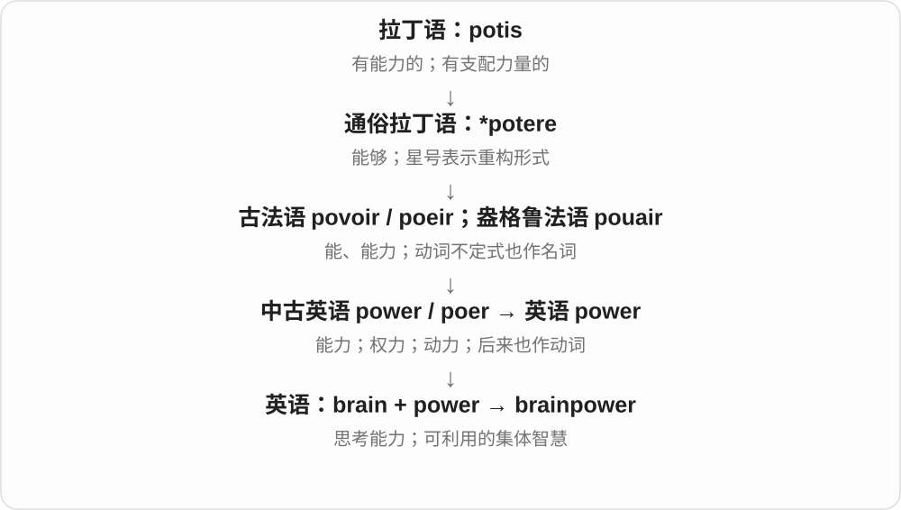

# 1104 · brain — 脑器官、思考能力；创意、思想操控与部位名分组

[逐词精讲目录](../00_逐词精讲目录.md) · [总目录](../00_总目录_按常用程度.md)

## 核心词根与来源

脑的更远来源有争议，可靠旧形足够。思考、灌输、脑电和解剖部位分别放场景，避免都写成大脑如何变化的空句。

**BRAIN：身体里的脑，也借指动脑能力和策划者**

brain → brainy、brainless；brainstorm → brainstorming；brainwash → brainwashing 认形方便但历史注明逆构；brainwave 两义，部位词最后。

- **器官、能力和人**：brain · brainy · brainless · brainchild · brainpower
- **构思与灵感**：brainstorm · brainstorming · brainwave
- **思想操控**：brainwash · brainwashing
- **固定部位**：midbrain · forebrain
- **brain → brains：大脑与头脑、智力**：brain · brains

## 词形与演化规律

brain + -y/-less；brain + storm/wash/wave；brainstorm + -ing；brainwashing 仿译；mid-/fore- + brain。

brain 接古英语 bræġn／brægen 等；brains 可泛说智力，也可在 the brains behind 中说策划者。

## 单词速览（按词族由简到繁）

同一基础词的相关扩展放在一起，先读基础形式，再读扩展；各组之间优先读常用的。具体词源关系见各词讲解。

| 单词 | 音标 | 核心意思 |
|---|---|---|
| [brain](#w-1) | /breɪn/ | 脑；智力；聪明人、策划者 |
| [brains](#w-15) | /breɪnz/ | 大脑〔复数〕；头脑、智力；策划者、智囊〔the brains behind〕 |
| [brainstorm](#w-3) | 英 /ˈbreɪnstɔːm/；美 /ˈbreɪnstɔːrm/ | 集思广益；集中想点子；灵感、妙计〔名词〕 |
| [brainstorming](#w-14) | 英 /ˈbreɪnstɔːmɪŋ/；美 /ˈbreɪnstɔːrmɪŋ/ | 头脑风暴；集思广益、发散想点子的活动 |
| [brainchild](#w-4) | /ˈbreɪntʃaɪld/ | 某人的创意；心血结晶 |
| [brainless](#w-5) | /ˈbreɪnləs/ | 没脑子的、愚蠢的；无需思考的 |
| [brainwash](#w-7) | 英 /ˈbreɪnwɒʃ/；美 /ˈbreɪnwɑːʃ/ | 给……洗脑；反复灌输以改变信念 |
| [brainwashing](#w-13) | 英 /ˈbreɪnwɒʃɪŋ/；美 /ˈbreɪnwɑːʃɪŋ/ | 洗脑；操控、灌输思想的过程 |
| [brainy](#w-8) | /ˈbreɪni/ | 聪明的；学问、智力出众的〔口语〕 |
| [brainpower](#w-9) | 英 /ˈbreɪnˌpaʊə/；美 /ˈbreɪnˌpaʊər/ | 脑力；智力；集体智慧 |
| [brainwave](#w-10) | /ˈbreɪnweɪv/ | 脑电波；灵机一动、妙计〔英式常用〕 |
| [midbrain](#w-11) | /ˈmɪdbreɪn/ | 中脑 |
| [forebrain](#w-12) | 英 /ˈfɔːbreɪn/；美 /ˈfɔːrbreɪn/ | 前脑 |

## 逐词讲解

### 1. brain — 脑；智力；聪明人、策划者

**音标**：/breɪn/

**先抓住这个画面**

头里的器官负责许多活动；日常把动脑的能力、想办法的人也借叫 brain。

**怎么拆**

继承古英语 bræġn、brægen 等形式，更远比较来源有争议，本文不把某个重建说法当定论。能力义常用复数 brains，人物义常见 the brains behind。

**怎么变成今天的意思**

**古英语 bræġn、brægen → 中古英语 brayn → brain**  
脑；更远来源有争议

↓

**现代 brain、brains**  
器官；智力、聪明人、策划者等比喻

use your brain 动脑，a brain scan 脑扫描，have brains 聪明，the brains behind the project 项目背后的策划者。

**常见搭配与例句**

a brain scan；use your brain；have brains；the brains behind。

> This puzzle really makes you use your brain.

这个谜题真得让你好好动脑。

> She is the brains behind the new design.

新设计背后的主脑是她。

**别混淆**

brain 器官及其能力比喻，mind 更常说思想、意识、心智；并非每处 head 头、mind 心智都能直接换成 brain。

### 2. brains — 大脑〔复数〕；头脑、智力；策划者、智囊〔the brains behind〕

**音标**：/breɪnz/

**先抓住这个画面**

器官 brain 负责思考，brains 又可以直接说思考能力。the brains behind 某事，则把做主要构思的人叫作背后的头脑。

**怎么拆**

brain + -s，/n/ 后读 /z/。brain 继承古英语 bræġn、brægen 等，更远来源有争议；智力、策划者等义由思考器官的名称发展。

**怎么变成今天的意思**

**古英语 bræġn／brægen → brain**  
脑；与思考能力相连的引申

↓

**brain + -s → brains**  
多个脑；智力；主要构思者

use your brains 动动脑筋；brains and patience 头脑与耐心；the brains behind the project 项目的主要策划者；pick someone’s brains 向某人请教、取经。

**常见搭配与例句**

a task that needs brains；the brains behind the design。

> This puzzle needs patience as well as brains.

这道谜题既需要头脑，也需要耐心。

> She is the brains behind the new exhibition.

她是这次新展览的主要策划者。

**别混淆**

brains 表智力时，不是在说一个人长着几个脑。the brains behind 可以指一个人，也可按语境说一群策划者，人数由其他信息决定。

### 3. brainstorm — 集思广益；集中想点子；灵感、妙计〔名词〕

**音标**：英 /ˈbreɪnstɔːm/；美 /ˈbreɪnstɔːrm/

**先抓住这个画面**

把脑子调动起来，一口气抛出各种可能的办法，先让点子冒出来。

**怎么拆**

brain + storm，较早有头脑剧烈紊乱的旧用法，后来出现灵感、集中思考用法，并形成团队创意方法。现代不能仅按旧病理义理解。

**怎么变成今天的意思**

**古英语 bræġn、brægen → 中古英语 brayn → brain**  
脑；更远来源有争议

↓

**现代 brain、brains**  
器官；智力、聪明人、策划者等比喻

↓

**brain + storm → brainstorm**  
旧脑内剧烈变化形象；后发展灵感、集中攻问题的用法

brainstorm ideas 集中想点子，brainstorm solutions 集思广益找办法。动词常直接接 ideas、solutions，也可不带宾语。

**常见搭配与例句**

brainstorm ideas；brainstorm solutions；have a brainstorm。

> Let’s brainstorm a few ideas before choosing one.

我们先想出几个点子，再选一个。

> The team met to brainstorm solutions to the problem.

团队开会集思广益，寻找解决办法。

**别混淆**

brainstorm 常强调先拓展可能性，evaluate 评估则检验优劣；实际讨论可交替进行，但动作重点不同。

### 4. brainstorming — 头脑风暴；集思广益、发散想点子的活动

**音标**：英 /ˈbreɪnstɔːmɪŋ/；美 /ˈbreɪnstɔːrmɪŋ/

**先抓住这个画面**

把 brainstorm 当作一段活动来安排：大家或一个人集中产出可能的想法。

**怎么拆**

brainstorm + -ing。现代创意方法在20世纪得到推广，不能从词形推断必须有多人或一定有效。

**怎么变成今天的意思**

**古英语 bræġn、brægen → 中古英语 brayn → brain**  
脑；更远来源有争议

↓

**现代 brain、brains**  
器官；智力、聪明人、策划者等比喻

↓

**brainstorm + -ing → brainstorming**  
集中产生点子的活动、方法

a brainstorming session 头脑风暴讨论，individual brainstorming 个人发散构思。

**常见搭配与例句**

a brainstorming session；individual brainstorming；brainstorming ideas。

> We held a brainstorming session on Friday.

周五我们开了一场头脑风暴讨论。

> She spent ten minutes brainstorming possible titles.

她花了十分钟发散思考可能的标题。

**别混淆**

brainstorming 活动，brainstorm 动词或点子名词；a brainstorming session 说一场讨论，通常不把 brainstorming 本身随意加复数。

### 5. brainchild — 某人的创意；心血结晶

**音标**：/ˈbreɪntʃaɪld/

**先抓住这个画面**

孩子由人养出来，创意由脑子想出来：把项目当作构思者的孩子，是一个形象比喻。

**怎么拆**

brain 脑、头脑 + child 孩子，复合成创意成果的固定比喻。不是一种脑部器官，也不是 children 的医学名称。

**怎么变成今天的意思**

**brain 头脑；child 孩子**  
并列构词部分

↓

**brainchild**  
某人构想、发起的成果

the brainchild of someone 某人构思出来的项目；可用于展览、组织、产品等，不保证一定是一个人独自完成全部工作。

**常见搭配与例句**

the brainchild of；someone’s brainchild；a new brainchild。

> The reading club is the brainchild of two local teachers.

读书会是两位当地老师想出来并发起的。

> The exhibition was her brainchild, but the whole team helped build it.

展览是她的创意，但整个团队都参与了落实。

**别混淆**

idea 可以只是一个想法，brainchild 常指能归给某个构思者的计划、项目或成果，带亲手孕育的意味。

### 6. brainless — 没脑子的、愚蠢的；无需思考的

**音标**：/ˈbreɪnləs/

**先抓住这个画面**

人明明有脑，却像没用上；也可说任务单调到不用动脑。

**怎么拆**

brain + -less，中古英语已有相应形式。日常多是评价或夸张，不是真作器官诊断。

**怎么变成今天的意思**

**古英语 bræġn、brægen → 中古英语 brayn → brain**  
脑；更远来源有争议

↓

**现代 brain、brains**  
器官；智力、聪明人、策划者等比喻

↓

**brain + -less → brainless**  
缺少脑、头脑；日常愚蠢或不需思考

a brainless decision 愚蠢决定，brainless entertainment 无需动脑的娱乐。称人 brainless 带侮辱意味。

**常见搭配与例句**

a brainless decision；brainless entertainment；a brainless task。

> Leaving the door open was a brainless mistake.

把门敞着是个没过脑子的错误。

> After work, he wanted some brainless entertainment.

下班后，他想看点不用动脑的娱乐内容。

**别混淆**

brainless 贬愚蠢、不动脑，mindless 可说机械、无意识；两者有重合，但都不应自动当医学判断。

### 7. brainwash — 给……洗脑；反复灌输以改变信念

**音标**：英 /ˈbreɪnwɒʃ/；美 /ˈbreɪnwɑːʃ/

**先抓住这个画面**

像要把原有想法洗掉，再塞入另一套；这是思想操控的比喻，不是真清洗脑器官。

**怎么拆**

brain + wash 可直接认形，来源是中文洗脑的仿译。英语动词可能由较早 brainwashing 逆构，不要按短词一定先于长词排列历史。

**怎么变成今天的意思**

**中文 洗脑 → 英语 brainwashing 等**  
按洗、脑两个意思仿译

↓

**brainwashing → brainwash〔可能逆构〕**  
对应的操控、灌输动词

brainwash someone into believing 反复灌输使人相信，be brainwashed 被洗脑。日常用法常带强烈批评，不是中性 persuade。

**常见搭配与例句**

brainwash someone into；be brainwashed；try to brainwash。

> The novel describes a group that tries to brainwash its recruits.

小说描写一个试图给新成员洗脑的团体。

> He accused the broadcasts of trying to brainwash the audience.

他指责那些广播试图给观众洗脑。

**别混淆**

persuade 说服可中性，brainwash 指思想操控、强灌输，评价强得多；不把普通意见分歧都当同一事实。

### 8. brainwashing — 洗脑；操控、灌输思想的过程

**音标**：英 /ˈbreɪnwɒʃɪŋ/；美 /ˈbreɪnwɑːʃɪŋ/

**先抓住这个画面**

把一个人原有信念压下去、反复强加另一套的过程；常带负面和强控制意味。

**怎么拆**

中文洗脑的仿译，20世纪中叶进入英语；现代可认 brainwash + -ing，但行为名词早于相应动词的常见记录。

**怎么变成今天的意思**

**中文 洗脑 → 英语 brainwashing**  
仿译的思想操控名称

↓

**现代 brainwashing 与 brainwash 相互对应**  
过程名词；动词可能由它逆构

accusations of brainwashing 洗脑指控，a story about brainwashing 关于思想操控的故事。用这个词是在作较强的描述、评价。

**常见搭配与例句**

accusations of brainwashing；a form of brainwashing；resist brainwashing。

> The documentary examines claims of brainwashing.

纪录片审视了关于洗脑的说法。

> The story explores the effects of prolonged brainwashing.

故事探讨长期思想灌输的影响。

**别混淆**

brainwashing 操控思想，brainstorming 想点子；同样以 brain 开头，活动目的完全不同。

### 9. brainy — 聪明的；学问、智力出众的〔口语〕

**音标**：/ˈbreɪni/

**先抓住这个画面**

别人夸你很会动脑、读书或解决难题，口语就可说 brainy。

**怎么拆**

brain + -y，中古英语已有相关形式。现代通常夸能力，不是解剖上脑子尺寸特别大。

**怎么变成今天的意思**

**古英语 bræġn、brægen → 中古英语 brayn → brain**  
脑；更远来源有争议

↓

**现代 brain、brains**  
器官；智力、聪明人、策划者等比喻

↓

**brain + -y → brainy**  
有头脑、聪明的

a brainy student 聪明学生，the brainy one 那个智力出众的人。语气较口语。

**常见搭配与例句**

a brainy student；the brainy one；a brainy solution。

> She was a brainy child who loved solving puzzles.

她小时候很聪明，爱解谜题。

> He is brainy, but he also explains things clearly.

他很聪明，也能把事情讲清楚。

**别混淆**

brainy 常偏智力、学习本领，wise 更偏判断有智慧；聪明不保证每次做出成熟选择。

### 10. brainpower — 脑力；智力；集体智慧

**音标**：英 /ˈbreɪnˌpaʊə/；美 /ˈbreɪnˌpaʊər/

**先抓住这个画面**

brainpower 是脑子能投入多少理解、判断和解题的力量。

**怎么拆**

brain 大脑 + power 能力，英语复合词，把思考能力比作一种可投入的力量。

**怎么变成今天的意思**

可形容一个人的智力，也可说团队的总脑力。a problem that takes brainpower 是需要动脑的问题，不一定需要大体力。

**常见搭配与例句**

use your brainpower；collective brainpower；require brainpower。

> This puzzle requires patience as well as brainpower.

这个谜题既需要耐心，也需要脑力。

> The team combined its brainpower to simplify the design.

团队汇集大家的智慧，简化了设计。

**别混淆**

manpower 偏人手、工作力量；brainpower 特别突出思考能力，人数多不一定等于脑力用得好。

### 11. brainwave — 脑电波；灵机一动、妙计〔英式常用〕

**音标**：/ˈbreɪnweɪv/

**先抓住这个画面**

科学语境是脑电活动的波形；日常说突然想到个好办法，是另一路形象用法。

**怎么拆**

brain + wave。脑电活动与灵感两义不能编成先测到某道波才有好主意的因果关系。

**怎么变成今天的意思**

**古英语 bræġn、brægen → 中古英语 brayn → brain**  
脑；更远来源有争议

↓

**现代 brain、brains**  
器官；智力、聪明人、策划者等比喻

↓

**brain + wave → brainwave**  
脑电波；另有突然好主意的比喻

record brainwaves 记录脑电波，have a brainwave 灵机一动。读复数 brains 与脑波 brainwaves 时别混淆。

**常见搭配与例句**

record brainwaves；have a brainwave；a sudden brainwave。

> The equipment records changes in brainwaves.

设备记录脑电波的变化。

> Then I had a brainwave: we could use the empty room.

接着我灵机一动：我们可以用那间空房。

**别混淆**

brainwave 英式常可妙计，brainstorm 也有灵感义，但动词 brainstorm ideas 通常讲集中构思。

### 12. midbrain — 中脑

**音标**：/ˈmɪdbreɪn/

**先抓住这个画面**

解剖名称里说脑干上部的一段；mid- 提醒中部位置，但不能只靠字面定位全部结构。

**怎么拆**

mid- 中间 + brain，是固定解剖部位名。这里先认识结构名称，不以词形替代解剖图。

**怎么变成今天的意思**

**古英语 bræġn、brægen → 中古英语 brayn → brain**  
脑；更远来源有争议

↓

**现代 brain、brains**  
器官；智力、聪明人、策划者等比喻

↓

**mid- + brain → midbrain**  
固定解剖部位名称：中脑

the midbrain region 中脑区域，a diagram of the midbrain 中脑示意图。

**常见搭配与例句**

the midbrain region；a diagram of the midbrain；midbrain structures。

> The diagram highlights the midbrain.

示意图高亮标出了中脑。

> The lecture introduced several midbrain structures.

讲座介绍了几种中脑结构。

**别混淆**

midbrain 是专业固定名称，不等于随便取整个脑的几何中心；forebrain 前脑又是另一分类名称。

### 13. forebrain — 前脑

**音标**：英 /ˈfɔːbreɪn/；美 /ˈfɔːrbreɪn/

**先抓住这个画面**

按发育和解剖分类命名的前部脑区域；fore- 说明前，不是专门预知未来的脑。

**怎么拆**

fore- 前部 + brain，形成固定解剖名称。学习组合先抓位置指向，具体边界按学科定义理解。

**怎么变成今天的意思**

**古英语 bræġn、brægen → 中古英语 brayn → brain**  
脑；更远来源有争议

↓

**现代 brain、brains**  
器官；智力、聪明人、策划者等比喻

↓

**fore- + brain → forebrain**  
固定解剖类别：前脑

the developing forebrain 发育中的前脑，forebrain structures 前脑结构。

**常见搭配与例句**

the developing forebrain；forebrain structures；a forebrain diagram。

> The textbook includes a diagram of the developing forebrain.

教材包含一张发育中前脑的示意图。

> The researcher compared several forebrain structures.

研究人员比较了几种前脑结构。

**别混淆**

forebrain 前脑不简单等于 forehead 额头；brain 脑与 head 头整体要分清。

## 这一组要分清什么

brainwash 洗脑与 brainstorming 构思分清；brainwave 可妙计或脑电；midbrain 固定部位不靠几何中心猜。

## 串起来练习

The brainy designer had a brainwave during the brainstorming session.

聪明的设计师在头脑风暴讨论时灵机一动。
