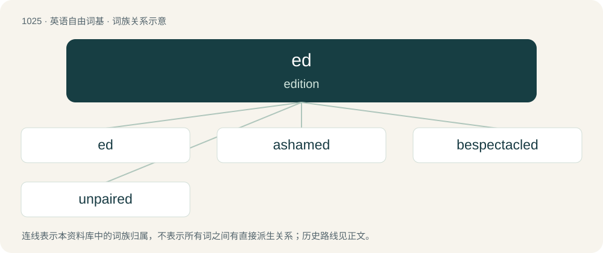

# 1104 · ed — edition

[总目录](../00_总目录_按常用程度.md)

**类型**：英语自由词基　｜　**来源语言**：见词源记录

## 核心含义与来源

- 核心含义：edition
- 英文含义：edition
- 词形：ed

**来源记录 1**（名词；edition）

Shortening.

## 词族图

## 单词速览（常用到不常用）

| 单词 | 音标 | 释义 |
|---|---|---|
| [ed](#w-1) | /ɛd/ | 【英文】edition |
| [ashamed](#w-2) | /əˈʃeɪmd/ | a. 惭愧的, 羞耻的 |
| [bespectacled](#w-3) | /bɪˈspɛktəkəld/ | a. 戴眼镜的 |
| [unpaired](#w-4) | /ˈʌnˈpeəd/ | a. 未配对的, 无配偶的 |

## 逐词详解

### 1. ed

**词性**：名词　｜　**音标**：/ɛd/

**英文义项**：edition / editor

**词源与演化**：

Shortening.

**例句**：

> Online higher ed has been growing pretty steadily for the past decade.

### 2. ashamed

**词性**：形容词　｜　**音标**：/əˈʃeɪmd/

**中文释义**：a. 惭愧的, 羞耻的

**英文义项**：Feeling shame or guilt.

**构词拆分**：a- + shame + -ed

**词源与演化**：

From Middle English ashamed, aschamed, from Old English āsċamod, past participle of Old English āsċamian (“to be ashamed”), equivalent to a- + shame + -ed.

**例句**：

> Are you ashamed for having lied?

该用例对应义项：feeling shame or guilt or embarrassment or remorse

### 3. bespectacled

**词性**：形容词　｜　**音标**：/bɪˈspɛktəkəld/

**中文释义**：a. 戴眼镜的

**英文义项**：Wearing spectacles (glasses).

**构词拆分**：be- + spectacle + -ed

**词源与演化**：

From be- + spectacle + -ed.

**例句**：

> The bespectacled librarian had a harsh look when I came in to pay my fines.

### 4. unpaired

**词性**：形容词　｜　**音标**：/ˈʌnˈpeəd/

**中文释义**：a. 未配对的, 无配偶的

**英文义项**：not forming one of a pair

**构词拆分**：un- + pair + -ed

**词源与演化**：

From un- + pair + -ed.
