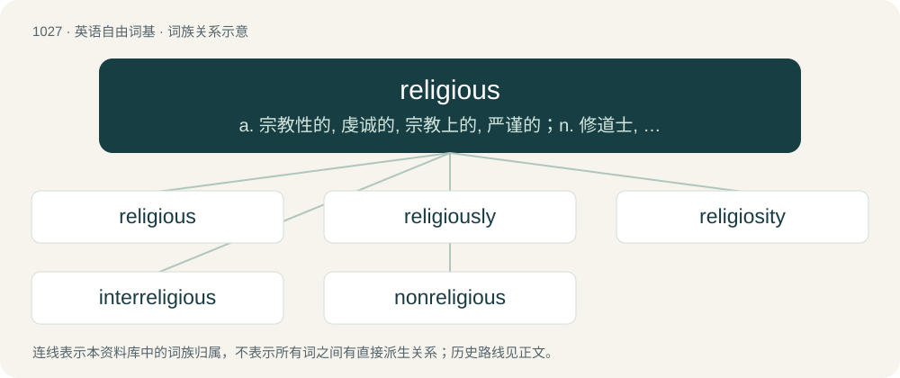

# 1105 · religious — a. 宗教性的, 虔诚的, 宗教上的, 严谨的；n. 修道士, 出家人

[总目录](../00_总目录_按常用程度.md)

**类型**：英语自由词基　｜　**来源语言**：见词源记录

## 核心含义与来源

- 核心含义：a. 宗教性的, 虔诚的, 宗教上的, 严谨的；n. 修道士, 出家人
- 英文含义：Concerning religion.
- 词形：religious

**来源记录 1**（形容词；Concerning religion.）

From Middle English religiouse, religious, religius, religeous, from Anglo-Norman religieus, religius, from Old French religious, religieux, and their source, Latin religiōsus (“religious, superstitious, conscientious”), from religiō. Doublet of religieux.

## 词族图

## 单词速览（常用到不常用）

| 单词 | 音标 | 释义 |
|---|---|---|
| [religious](#w-1) | /ɹɪˈlɪd͡ʒəs/ | a. 宗教性的, 虔诚的, 宗教上的, 严谨的；n. 修道士, 出家人 |
| [religiously](#w-2) |  | adv. 虔诚而经常地, 笃诚地 |
| [religiosity](#w-3) | 英 /ɹɪˌlɪd͡ʒɪˈɒsɪti/；美 /ɹɪˌlɪd͡ʒɪˈɑsəti/ | n. 笃信, 虚伪信仰, 虔诚, 宗教狂 |
| [interreligious](#w-4) | /,intəriˈlidʒəs/ | a. 各宗教间的 |
| [nonreligious](#w-5) |  | 【英文】Not religious. |

## 逐词详解

### 1. religious

**词性**：形容词　｜　**音标**：/ɹɪˈlɪd͡ʒəs/

**中文释义**：a. 宗教性的, 虔诚的, 宗教上的, 严谨的；n. 修道士, 出家人

**英文义项**：Concerning religion. / Committed to the practice or adherence of religion.

**词源与演化**：

From Middle English religiouse, religious, religius, religeous, from Anglo-Norman religieus, religius, from Old French religious, religieux, and their source, Latin religiōsus (“religious, superstitious, conscientious”), from religiō. Doublet of religieux.

**例句**：

> It is the job of this court to rule on legal matters. We do not consider religious issues.

该用例对应义项：Concerning religion.

### 2. religiously

**词性**：副词

**中文释义**：adv. 虔诚而经常地, 笃诚地

**英文义项**：In the manner of religion. / Passionately or diligently; faithfully; conscientiously.

**构词拆分**：religious + -ly

**词源与演化**：

From religious + -ly.

**例句**：

> It is odd he gets so many cavities since he brushes his teeth religiously, every night, rain or shine.

该用例对应义项：Passionately or diligently; faithfully; conscientiously.

### 3. religiosity

**词性**：名词　｜　**音标**：英 /ɹɪˌlɪd͡ʒɪˈɒsɪti/；美 /ɹɪˌlɪd͡ʒɪˈɑsəti/

**中文释义**：n. 笃信, 虚伪信仰, 虔诚, 宗教狂

**英文义项**：The quality of being religious or pious, especially when zealous.

**构词拆分**：religio(u)s + -ity

**词源与演化**：

From religio(u)s + -ity, from Latin religiositas.

**例句**：

> Religiosity is dropping faster in the United States than almost any other country.

### 4. interreligious

**词性**：形容词　｜　**音标**：/,intəriˈlidʒəs/

**中文释义**：a. 各宗教间的

**英文义项**：Involving more than one religion

**构词拆分**：inter- + religious

**词源与演化**：

From inter- + religious.

### 5. nonreligious

**词性**：形容词

**英文义项**：Not religious.

**构词拆分**：From non- + religious.

**词源与演化**：

From non- + religious.

**例句**：

> Many nonreligious people are agnostic, although some are atheists.
