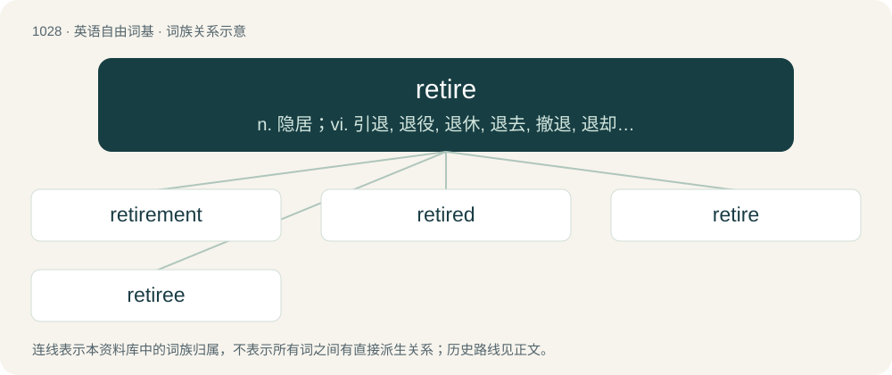

# 1106 · retire — n. 隐居；vi. 引退, 退役, 退休, 退去, 撤退, 退却；vt. 使...撤退, 辞退

[总目录](../00_总目录_按常用程度.md)

**类型**：英语自由词基　｜　**来源语言**：见词源记录

## 核心含义与来源

- 核心含义：n. 隐居；vi. 引退, 退役, 退休, 退去, 撤退, 退却；vt. 使...撤退, 辞退
- 英文含义：To stop working on a permanent basis, usually because of old age or illness.
- 词形：retire

**多个词源／构词路径**：同一拼写可能有不同来源；以下按词性和含义分别列出。

**来源记录 1**（动词；To stop working on a permanent basis, usually because of old age or illness.）

From Middle French retirer (“draw back”), from Old French retirer, built from re- (“back”) + tirer (“draw, pull”), the latter from Vulgar Latin \*tīrāre, of highly uncertain origin.

**来源记录 2**（动词；To fit (a vehicle) with new tires.）

From re- + tire.

## 词族图

## 单词速览（常用到不常用）

| 单词 | 音标 | 释义 |
|---|---|---|
| [retirement](#w-1) | 英 /ɹəˈtaɪə(ɹ).mənt/ | n. 退休, 隐居, 撤退；\[经\] 退休, 退股, (固定资产)报废 |
| [retired](#w-2) | 英 /ɹɪˈtaɪəd/；美 /ɹɪˈtaɪəɹd/ | a. 隐退的, 退休的, 退役的；\[经\] 退休的, 已收回的 |
| [retire](#w-3) | 英 /ɹɪˈtaɪə/；美 /ɹəˈtaɪɹ/ | n. 隐居；vi. 引退, 退役, 退休, 退去, 撤退, 退却；vt. 使...撤退, 辞退 |
| [retiree](#w-4) | 英 /ɹəˈtaɪ.ə(ɹ)ˌiː/ | n. 退休人员, 退休者；\[法\] 退休者, 退职者 |

## 逐词详解

### 1. retirement

**词性**：名词　｜　**音标**：英 /ɹəˈtaɪə(ɹ).mənt/

**中文释义**：n. 退休, 隐居, 撤退；\[经\] 退休, 退股, (固定资产)报废

**英文义项**：An act of retiring; withdrawal. / The state of being retired; seclusion.

**构词拆分**：retire + -ment

**词源与演化**：

From French retirement, from retirer (“withdraw, retire”); corresponding to retire + -ment.

**例句**：

> The general lived the rest of his life peacefully after his retirement.

### 2. retired

**词性**：形容词　｜　**音标**：英 /ɹɪˈtaɪəd/；美 /ɹɪˈtaɪəɹd/

**中文释义**：a. 隐退的, 退休的, 退役的；\[经\] 退休的, 已收回的

**英文义项**：Secluded from society (of a lifestyle, activity etc.); private, quiet. / Of a place, far from civilization, not able to be easily seen or accessed; secluded.

**构词拆分**：retire + -ed

**词源与演化**：

From retire + -ed.

**例句**：

> Following Jackie Robinson's success, his uniform number, 42, became a retired number across all major league teams.

该用例对应义项：No longer in use or production.

### 3. retire

**词性**：动词　｜　**音标**：英 /ɹɪˈtaɪə/；美 /ɹəˈtaɪɹ/

**中文释义**：n. 隐居；vi. 引退, 退役, 退休, 退去, 撤退, 退却；vt. 使...撤退, 辞退

**英文义项**：To stop working on a permanent basis, usually because of old age or illness. / To stop playing their sport and in competitions a sports player.

**词源与演化**：

From Middle French retirer (“draw back”), from Old French retirer, built from re- (“back”) + tirer (“draw, pull”), the latter from Vulgar Latin \*tīrāre, of highly uncertain origin.

**例句**：

> I have decided to retire from football at the end of the season after the World Cup.

该用例对应义项：To stop playing their sport and in competitions a sports player.

### 4. retiree

**词性**：名词　｜　**音标**：英 /ɹəˈtaɪ.ə(ɹ)ˌiː/

**中文释义**：n. 退休人员, 退休者；\[法\] 退休者, 退职者

**英文义项**：Someone who has retired from active working.

**构词拆分**：retire + -ee

**词源与演化**：

From retire + -ee.

**例句**：

> He has been a retiree since 2001.

该用例对应义项：Someone who has retired from active working.
