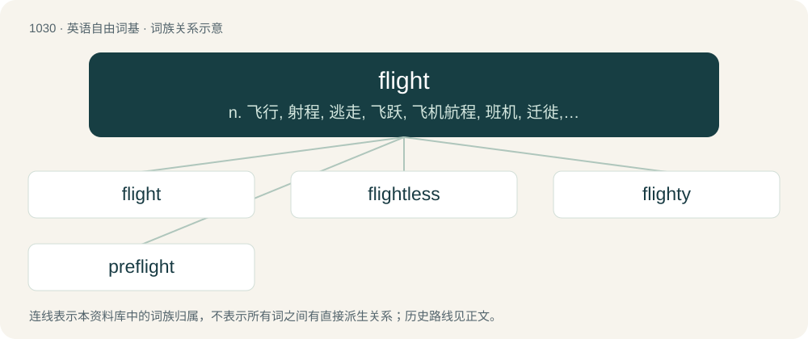

# 1108 · flight — n. 飞行, 射程, 逃走, 飞跃, 飞机航程, 班机, 迁徙, 飞逝；vi. 迁徙；vt. 射击(飞禽), 为(箭)装上羽毛, 使惊飞

[总目录](../00_总目录_按常用程度.md)

**类型**：英语自由词基　｜　**来源语言**：见词源记录

## 核心含义与来源

- 核心含义：n. 飞行, 射程, 逃走, 飞跃, 飞机航程, 班机, 迁徙, 飞逝；vi. 迁徙；vt. 射击(飞禽), 为(箭)装上羽毛, 使惊飞
- 英文含义：The act of flying; the ability to fly.
- 词形：flight

**多个词源／构词路径**：同一拼写可能有不同来源；以下按词性和含义分别列出。

**来源记录 1**（名词；The act of flying; the ability to fly.）

From Middle English flight, from Old English flyht (“flight”), from Proto-West Germanic \*fluhti (“flight”), derived from \*fleuganą (“to fly”), from Proto-Indo-European \*plewk- (“to fly”), enlargement of \*plew- (“flow”). Analyzable as fly + -t (variant of -th). Cognate with West Frisian flecht (“flight”), Dutch vlucht (“flight”), German Flucht (“flight”) (etymology 2).

**来源记录 2**（名词；The act of fleeing.）

From Middle English, from Old English flyht, from Proto-West Germanic \*fluhti, derived from \*fleuhaną (“to flee”). Analyzable as flee + -t (variant of -th). Cognate with Dutch vlucht, German Flucht (etymology 1).

## 词族图

## 单词速览（常用到不常用）

| 单词 | 音标 | 释义 |
|---|---|---|
| [flight](#w-1) | 英 /ˈflaɪ̯t/；/ˈflɐɪ̯t/ | n. 飞行, 射程, 逃走, 飞跃, 飞机航程, 班机, 迁徙, 飞逝；vi. 迁徙；vt. 射击(飞禽), 为(箭)装上羽毛, 使惊飞 |
| [flightless](#w-2) | /ˈflaitlis/ | a. 不能飞的 |
| [flighty](#w-3) | /ˈflaɪti/ | a. 轻浮的, 轻狂的, 心情浮动的 |
| [preflight](#w-4) | /ˈpriːˈflait/ | a. 起飞前的, 为飞机起飞作准备的 |

## 逐词详解

### 1. flight

**词性**：名词　｜　**音标**：英 /ˈflaɪ̯t/；/ˈflɐɪ̯t/

**中文释义**：n. 飞行, 射程, 逃走, 飞跃, 飞机航程, 班机, 迁徙, 飞逝；vi. 迁徙；vt. 射击(飞禽), 为(箭)装上羽毛, 使惊飞

**英文义项**：The act of flying; the ability to fly. / An instance of flying.

**构词拆分**：fly + -t

**词源与演化**：

From Middle English flight, from Old English flyht (“flight”), from Proto-West Germanic \*fluhti (“flight”), derived from \*fleuganą (“to fly”), from Proto-Indo-European \*plewk- (“to fly”), enlargement of \*plew- (“flow”). Analyzable as fly + -t (variant of -th). Cognate with West Frisian flecht (“flight”), Dutch vlucht (“flight”), German Flucht (“flight”) (etymology 2).

**例句**：

> The central figure in the painting is a young woman, surrounded by a flight of angels.

该用例对应义项：A group of angels or types of angels, e.g., seraphim, cherubim.

### 2. flightless

**词性**：形容词　｜　**音标**：/ˈflaitlis/

**中文释义**：a. 不能飞的

**英文义项**：Describing kinds of birds that normally cannot fly, such as the penguin, ostrich, and emu. / Describing an individual bird that normally would be able to fly but in this case cannot, such as an injured sparrow.

**构词拆分**：flight + -less

**词源与演化**：

From flight + -less.

**例句**：

> Oh great, some wind is blowing in Chicago, so now I'm flightless in Seattle, because this airline can't cope!

该用例对应义项：Suddenly deprived of a scheduled (airline) flight by its cancellation.

### 3. flighty

**词性**：形容词　｜　**音标**：/ˈflaɪti/

**中文释义**：a. 轻浮的, 轻狂的, 心情浮动的

**英文义项**：Given to unplanned and silly ideas or actions. / That flies easily or often.

**构词拆分**：flight + -y

**词源与演化**：

From flight + -y. Compare Dutch vluchtig (“volatile; fleeting; cursory”), German flüchtig (“volatile; fleeting; momentary; quick”), Danish flygtig (“elusive; evasive”), Swedish flyktig.

**例句**：

> My boss accused me of being flighty, so I immediately quit.

### 4. preflight

**词性**：形容词　｜　**音标**：/ˈpriːˈflait/

**中文释义**：a. 起飞前的, 为飞机起飞作准备的

**英文义项**：Taking place before the start of a flight. / Serving to confirm that requests can be accepted, before sending an actual request.

**构词拆分**：pre- + flight

**词源与演化**：

From pre- + flight.

**用法示例／搭配（非完整句）**：

> a CORS preflight request

该用例对应义项：Serving to confirm that requests can be accepted, before sending an actual request.
