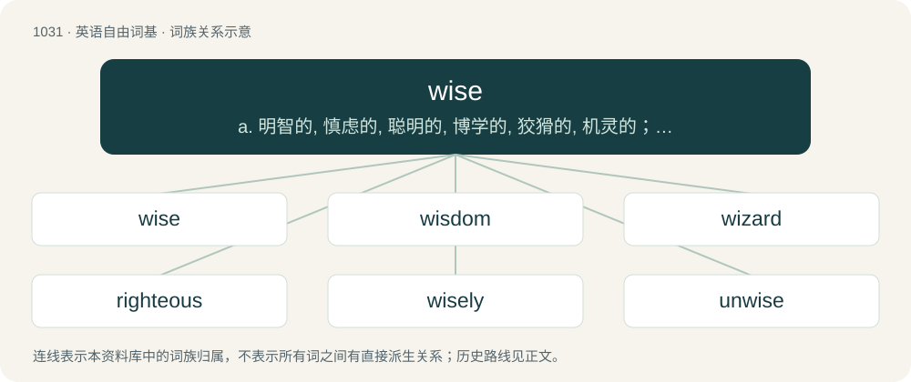

# 1109 · wise — a. 明智的, 慎虑的, 聪明的, 博学的, 狡猾的, 机灵的；vi. 知道；vt. 教导, 告诉, 劝导

[总目录](../00_总目录_按常用程度.md)

**类型**：英语自由词基　｜　**来源语言**：见词源记录

## 核心含义与来源

- 核心含义：a. 明智的, 慎虑的, 聪明的, 博学的, 狡猾的, 机灵的；vi. 知道；vt. 教导, 告诉, 劝导
- 英文含义：Showing good judgement or the benefit of experience.
- 词形：wise

**多个词源／构词路径**：同一拼写可能有不同来源；以下按词性和含义分别列出。

**来源记录 1**（形容词；Showing good judgement or the benefit of experience.）

From Middle English wys, wyse, from Old English wīs (“wise”), from Proto-Germanic \*wīsaz (“knowledgeable, wise”), from Proto-Indo-European \*wéydos (“seeing; knowledge”), from \*weyd- (“to see”). Cognates Cognate with West Frisian wiis (“wise”), Dutch wijs (“wise”), German weis, weise (“wise”), Low German wies (“wise; clever”), Danish, Norwegian Bokmål, Norwegian Nynorsk, and Swedish vis (“wise”), Icelandic vís (“wise; certain”), Gothic \*𐍅𐌴𐌹𐍃 (\*weis, “wise”); also Irish fios (“knowledge; information”), Manx fys (“knowledge; information”), Scottish Gaelic fhios, fios (“knowledge; information”), Welsh gwys, gwŷs (“citation, summons”), Latin videō (“to look, perceive, see; to note, observe; to comprehend, understand”), Greek είδος (eídos, “form, kind, type”), Albanian vizë (“line, stripe, track; dash”), Latvian veids (“form, kind, mode, type”), Lithuanian veidas (“face; appearance, aspect, look”), Belarusian ве́даць (vjédacʹ, “to know”), Bulgarian вям (vjam, “to know”), Czech vědět (“to know”), Polish wiedzieć (“to know”), Russian ве́дать (védatʹ, “to know”), Serbo-Croatian vedeti, viedieti (“to know”), Slovak vedieť (“to know”), Slovene vedeti (“to know”), Ukrainian ві́дати (vídaty, “to know”), Armenian գիտեմ (gitem, “I know”), գիտենալ (gitenal), գիտնալ (gitnal, “to know”), Avestan 𐬬𐬀𐬉𐬛 (vaēd, “find”), 𐬬𐬌𐬛 (vid, “to know”), Persian نوید (navid / nawīd, nuwēd, “invitation; annunciation; good news”), Tocharian A ime (“awareness, consciousness, memory, thought”), Tocharian B īme (“awareness, consciousness, memory, thought”), ūwe (“educated, learned, knowledgeable”), Sanskrit वेदस् (vedas, “knowledge, science; property, wealth”). Compare wit.

**来源记录 2**（动词；To instruct.）

From Middle English wisen (“to advise, direct”), from Old English wisian (“to show the way, guide, direct”), from Proto-West Germanic \*wīsōn, from Proto-Germanic \*wīsōną (“to show the way, dispense knowledge”), from Proto-Indo-European \*weyd- (“to know”). Compare Dutch wijzen (“to indicate, point out”), German weisen (“to show, indicate”), Danish and Norwegian Bokmål vise (“to show”), Norwegian Nynorsk visa (“to show”).

## 词族图

## 单词速览（常用到不常用）

| 单词 | 音标 | 释义 |
|---|---|---|
| [wise](#w-1) | /waɪz/ | a. 明智的, 慎虑的, 聪明的, 博学的, 狡猾的, 机灵的；vi. 知道；vt. 教导, 告诉, 劝导 |
| [wisdom](#w-2) | 英 /ˈwɪzdəm/ | n. 智慧, 明智行为, 学识, 名言, 贤人 |
| [wizard](#w-3) | 英 /ˈwɪzəd/；美 /ˈwɪzɚd/ | n. 男巫, 术士, 奇才；a. 男巫的, 巫术的；\[计\] 向导 |
| [righteous](#w-4) | /ˈɹaɪt͡ʃəs/ | a. 公正的, 正义的, 正直的；\[法\] 正直的, 正当的, 正义的 |
| [wisely](#w-5) | /ˈwaɪzli/ | adv. 聪明地, 精明地 |
| [unwise](#w-6) | /ʌnˈwaɪz/ | a. 愚蠢的, 欠考虑的, 不明智的, 轻率的 |
| [counterclockwise](#w-7) | /.kauntəˈklɒkwaiz/ | a. 反时针方向的；adv. 反时针方向 |
| [pennywise](#w-8) | /ˈpeniˈwaiz/ | adj. 小数目上节约的 |

## 逐词详解

### 1. wise

**词性**：形容词　｜　**音标**：/waɪz/

**中文释义**：a. 明智的, 慎虑的, 聪明的, 博学的, 狡猾的, 机灵的；vi. 知道；vt. 教导, 告诉, 劝导

**英文义项**：Showing good judgement or the benefit of experience. / Disrespectful.

**词源与演化**：

From Middle English wys, wyse, from Old English wīs (“wise”), from Proto-Germanic \*wīsaz (“knowledgeable, wise”), from Proto-Indo-European \*wéydos (“seeing; knowledge”), from \*weyd- (“to see”). Cognates Cognate with West Frisian wiis (“wise”), Dutch wijs (“wise”), German weis, weise (“wise”), Low German wies (“wise; clever”), Danish, Norwegian Bokmål, Norwegian Nynorsk, and Swedish vis (“wise”), Icelandic vís (“wise; certain”), Gothic \*𐍅𐌴𐌹𐍃 (\*weis, “wise”); also Irish fios (“knowledge; information”), Manx fys (“knowledge; information”), Scottish Gaelic fhios, fios (“knowledge; information”), Welsh gwys, gwŷs (“citation, summons”), Latin videō (“to look, perceive, see; to note, observe; to comprehend, understand”), Greek είδος (eídos, “form, kind, type”), Albanian vizë (“line, stripe, track; dash”), Latvian veids (“form, kind, mode, type”), Lithuanian veidas (“face; appearance, aspect, look”), Belarusian ве́даць (vjédacʹ, “to know”), Bulgarian вям (vjam, “to know”), Czech vědět (“to know”), Polish wiedzieć (“to know”), Russian ве́дать (védatʹ, “to know”), Serbo-Croatian vedeti, viedieti (“to know”), Slovak vedieť (“to know”), Slovene vedeti (“to know”), Ukrainian ві́дати (vídaty, “to know”), Armenian գիտեմ (gitem, “I know”), գիտենալ (gitenal), գիտնալ (gitnal, “to know”), Avestan 𐬬𐬀𐬉𐬛 (vaēd, “find”), 𐬬𐬌𐬛 (vid, “to know”), Persian نوید (navid / nawīd, nuwēd, “invitation; annunciation; good news”), Tocharian A ime (“awareness, consciousness, memory, thought”), Tocharian B īme (“awareness, consciousness, memory, thought”), ūwe (“educated, learned, knowledgeable”), Sanskrit वेदस् (vedas, “knowledge, science; property, wealth”). Compare wit.

**例句**：

> They were considered the wise old men of the administration.

该用例对应义项：Showing good judgement or the benefit of experience.

### 2. wisdom

**词性**：名词　｜　**音标**：英 /ˈwɪzdəm/

**中文释义**：n. 智慧, 明智行为, 学识, 名言, 贤人

**英文义项**：An element of personal character that enables one to distinguish the wise from the unwise. / A piece of wise advice.

**构词拆分**：wise + -dom

**词源与演化**：

From Middle English wisdom, from Old English wīsdōm (“wisdom”), from Proto-West Germanic \*wīsadōm, from Proto-Germanic \*wīsadōmaz (“wisdom”), corresponding to wise + -dom. Cognate with Scots wisdom, wysdom (“wisdom”), West Frisian wiisdom (“wisdom”), Dutch wijsdom (“wisdom”), German Weistum (“legal sentence”), Danish/Norwegian/Swedish visdom (“wisdom”), Icelandic vísdómur (“wisdom”).

**例句**：

> With a little more wisdom, he would not have got in trouble.

### 3. wizard

**词性**：名词　｜　**音标**：英 /ˈwɪzəd/；美 /ˈwɪzɚd/

**中文释义**：n. 男巫, 术士, 奇才；a. 男巫的, 巫术的；\[计\] 向导

**英文义项**：Someone, usually male, who uses (or has skill with) magic, mystic items, and magical and mystical practices. / One who is especially skilled or unusually talented in a particular field.

**构词拆分**：wise + -ard

**词源与演化**：

From Middle English wysard, wysarde, equivalent to wise + -ard. A uniquely medieval English word with no known morphologically exact cognates in other Germanic languages; did not gain distinct sense of "occultist, magic user" (as opposed to a philosopher or sage) until circa 1500s, aligning roughly with the starting English Renaissance. However, via Proto-Indo-European \*weyd- cognate with Proto-Celtic \*druwits (whence English druid), Proto-Slavic \*vědьma (Polish wiedźma, Russian ве́дьма (védʹma)), Russian веду́н (vedún). The sense of "old (male) virgin" is from a Japanese Internet meme in which virgins who are typically friendless, shy outcasts and loners who don't fit in anywhere legendarily gain magical powers upon reaching 30 years of age; popularized ultimately by 4chan and adjacent online incel spaces. Compare typologically specialist (&lt;&lt; Latin speciō).

**例句**：

> Use the "Add Network Connection" wizard to connect to a network in a series of simple steps.

该用例对应义项：A computer program or script used to simplify complex operations, often for an inexperienced user.

### 4. righteous

**词性**：形容词　｜　**音标**：/ˈɹaɪt͡ʃəs/

**中文释义**：a. 公正的, 正义的, 正直的；\[法\] 正直的, 正当的, 正义的

**英文义项**：Free from sin or guilt. / Moral and virtuous, perhaps to the point of sanctimony.

**构词拆分**：right + -wise；right + wise (“way, manner”)

**词源与演化**：

From earlier rightuous, rightwose, rightwos, rightwise, from Middle English rightwise, rightwis, from Old English rihtwīs (“righteous, just”), corresponding to right + -wise (with assimilation of second element to -ous), or to right + wise (“way, manner”). Cognate with Scots richtwis (“righteous”), Old High German rehtwīsic (“righteous, just”), Icelandic réttvíss (“righteous, just”). Compare also thefteous, mighteous.

**例句**：

> Human beings should take a righteous path, and so should art. We should promote kindness and beauty through art.

该用例对应义项：Moral and virtuous, perhaps to the point of sanctimony.

### 5. wisely

**词性**：副词　｜　**音标**：/ˈwaɪzli/

**中文释义**：adv. 聪明地, 精明地

**英文义项**：In a wise manner; using good judgement.

**构词拆分**：wise + -ly

**词源与演化**：

From Middle English wisliche, wislike, from Old English wīslīċe (“wisely”, adverb), equivalent to wise + -ly.

**例句**：

> She wisely decided to re-check her homework before submitting it.

该用例对应义项：In a wise manner; using good judgement.

### 6. unwise

**词性**：形容词　｜　**音标**：/ʌnˈwaɪz/

**中文释义**：a. 愚蠢的, 欠考虑的, 不明智的, 轻率的

**英文义项**：Not wise; lacking wisdom

**构词拆分**：un- + wise

**词源与演化**：

From Middle English unwis, from Old English unwīs (“unwise, foolish, ignorant, uninformed, insane”), equivalent to un- + wise. Cognate with Dutch onwijs (“unwise”), German unweise (“unwise”), Danish uvis (“unwise”), Swedish ovis (“unwise”), Icelandic óvís (“unwise”).

**用法示例／搭配（非完整句）**：

> unwise measures

该用例对应义项：Not wise; lacking wisdom

### 7. counterclockwise

**词性**：形容词　｜　**音标**：/.kauntəˈklɒkwaiz/

**中文释义**：a. 反时针方向的；adv. 反时针方向

**英文义项**：Moving or located in the direction of rotation opposite from clockwise.

**构词拆分**：counter- + clock + -wise

**词源与演化**：

From counter- + clock + -wise.

**例句**：

> Rotating it clockwise will tighten it, while rotating it counterclockwise will loosen it.

### 8. pennywise

**词性**：形容词　｜　**音标**：/ˈpeniˈwaiz/

**中文释义**：adj. 小数目上节约的

**英文义项**：Careful with small amounts of money or over small matters.

**构词拆分**：penny + wise

**词源与演化**：

From penny + wise.
