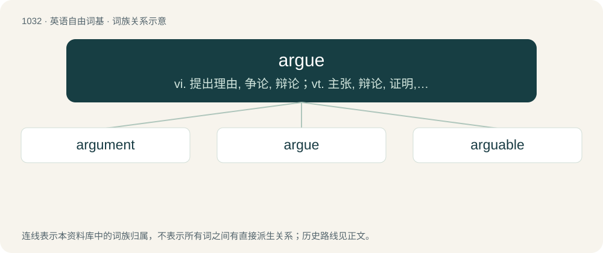

# 1110 · argue — vi. 提出理由, 争论, 辩论；vt. 主张, 辩论, 证明, 说服

[总目录](../00_总目录_按常用程度.md)

**类型**：英语自由词基　｜　**来源语言**：见词源记录

## 核心含义与来源

- 核心含义：vi. 提出理由, 争论, 辩论；vt. 主张, 辩论, 证明, 说服
- 英文含义：To show grounds for concluding (that); to indicate, imply.
- 词形：argue

**来源记录 1**（动词；To show grounds for concluding (that); to indicate, imply.）

From Middle English arguen, from Old French arguer, from Latin arguere (“to declare, show, prove, make clear, reprove, accuse”), q.v. for more. Displaced native Old English flītan and reċċan.

## 词族图

## 单词速览（常用到不常用）

| 单词 | 音标 | 释义 |
|---|---|---|
| [argument](#w-1) | 英 /ˈɑːɡjʊmənt/；美 /ˈɑɹɡjʊmənt/ | n. 争论, 论证, 论据, 自变量；\[计\] 参数 |
| [argue](#w-2) | 英 /ˈɑː.ɡjuː/；美 /ˈɑɹ.ɡju/ | vi. 提出理由, 争论, 辩论；vt. 主张, 辩论, 证明, 说服 |
| [arguable](#w-3) | 英 /ˈɑːɡjuəbl/；美 /ˈɑɹɡjuəbl/ | a. 可辩论的, 可论证的；\[法\] 可争辩的, 可论证的 |

## 逐词详解

### 1. argument

**词性**：名词　｜　**音标**：英 /ˈɑːɡjʊmənt/；美 /ˈɑɹɡjʊmənt/

**中文释义**：n. 争论, 论证, 论据, 自变量；\[计\] 参数

**英文义项**：A fact or statement used to support a proposition; a reason. / A series of propositions organized so that the final proposition is a conclusion which is intended to follow logically from the preceding propositions, which function as premises.

**构词拆分**：argue + -ment

**词源与演化**：

From Middle English argument, from Anglo-Norman and Old French arguement, from Latin argumentum. The English word is analysable as argue + -ment. Doublet of argumentum. Displaced native Old English racu and ġeflit.

**例句**：

> The neighbours got into an argument about the branches of the trees that extended over the fence.

该用例对应义项：A verbal dispute; a quarrel.

### 2. argue

**词性**：动词　｜　**音标**：英 /ˈɑː.ɡjuː/；美 /ˈɑɹ.ɡju/

**中文释义**：vi. 提出理由, 争论, 辩论；vt. 主张, 辩论, 证明, 说服

**英文义项**：To show grounds for concluding (that); to indicate, imply. / To debate, disagree, or discuss opposing or differing viewpoints; to controvert; to wrangle.

**词源与演化**：

From Middle English arguen, from Old French arguer, from Latin arguere (“to declare, show, prove, make clear, reprove, accuse”), q.v. for more. Displaced native Old English flītan and reċċan.

**例句**：

> The new increase in crime argues for even tougher jail sentences, according to some.

该用例对应义项：To show grounds for concluding (that); to indicate, imply.

### 3. arguable

**词性**：形容词　｜　**音标**：英 /ˈɑːɡjuəbl/；美 /ˈɑɹɡjuəbl/

**中文释义**：a. 可辩论的, 可论证的；\[法\] 可争辩的, 可论证的

**英文义项**：That can be argued; that can be proven or strongly supported with sound logical deduction, precedent, and evidence. / Open to doubt, argument or debate.

**构词拆分**：argue + -able

**词源与演化**：

From argue + -able.
