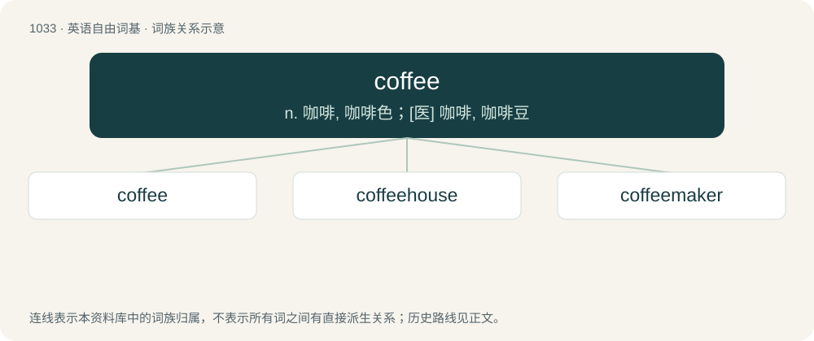

# 1111 · coffee — n. 咖啡, 咖啡色；\[医\] 咖啡, 咖啡豆

[总目录](../00_总目录_按常用程度.md)

**类型**：英语自由词基　｜　**来源语言**：见词源记录

## 核心含义与来源

- 核心含义：n. 咖啡, 咖啡色；\[医\] 咖啡, 咖啡豆
- 英文含义：A beverage made by infusing the beans of the coffee plant in hot water.
- 词形：coffee

**来源记录 1**（名词；A beverage made by infusing the beans of the coffee plant in hot water.）

Borrowed from Dutch koffie, from Italian caffè, from Ottoman Turkish قهوه (kahve), from Arabic قَهْوَة (qahwa). Doublet of café and caffè and cognate with the words for "coffee" in other major European languages, most of which are derived from the Turkish and Italian words.

## 词族图

## 单词速览（常用到不常用）

| 单词 | 音标 | 释义 |
|---|---|---|
| [coffee](#w-1) | 英 /ˈkɒfi/；美 /ˈkɑfi/ | n. 咖啡, 咖啡色；\[医\] 咖啡, 咖啡豆 |
| [coffeehouse](#w-2) |  | n. 咖啡馆 |
| [coffeemaker](#w-3) | 美 /ˈkɑ.fiˌmeɪk.ɚ/ | n. &lt;美&gt;煮咖啡器,咖啡壶 |

## 逐词详解

### 1. coffee

**词性**：名词　｜　**音标**：英 /ˈkɒfi/；美 /ˈkɑfi/

**中文释义**：n. 咖啡, 咖啡色；\[医\] 咖啡, 咖啡豆

**英文义项**：A beverage made by infusing the beans of the coffee plant in hot water. / A serving of this beverage.

**词源与演化**：

Borrowed from Dutch koffie, from Italian caffè, from Ottoman Turkish قهوه (kahve), from Arabic قَهْوَة (qahwa). Doublet of café and caffè and cognate with the words for "coffee" in other major European languages, most of which are derived from the Turkish and Italian words.

**例句**：

> He and his friends used to order coffee whenever they went out.

该用例对应义项：A beverage made by infusing the beans of the coffee plant in hot water.

### 2. coffeehouse

**词性**：名词

**中文释义**：n. 咖啡馆

**英文义项**：An establishment where coffee is served to clients; a café.

**构词拆分**：coffee + house

**词源与演化**：

From coffee + house.

**例句**：

> The coffeehouse closest to the school is closed at noon.

### 3. coffeemaker

**词性**：名词　｜　**音标**：美 /ˈkɑ.fiˌmeɪk.ɚ/

**中文释义**：n. &lt;美&gt;煮咖啡器,咖啡壶

**英文义项**：A person who makes coffee. / Any of several different types of kitchen apparatus used to brew and filter coffee.

**构词拆分**：coffee + maker

**词源与演化**：

From coffee + maker.

**例句**：

> She bought a toaster, a coffeemaker, an egg cooker and a hand mixer.
