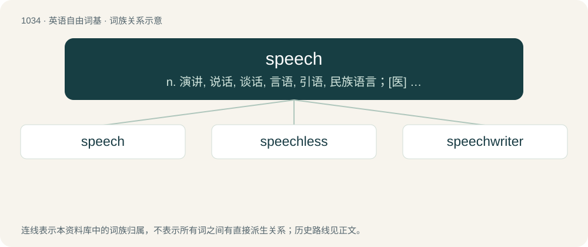

# 1113 · speech — n. 演讲, 说话, 谈话, 言语, 引语, 民族语言；\[医\] 言语, 语言

[总目录](../00_总目录_按常用程度.md)

**类型**：英语自由词基　｜　**来源语言**：见词源记录

## 核心含义与来源

- 核心含义：n. 演讲, 说话, 谈话, 言语, 引语, 民族语言；\[医\] 言语, 语言
- 英文含义：The ability to speak; the faculty of uttering words or articulate sounds and vocalizations to communicate.
- 词形：speech

**来源记录 1**（名词；The ability to speak; the faculty of uttering words or articulate sounds and vocalizations to communicate.）

From Middle English speche, from Old English spǣċ, sprǣċ (“speech, discourse, language”), from Proto-West Germanic \*sprāku (“speech, language”), from Proto-Indo-European \*spereg-, \*spreg- (“to make a sound”). Cognate with Dutch spraak (“speech”), German Sprache (“language, speech”). More at speak.

## 词族图

## 单词速览（常用到不常用）

| 单词 | 音标 | 释义 |
|---|---|---|
| [speech](#w-1) | /spiːt͡ʃ/ | n. 演讲, 说话, 谈话, 言语, 引语, 民族语言；\[医\] 言语, 语言 |
| [speechless](#w-2) | 美 /ˈspiːt͡ʃ.lɪs/ | a. 不会说话的, 哑的, 说不出话的, 无言的, 非言语所能表达的, (非正式)烂醉的 |
| [speechwriter](#w-3) | /ˈspiːtʃ,raitə(r)/ | n. 演讲稿撰写人 |

## 逐词详解

### 1. speech

**词性**：名词　｜　**音标**：/spiːt͡ʃ/

**中文释义**：n. 演讲, 说话, 谈话, 言语, 引语, 民族语言；\[医\] 言语, 语言

**英文义项**：The ability to speak; the faculty of uttering words or articulate sounds and vocalizations to communicate. / The act of speaking, a certain style of it.

**词源与演化**：

From Middle English speche, from Old English spǣċ, sprǣċ (“speech, discourse, language”), from Proto-West Germanic \*sprāku (“speech, language”), from Proto-Indo-European \*spereg-, \*spreg- (“to make a sound”). Cognate with Dutch spraak (“speech”), German Sprache (“language, speech”). More at speak.

**例句**：

> The candidate made some ambitious promises in his campaign speech.

该用例对应义项：A formal session of speaking, especially a long oral message given publicly by one person.

### 2. speechless

**词性**：形容词　｜　**音标**：美 /ˈspiːt͡ʃ.lɪs/

**中文释义**：a. 不会说话的, 哑的, 说不出话的, 无言的, 非言语所能表达的, (非正式)烂醉的

**英文义项**：Not speaking; not knowing what to say; silent, especially due to surprise, amazement, etc.; wordless.

**构词拆分**：speech + -less

**词源与演化**：

From Middle English specheles, from Old English sprǣċlēas (“speechless; without the power of speak”), from Proto-Germanic \*sprēkalausaz, equivalent to speech + -less. Cognate with West Frisian sprakeleas (“speechless”), Dutch sprakeloos (“speechless”), German Low German spraaklos (“speechless”), German sprachlos (“speechless”).

**例句**：

> When he walked into his surprise birthday party, he was completely speechless.

该用例对应义项：Not speaking; not knowing what to say; silent, especially due to surprise, amazement, etc.; wordless.

### 3. speechwriter

**词性**：名词　｜　**音标**：/ˈspiːtʃ,raitə(r)/

**中文释义**：n. 演讲稿撰写人

**英文义项**：Someone who writes speeches for others, especially as a profession.

**构词拆分**：speech + writer

**词源与演化**：

From speech + writer.
