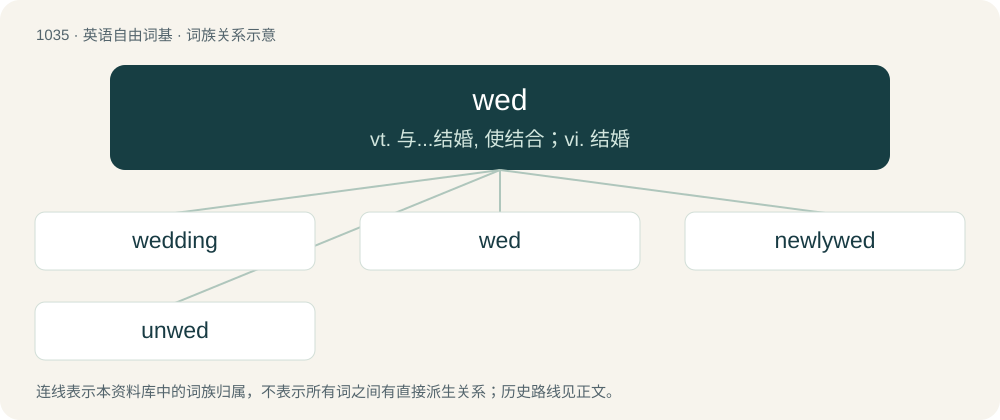

# 1115 · wed — vt. 与...结婚, 使结合；vi. 结婚

[总目录](../00_总目录_按常用程度.md)

**类型**：英语自由词基　｜　**来源语言**：见词源记录

## 核心含义与来源

- 核心含义：vt. 与...结婚, 使结合；vi. 结婚
- 英文含义：To perform the marriage ceremony for; to join in matrimony.
- 词形：wed

**来源记录 1**（动词；To perform the marriage ceremony for; to join in matrimony.）

From Middle English wedden, weddien, from Old English weddian (“to pledge; wed”), from Proto-West Germanic \*waddjōn, from Proto-Germanic \*wadjōną (“to pledge”), from \*wadją (“pledge”), ultimately from Proto-Indo-European \*wedʰ- (“to pledge”). Cognate with Scots wed, wod, wad (“to wed”), Saterland Frisian wädje (“to bet, wager”), West Frisian wedzje (“to bet, wager”), Low German and Dutch wedden (“to bet”), German wetten (“to bet”), Danish vædde (“to bet”), Swedish vädja (“to appeal”), Icelandic veðja (“to bet”); more distantly, to Sanskrit वधू (vadhū́, “bride”). Related also to gage, engage, and wage.

## 词族图

## 单词速览（常用到不常用）

| 单词 | 音标 | 释义 |
|---|---|---|
| [wedding](#w-1) | 英 /ˈwɛdɪŋ/ | n. 婚礼, 结婚, 结婚周年纪念日, 结合；\[法\] 结婚, 婚礼, 结婚纪念日 |
| [wed](#w-2) | /ˈwɛd/ | vt. 与...结婚, 使结合；vi. 结婚 |
| [newlywed](#w-3) | /ˈnjuːliˌwɛd/ | n. 新(婚的)人, 新婚夫妇 |
| [unwed](#w-4) | /,ʌnˈwed/ | a. 没有结婚的；未婚的 |

## 逐词详解

### 1. wedding

**词性**：名词　｜　**音标**：英 /ˈwɛdɪŋ/

**中文释义**：n. 婚礼, 结婚, 结婚周年纪念日, 结合；\[法\] 结婚, 婚礼, 结婚纪念日

**英文义项**：A marriage ceremony; a ritual officially celebrating the beginning of a marriage. / The joining of two or more parts.

**构词拆分**：wed + -ing

**词源与演化**：

From Middle English wedding, weddynge, from Old English weddung (“betrothal, espousal”), equivalent to wed + -ing. Cognate with Middle Dutch weddinghe.

**例句**：

> The wedding of our three companies took place last week.

该用例对应义项：The joining of two or more parts.

### 2. wed

**词性**：动词　｜　**音标**：/ˈwɛd/

**中文释义**：vt. 与...结婚, 使结合；vi. 结婚

**英文义项**：To perform the marriage ceremony for; to join in matrimony. / To take as one's spouse.

**词源与演化**：

From Middle English wedden, weddien, from Old English weddian (“to pledge; wed”), from Proto-West Germanic \*waddjōn, from Proto-Germanic \*wadjōną (“to pledge”), from \*wadją (“pledge”), ultimately from Proto-Indo-European \*wedʰ- (“to pledge”). Cognate with Scots wed, wod, wad (“to wed”), Saterland Frisian wädje (“to bet, wager”), West Frisian wedzje (“to bet, wager”), Low German and Dutch wedden (“to bet”), German wetten (“to bet”), Danish vædde (“to bet”), Swedish vädja (“to appeal”), Icelandic veðja (“to bet”); more distantly, to Sanskrit वधू (vadhū́, “bride”). Related also to gage, engage, and wage.

**例句**：

> They will wed in the summer.

该用例对应义项：To take each other as a spouse.

### 3. newlywed

**词性**：名词　｜　**音标**：/ˈnjuːliˌwɛd/

**中文释义**：n. 新(婚的)人, 新婚夫妇

**英文义项**：A recently married person.

**构词拆分**：From newly + wed.

**词源与演化**：

From newly + wed.

**例句**：

> Tanaka only just recently became a newlywed.

### 4. unwed

**词性**：名词　｜　**音标**：/,ʌnˈwed/

**中文释义**：a. 没有结婚的；未婚的

**英文义项**：One who is not married; a bachelor or a spinster.

**构词拆分**：un- + wed

**词源与演化**：

From un- (not) + wed.

**例句**：

> Should unweds living together receive the same social benefits as married couples?

该用例对应义项：One who is not married; a bachelor or a spinster.
