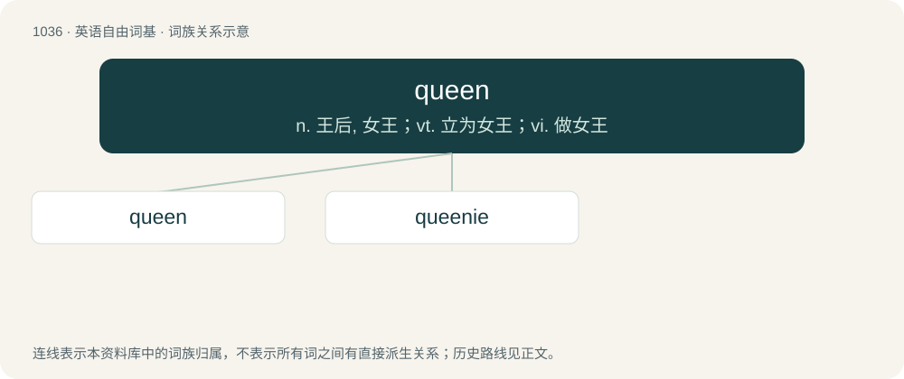

# 1116 · queen — n. 王后, 女王；vt. 立为女王；vi. 做女王

[总目录](../00_总目录_按常用程度.md)

**类型**：英语自由词基　｜　**来源语言**：见词源记录

## 核心含义与来源

- 核心含义：n. 王后, 女王；vt. 立为女王；vi. 做女王
- 英文含义：The wife, consort, or widow of a king.
- 词形：queen

**来源记录 1**（名词；The wife, consort, or widow of a king.）

From Middle English quene, queen, cwen, from Old English cwēn (“queen”), from Proto-West Germanic \*kwāni, from Proto-Germanic \*kwēniz (“wife, woman”), from Proto-Indo-European \*gʷénh₂s (“woman”). Cognate with Scots queen, wheen (“queen”), Old Saxon quān ("wife"; &gt; Middle Low German quene (“elderly woman”)), Dutch kween (“woman past child-bearing age”), Swedish kvinna (“woman”), Norwegian Bokmål and Norwegian Nynorsk kvinne (“woman”), Danish kvinde (“woman”), Icelandic kvon (“wife”), Gothic 𐌵𐌴𐌽𐍃 (qēns, “wife”), Norwegian dialectal kvån (“wife”). Related to and possibly merged with and/or absorbed some senses of English quean, from Middle English quene, from Old English cwene (“woman; female serf, quean”), see quean. Generally eclipsed non-native Middle English regina (“queen”), borrowed from Latin rēgīna (“queen”) (see Modern English Regina). Doublet of quean and gyne. In reference to insects, by analogy with the obsolete term king, which it took over from starting in the 1600s, when they were discovered to be female.

## 词族图

## 单词速览（常用到不常用）

| 单词 | 音标 | 释义 |
|---|---|---|
| [queen](#w-1) | /kwiːn/ | n. 王后, 女王；vt. 立为女王；vi. 做女王 |
| [queenie](#w-2) | 英 /ˈkwiːni/ | 【英文】An effeminate man; a male homosexual (especially as a term of address). |

## 逐词详解

### 1. queen

**词性**：名词　｜　**音标**：/kwiːn/

**中文释义**：n. 王后, 女王；vt. 立为女王；vi. 做女王

**英文义项**：The wife, consort, or widow of a king. / A female monarch.

**词源与演化**：

From Middle English quene, queen, cwen, from Old English cwēn (“queen”), from Proto-West Germanic \*kwāni, from Proto-Germanic \*kwēniz (“wife, woman”), from Proto-Indo-European \*gʷénh₂s (“woman”). Cognate with Scots queen, wheen (“queen”), Old Saxon quān ("wife"; &gt; Middle Low German quene (“elderly woman”)), Dutch kween (“woman past child-bearing age”), Swedish kvinna (“woman”), Norwegian Bokmål and Norwegian Nynorsk kvinne (“woman”), Danish kvinde (“woman”), Icelandic kvon (“wife”), Gothic 𐌵𐌴𐌽𐍃 (qēns, “wife”), Norwegian dialectal kvån (“wife”). Related to and possibly merged with and/or absorbed some senses of English quean, from Middle English quene, from Old English cwene (“woman; female serf, quean”), see quean. Generally eclipsed non-native Middle English regina (“queen”), borrowed from Latin rēgīna (“queen”) (see Modern English Regina). Doublet of quean and gyne. In reference to insects, by analogy with the obsolete term king, which it took over from starting in the 1600s, when they were discovered to be female.

**例句**：

> My mother was queen of the St. Patrick's Day parade when she was 19.

该用例对应义项：A girl or woman chosen to preside in an honorary or ceremonial manner over a specified festivity or occasion, as May Queen, Homecoming Queen, prom queen, pearly queen.

### 2. queenie

**词性**：名词　｜　**音标**：英 /ˈkwiːni/

**英文义项**：An effeminate man; a male homosexual (especially as a term of address). / The queen scallop.

**构词拆分**：queen + -ie

**词源与演化**：

From queen + -ie. Piecewise doublet of queanie.
