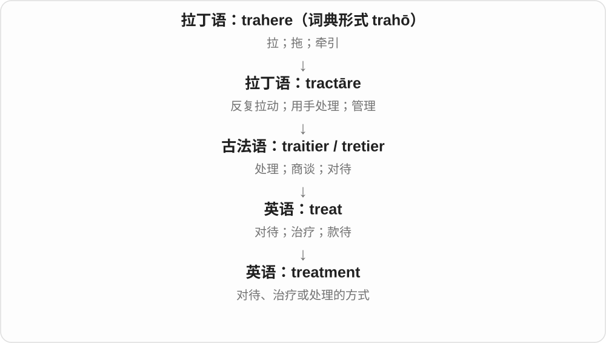

# 1116 · treatment — 对待；处理；治疗

[逐词精讲目录](../00_逐词精讲目录.md) · [总目录](../00_总目录_按常用程度.md)

## 核心词根与来源

treatment 经法语相关名词进入，联系 treat 对待、处理。pretreatment 在前加 pre-，表示正式步骤之前的预处理。

**TREATMENT：把对待或处理作为一项过程**

同一个动作可对人表现态度，也可对材料作加工。

- **处理与对待**：treatment
- **前置步骤**：pretreatment

## 词形与演化规律

treatment 有治疗、待遇、处理等语境义；pre- 是事先，不自动表示一定与医学有关。

## 单词速览（按词族由简到繁）

同一基础词的相关扩展放在一起，先读基础形式，再读扩展；各组之间优先读常用的。具体词源关系见各词讲解。

| 单词 | 音标 | 核心意思 |
|---|---|---|
| [treatment](#w-1) | /ˈtriːtmənt/ | 对待；治疗；处理方式 |
| [pretreatment](#w-2) | 英、美 /ˌpriːˈtriːtmənt/ | 预处理；正式治疗前的处理；治疗前的 |

## 逐词讲解

### 1. treatment — 对待；治疗；处理方式

**音标**：/ˈtriːtmənt/

**先抓住这个画面**

treatment 把“怎样对待”变成可讨论的一整套做法：病人接受什么治疗，员工受到怎样的待遇，材料经过什么处理。

**怎么拆**

treat + -ment；-ment 形成动作、过程或结果名词，也可与法语 traitement 对照。

**怎么变成今天的意思**

核心始终是对象被怎样处理。medical treatment 只是一支；equal treatment 说一视同仁，water treatment 说水处理。

**常见搭配与例句**

receive treatment；equal treatment；the treatment of…；water treatment；special treatment。

> All applicants should receive equal treatment.

所有申请者都应受到平等对待。

> The water passes through several stages of treatment.

这些水会经过几个处理阶段。

**别混淆**

treatment 可以指治疗过程；medicine 可以指药物或医学。一次治疗未必只靠吃药。

### 2. pretreatment — 预处理；正式治疗前的处理；治疗前的

**音标**：英、美 /ˌpriːˈtriːtmənt/

**先抓住这个画面**

主步骤开始前，先把材料或对象整理到适合处理的状态。

**怎么拆**

pre- + treatment；treatment 既可表示治疗，也可表示材料处理，不能一律译成医疗。

**怎么变成今天的意思**

**拉丁语 prae → 法语、中世纪拉丁语 pre- → 英语 pre-**  
时间在先；位置在前；后来可与英语现成词自由组合

↓

**英语 pre- + treatment → pretreatment**  
主要处理前的准备；或治疗开始前的阶段

surface pretreatment 可以是涂装前的表面处理；pretreatment measurements 则可能只指治疗开始前取得的测量值，并非一种治疗。

**常见搭配与例句**

surface pretreatment；a pretreatment stage；pretreatment measurements。

> The metal needs pretreatment before painting.

这块金属在涂漆前需要预处理。

> The researchers compared pretreatment and follow-up measurements.

研究人员比较了治疗前与随访时的测量结果。

**别混淆**

preparation 范围很宽；pretreatment 特别指主处理以前的一道处理或有关时间阶段。

## 这一组要分清什么

treatment 不必是药物治疗；water treatment 是水处理，fair treatment 是公平对待。

## 串起来练习

The material needs pretreatment before the final surface treatment.

这种材料在最后表面处理前需要预处理。
