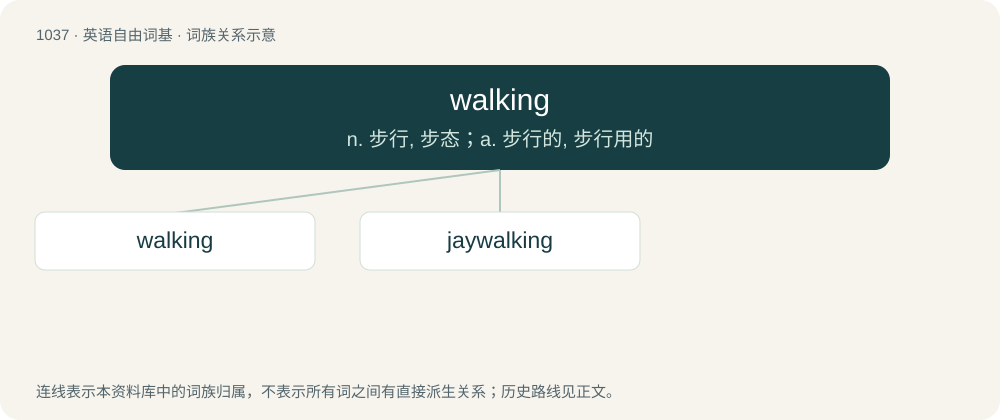

# 1117 · walking — n. 步行, 步态；a. 步行的, 步行用的

[总目录](../00_总目录_按常用程度.md)

**类型**：英语自由词基　｜　**来源语言**：见词源记录

## 核心含义与来源

- 核心含义：n. 步行, 步态；a. 步行的, 步行用的
- 英文含义：Incarnate as a human; living.
- 词形：walking

**来源记录 1**（形容词；Incarnate as a human; living.）

From Middle English walkynge, walkinge, walkinde, walkende, walkand, walkande, from Old English wealcende (attested as Old English wealcendes), from Proto-Germanic \*walkandz, present participle of Proto-Germanic \*walkaną (“to roll, trample, walk”), equivalent to walk + -ing.

## 词族图

## 单词速览（常用到不常用）

| 单词 | 音标 | 释义 |
|---|---|---|
| [walking](#w-1) | 英 /ˈwɔː.kɪŋ/；美 /ˈwɔ.kɪŋ/ | n. 步行, 步态；a. 步行的, 步行用的 |
| [jaywalking](#w-2) | /ˈdʒeɪwɔːkɪŋ/ | n. 走路不遵守交通规则；v. 擅自穿越马路( jaywalk的现在分词 ) |

## 逐词详解

### 1. walking

**词性**：形容词　｜　**音标**：英 /ˈwɔː.kɪŋ/；美 /ˈwɔ.kɪŋ/

**中文释义**：n. 步行, 步态；a. 步行的, 步行用的

**英文义项**：Incarnate as a human; living. / Able to walk in spite of injury or sickness.

**构词拆分**：walk + -ing

**词源与演化**：

From Middle English walkynge, walkinge, walkinde, walkende, walkand, walkande, from Old English wealcende (attested as Old English wealcendes), from Proto-Germanic \*walkandz, present participle of Proto-Germanic \*walkaną (“to roll, trample, walk”), equivalent to walk + -ing.

**例句**：

> Elizabeth knows so many words that they call her the walking dictionary.

该用例对应义项：Incarnate as a human; living.

### 2. jaywalking

**词性**：名词　｜　**音标**：/ˈdʒeɪwɔːkɪŋ/

**中文释义**：n. 走路不遵守交通规则；v. 擅自穿越马路( jaywalk的现在分词 )

**英文义项**：An act of behaving as a jaywalker.

**构词拆分**：jaywalk + -ing；jay (“a stupid person”) + walking

**词源与演化**：

Back-formation from jaywalker. Analyzable as jaywalk + -ing, or jay (“a stupid person”) + walking.

**例句**：

> The police have been cracking down on jaywalking in the area.
