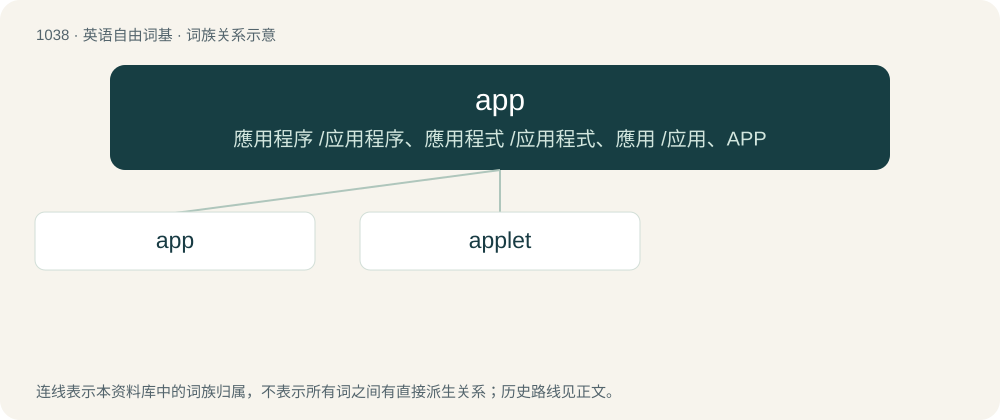

# 1118 · app — 應用程序 /应用程序、應用程式 /应用程式、應用 /应用、APP

[总目录](../00_总目录_按常用程度.md)

**类型**：英语自由词基　｜　**来源语言**：见词源记录

## 核心含义与来源

- 核心含义：應用程序 /应用程序、應用程式 /应用程式、應用 /应用、APP
- 英文含义：An application (program), especially a small one designed for a mobile device.
- 词形：app

**多个词源／构词路径**：同一拼写可能有不同来源；以下按词性和含义分别列出。

**来源记录 1**（名词；An application (program), especially a small one designed for a mobile device.）

Clipping of application.

**来源记录 2**（名词；appetizer）

Shortening of appetizer.

**来源记录 3**（名词；An appearance in a game.）

Shortening of appearance.

## 词族图

## 单词速览（常用到不常用）

| 单词 | 音标 | 释义 |
|---|---|---|
| [app](#w-1) | 英 /æp/ | 應用程序 /应用程序、應用程式 /应用程式、應用 /应用、APP |
| [applet](#w-2) | /ˈæplət/ | n. 小型程式；支程序, 小应用程序；程序类型 |

## 逐词详解

### 1. app

**词性**：名词　｜　**音标**：英 /æp/

**中文释义**：應用程序 /应用程序、應用程式 /应用程式、應用 /应用、APP

**英文义项**：An application (program), especially a small one designed for a mobile device. / application (use, purpose; not a computer program)

**词源与演化**：

Clipping of application.

**例句**：

> I never thought it'd be this hard to create an iPad app.

### 2. applet

**词性**：名词　｜　**音标**：/ˈæplət/

**中文释义**：n. 小型程式；支程序, 小应用程序；程序类型

**英文义项**：A small program module that runs under the control of a larger application, typically a web browser.

**构词拆分**：app + -let

**词源与演化**：

From app + -let, but perhaps also influenced by Apple (the term originated in AppleScript).

**例句**：

> This is how you execute CLSID applet commands.
