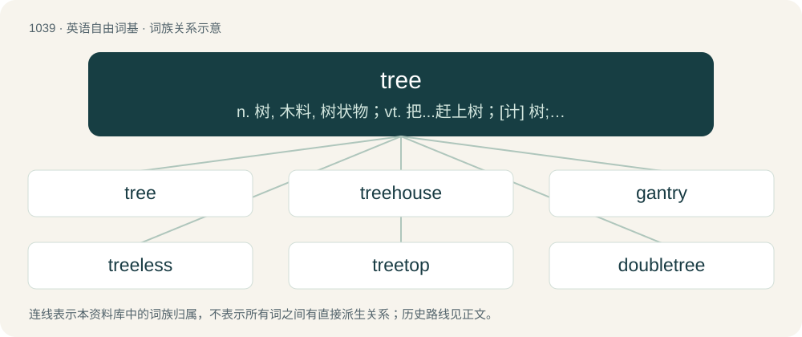

# 1121 · tree — n. 树, 木料, 树状物；vt. 把...赶上树；\[计\] 树; DOS外部命令:显示指定磁盘驱动器的目录结构

[总目录](../00_总目录_按常用程度.md)

**类型**：英语自由词基　｜　**来源语言**：见词源记录

## 核心含义与来源

- 核心含义：n. 树, 木料, 树状物；vt. 把...赶上树；\[计\] 树; DOS外部命令:显示指定磁盘驱动器的目录结构
- 英文含义：A perennial woody plant taller and larger than a shrub with a wooden trunk and, at some distance from the ground, having leaves and branches.
- 词形：tree

**来源记录 1**（名词；A perennial woody plant taller and larger than a shrub with a wooden trunk and, at some distance from the ground, having leaves and branches.）

From Middle English trau, tre, tree, treo, treou, trew, trewe, troe, trouȝh, trouȝgh, trow, trowe, from Old English trēo, trēow, trēu, trīo, trīow, trȳw (“tree; wood; forest; beam, cudgel, log; cross”), from Proto-West Germanic \*treu, from Proto-Germanic \*trewą (“tree”), from pre-Germanic \*dréwom, thematic e-grade derivative of Proto-Indo-European \*dóru (“tree”). Related to tar, true. Cognates Cognate with Dutch teer (“tree”), Danish, Faroese, and Scanian træ (“tree; timber, wood”), Elfdalian trai (“tree; timber, wood”), Icelandic tré (“tree; wood”), Norwegian Bokmål and Norwegian Nynorsk tre (“tree; wood”), Swedish trä (“wood; tree”), träd (“tree”), Gothic 𐍄𐍂𐌹𐌿 (triu, “piece of wood”); also Breton derv (“oak”), Cornish dar (“oak”), Irish dair (“oak”), Manx darragh (“oak; oaken”), Scottish Gaelic darach (“oak”), Welsh dâr (“oak”), Ancient Greek δόρυ (dóru, “tree; wood; spear”) (whence Greek δόρυ (dóry, “pike, spear”)), Albanian dru (“tree; wood”), Latvian darva (“tar”), Lithuanian derva (“tar; resin”), Belarusian дзе́рава (dzjérava, “tree”), дрэ́ва (dréva, “tree; wood”), Czech drvo, dřevo (“wood”), Polish drzewo (“tree; wood”), Russian де́рево (dérevo), дре́во (drévo, “tree; wood”), Serbo-Croatian др̏во, drȇvo, drijȇvo, drȋvo, dȑvo (“tree; wood”), Slovak and Slovene drevo (“tree; wood”), Ukrainian де́рево (dérevo, “tree; wood”), Armenian տարր (tarr, “element; component”), Avestan 𐬛𐬁𐬎𐬭𐬎 (dāᵘru, “wood”), Central Kurdish and Persian دار (dâr, “tree; wood”), Northern Kurdish dar (“tree”), Zazaki dare (“tree”), Hittite 𒋫𒊒 (taru), 𒋫𒀀𒊒 (táru, “tree; wood”), Luwian 𒋫𒀀𒊒 (tāru, “wood”), Tocharian A and Tocharian B or (“wood”), Sanskrit दारु (dāru, “timber, wood”). Replaced alternative Middle English beem, from Old English bēam (see beam) and eclipsed non-native Middle English arbre, borrowed from Old French arbre.

## 词族图

## 单词速览（常用到不常用）

| 单词 | 音标 | 释义 |
|---|---|---|
| [tree](#w-1) | /tɹiː/ | n. 树, 木料, 树状物；vt. 把...赶上树；\[计\] 树; DOS外部命令:显示指定磁盘驱动器的目录结构 |
| [treehouse](#w-2) | /ˈtɹiːˌhaʊs/ | n. 树屋 |
| [gantry](#w-3) | /ˈɡæntɹi/ | n. 桶架, 龙门起重架, (跨轨)信号架, (起重架的)构台/门架, 导弹拖车 |
| [treeless](#w-4) | /ˈtriːlis/ | a. 无树木的 |
| [treetop](#w-5) | 英 /ˈtɹiːˌtɒp/；美 /ˈtɹiˌtɑp/ | n. 树稍 |
| [doubletree](#w-6) | /ˈdʌbltriː/ | n. (用双马拉车等时使用的)双驾横木 |

## 逐词详解

### 1. tree

**词性**：名词　｜　**音标**：/tɹiː/

**中文释义**：n. 树, 木料, 树状物；vt. 把...赶上树；\[计\] 树; DOS外部命令:显示指定磁盘驱动器的目录结构

**英文义项**：A perennial woody plant taller and larger than a shrub with a wooden trunk and, at some distance from the ground, having leaves and branches. / Any other plant (such as a large shrub or herb) that is reminiscent of the above in form and size.

**词源与演化**：

From Middle English trau, tre, tree, treo, treou, trew, trewe, troe, trouȝh, trouȝgh, trow, trowe, from Old English trēo, trēow, trēu, trīo, trīow, trȳw (“tree; wood; forest; beam, cudgel, log; cross”), from Proto-West Germanic \*treu, from Proto-Germanic \*trewą (“tree”), from pre-Germanic \*dréwom, thematic e-grade derivative of Proto-Indo-European \*dóru (“tree”). Related to tar, true. Cognates Cognate with Dutch teer (“tree”), Danish, Faroese, and Scanian træ (“tree; timber, wood”), Elfdalian trai (“tree; timber, wood”), Icelandic tré (“tree; wood”), Norwegian Bokmål and Norwegian Nynorsk tre (“tree; wood”), Swedish trä (“wood; tree”), träd (“tree”), Gothic 𐍄𐍂𐌹𐌿 (triu, “piece of wood”); also Breton derv (“oak”), Cornish dar (“oak”), Irish dair (“oak”), Manx darragh (“oak; oaken”), Scottish Gaelic darach (“oak”), Welsh dâr (“oak”), Ancient Greek δόρυ (dóru, “tree; wood; spear”) (whence Greek δόρυ (dóry, “pike, spear”)), Albanian dru (“tree; wood”), Latvian darva (“tar”), Lithuanian derva (“tar; resin”), Belarusian дзе́рава (dzjérava, “tree”), дрэ́ва (dréva, “tree; wood”), Czech drvo, dřevo (“wood”), Polish drzewo (“tree; wood”), Russian де́рево (dérevo), дре́во (drévo, “tree; wood”), Serbo-Croatian др̏во, drȇvo, drijȇvo, drȋvo, dȑvo (“tree; wood”), Slovak and Slovene drevo (“tree; wood”), Ukrainian де́рево (dérevo, “tree; wood”), Armenian տարր (tarr, “element; component”), Avestan 𐬛𐬁𐬎𐬭𐬎 (dāᵘru, “wood”), Central Kurdish and Persian دار (dâr, “tree; wood”), Northern Kurdish dar (“tree”), Zazaki dare (“tree”), Hittite 𒋫𒊒 (taru), 𒋫𒀀𒊒 (táru, “tree; wood”), Luwian 𒋫𒀀𒊒 (tāru, “wood”), Tocharian A and Tocharian B or (“wood”), Sanskrit दारु (dāru, “timber, wood”). Replaced alternative Middle English beem, from Old English bēam (see beam) and eclipsed non-native Middle English arbre, borrowed from Old French arbre.

**例句**：

> The banana tree is a tall perennial herb: its trunk is not woody.

该用例对应义项：Any other plant (such as a large shrub or herb) that is reminiscent of the above in form and size.

### 2. treehouse

**词性**：名词　｜　**音标**：/ˈtɹiːˌhaʊs/

**中文释义**：n. 树屋

**英文义项**：A house, or similar structure within a tree, or several trees, built with light materials. / A tropical residence built in a tree, or on stilts.

**构词拆分**：tree + house

**词源与演化**：

From tree + house. First use appears c. 1867. See cite below.

**例句**：

> Tom used to hang out with his friends in his treehouse.

### 3. gantry

**词性**：名词　｜　**音标**：/ˈɡæntɹi/

**中文释义**：n. 桶架, 龙门起重架, (跨轨)信号架, (起重架的)构台/门架, 导弹拖车

**英文义项**：A framework of steel bars resting on side supports to bridge over or around something. / A supporting framework for a barrel.

**构词拆分**：gaun (“gallon”) + tree

**词源与演化**：

From earlier gauntree, possibly from dialectal gaun (“gallon”) + tree, perhaps as a reinterpretation of Middle English \*gaunter, from Old Northern French gantier, from Late Latin cantarium, from Latin canterius (“trellis, sort of frame”).

### 4. treeless

**词性**：形容词　｜　**音标**：/ˈtriːlis/

**中文释义**：a. 无树木的

**英文义项**：Having no trees.

**构词拆分**：tree + -less

**词源与演化**：

From tree + -less.

### 5. treetop

**词性**：名词　｜　**音标**：英 /ˈtɹiːˌtɒp/；美 /ˈtɹiˌtɑp/

**中文释义**：n. 树稍

**英文义项**：The crown or uppermost branches of a tree.

**构词拆分**：tree + top

**词源与演化**：

From tree + top.

**例句**：

> The crow cawed from the treetop.

### 6. doubletree

**词性**：名词　｜　**音标**：/ˈdʌbltriː/

**中文释义**：n. (用双马拉车等时使用的)双驾横木

**英文义项**：a device that connects two horses to a wagon or other implement. The tugs of a harness are connected to a singletree, two of which are connected to a doubletree, which, in turn, is connected to the implement.

**构词拆分**：double + tree

**词源与演化**：

From double + tree.
