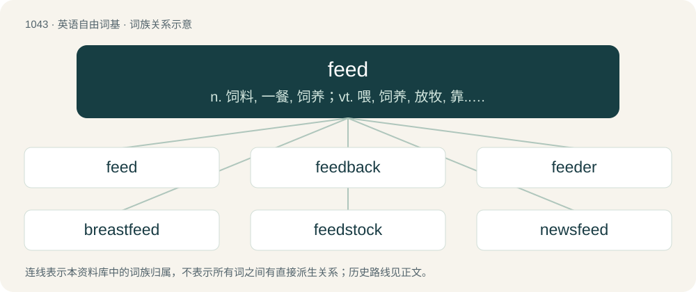

# 1124 · feed — n. 饲料, 一餐, 饲养；vt. 喂, 饲养, 放牧, 靠...为生；vi. 吃东西, 用餐, 流入

[总目录](../00_总目录_按常用程度.md)

**类型**：英语自由词基　｜　**来源语言**：见词源记录

## 核心含义与来源

- 核心含义：n. 饲料, 一餐, 饲养；vt. 喂, 饲养, 放牧, 靠...为生；vi. 吃东西, 用餐, 流入
- 英文含义：To give (someone or something) food to eat.
- 词形：feed

**多个词源／构词路径**：同一拼写可能有不同来源；以下按词性和含义分别列出。

**来源记录 1**（动词；To give (someone or something) food to eat.）

From Middle English feden, from Old English fēdan (“to feed”), from Proto-West Germanic \*fōdijan, from Proto-Germanic \*fōdijaną (“to feed”), from Proto-Indo-European \*peh₂- (“to guard, graze, feed”). Cognate with West Frisian fiede (“to nourish, feed”), Dutch voeden (“to feed”), Danish føde (“to bring forth, feed”), Swedish föda (“to bring forth, feed”), Icelandic fæða (“to feed”), and more distantly with Latin pāscō (“feed, nourish”, verb) through Indo-European. More at food, fodder.

**来源记录 2**（名词；Food given to (especially herbivorous) non-human animals.）

From Middle English fede, fed, from the verb (see above). Alternatively, perhaps from Old Norse fœða (“nourishment, food”), from Proto-Germanic \*fōdijaną (“to feed”), whence also Old English fēdan (“to feed”).

## 词族图

## 单词速览（常用到不常用）

| 单词 | 音标 | 释义 |
|---|---|---|
| [feed](#w-1) | /fiːd/ | n. 饲料, 一餐, 饲养；vt. 喂, 饲养, 放牧, 靠...为生；vi. 吃东西, 用餐, 流入 |
| [feedback](#w-2) | /ˈfiːdˌbæk/ | n. 反馈, 反应；\[计\] 反馈 |
| [feeder](#w-3) | 美 /ˈfidɚ/ | n. 饲养者, 供给者, 奶瓶；\[化\] 给料器 |
| [breastfeed](#w-4) | /ˈbɹɛs(t)fiːd/ | vt.& vi. 用母乳喂养, 哺乳 |
| [feedstock](#w-5) | /ˈfiːdˌstɒk/ | n. 原料 |
| [newsfeed](#w-6) |  | 新闻供应 |
| [feedlot](#w-7) | /ˈfiːdlɒt/ | n. 饲育场 |

## 逐词详解

### 1. feed

**词性**：动词　｜　**音标**：/fiːd/

**中文释义**：n. 饲料, 一餐, 饲养；vt. 喂, 饲养, 放牧, 靠...为生；vi. 吃东西, 用餐, 流入

**英文义项**：To give (someone or something) food to eat. / To eat (usually of animals).

**词源与演化**：

From Middle English feden, from Old English fēdan (“to feed”), from Proto-West Germanic \*fōdijan, from Proto-Germanic \*fōdijaną (“to feed”), from Proto-Indo-European \*peh₂- (“to guard, graze, feed”). Cognate with West Frisian fiede (“to nourish, feed”), Dutch voeden (“to feed”), Danish føde (“to bring forth, feed”), Swedish föda (“to bring forth, feed”), Icelandic fæða (“to feed”), and more distantly with Latin pāscō (“feed, nourish”, verb) through Indo-European. More at food, fodder.

**例句**：

> We got interesting results after feeding the computer with the new data.

该用例对应义项：To supply (a machine) with something to be processed.

### 2. feedback

**词性**：名词　｜　**音标**：/ˈfiːdˌbæk/

**中文释义**：n. 反馈, 反应；\[计\] 反馈

**英文义项**：Critical assessment of a process or activity or of their results. / The part of an output signal that is looped back into the input to control or modify a system.

**构词拆分**：From feed + back.

**词源与演化**：

From feed + back.

**例句**：

> After you hand in your essays, I will give both grades and feedback.

该用例对应义项：Critical assessment of a process or activity or of their results.

### 3. feeder

**词性**：名词　｜　**音标**：美 /ˈfidɚ/

**中文释义**：n. 饲养者, 供给者, 奶瓶；\[化\] 给料器

**英文义项**：One who feeds, or gives food to another. / The participant in feederism who feeds the other (the feedee).

**构词拆分**：feed + -er

**词源与演化**：

From Middle English feedere, federe, fedare, equivalent to feed + -er.

**用法示例／搭配（非完整句）**：

> bird feeder

该用例对应义项：That which is used to feed.

### 4. breastfeed

**词性**：动词　｜　**音标**：/ˈbɹɛs(t)fiːd/

**中文释义**：vt.& vi. 用母乳喂养, 哺乳

**英文义项**：To feed (a baby) milk via the breasts; to suckle; to nurse. / To nurse, to suck milk from a breast.

**构词拆分**：breast + feed

**词源与演化**：

From breast + feed.

**例句**：

> This is a designated place for mothers to breastfeed their babies.

该用例对应义项：To feed (a baby) milk via the breasts; to suckle; to nurse.

### 5. feedstock

**词性**：名词　｜　**音标**：/ˈfiːdˌstɒk/

**中文释义**：n. 原料

**英文义项**：Any bulk raw material constituting the principal input for an industrial process.

**构词拆分**：feed + stock

**词源与演化**：

From feed + stock.

**例句**：

> Bio-materials may be substituted for petrochemical feedstocks as petroleum prices rise.

该用例对应义项：Any bulk raw material constituting the principal input for an industrial process.

### 6. newsfeed

**词性**：名词

**中文释义**：新闻供应

**英文义项**：A feed, especially one providing news content.

**构词拆分**：news + feed

**词源与演化**：

From news + feed.

### 7. feedlot

**词性**：名词　｜　**音标**：/ˈfiːdlɒt/

**中文释义**：n. 饲育场

**英文义项**：Land on which livestock are fattened for market.

**构词拆分**：feed + lot

**词源与演化**：

From feed + lot.
