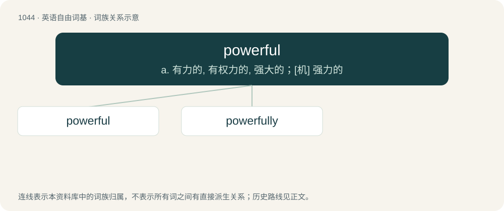

# 1125 · powerful — a. 有力的, 有权力的, 强大的；\[机\] 强力的

[总目录](../00_总目录_按常用程度.md)

**类型**：英语自由词基　｜　**来源语言**：见词源记录

## 核心含义与来源

- 核心含义：a. 有力的, 有权力的, 强大的；\[机\] 强力的
- 英文含义：Having, or capable of exerting, power or influence.
- 词形：powerful

**来源记录 1**（形容词；Having, or capable of exerting, power or influence.）

From Middle English pouerful, powarfull. By surface analysis, power + -ful.

## 词族图

## 单词速览（常用到不常用）

| 单词 | 音标 | 释义 |
|---|---|---|
| [powerful](#w-1) | 英 /ˈpaʊəfl̩/；美 /ˈpaʊɚfl̩/ | a. 有力的, 有权力的, 强大的；\[机\] 强力的 |
| [powerfully](#w-2) | 英 /ˈpaʊəf(ə)li/；美 /ˈpaʊɚf(ə)li/ | adv. 强有力, 强大, 效力大, 有权威, 权力大, 有影响, 很多, 相当, 非常 |

## 逐词详解

### 1. powerful

**词性**：形容词　｜　**音标**：英 /ˈpaʊəfl̩/；美 /ˈpaʊɚfl̩/

**中文释义**：a. 有力的, 有权力的, 强大的；\[机\] 强力的

**英文义项**：Having, or capable of exerting, power or influence. / Leading to many or important deductions.

**词源与演化**：

From Middle English pouerful, powarfull. By surface analysis, power + -ful.

**用法示例／搭配（非完整句）**：

> a powerful set of postulates

该用例对应义项：Leading to many or important deductions.

### 2. powerfully

**词性**：副词　｜　**音标**：英 /ˈpaʊəf(ə)li/；美 /ˈpaʊɚf(ə)li/

**中文释义**：adv. 强有力, 强大, 效力大, 有权威, 权力大, 有影响, 很多, 相当, 非常

**英文义项**：In a powerful manner.

**构词拆分**：powerful + -ly

**词源与演化**：

From powerful + -ly.

**例句**：

> The federal government replaced the powerfully pro-settler Sir Godfrey Huggins with the even tougher and more determined ex-trade unionist.

该用例对应义项：in a powerful manner
