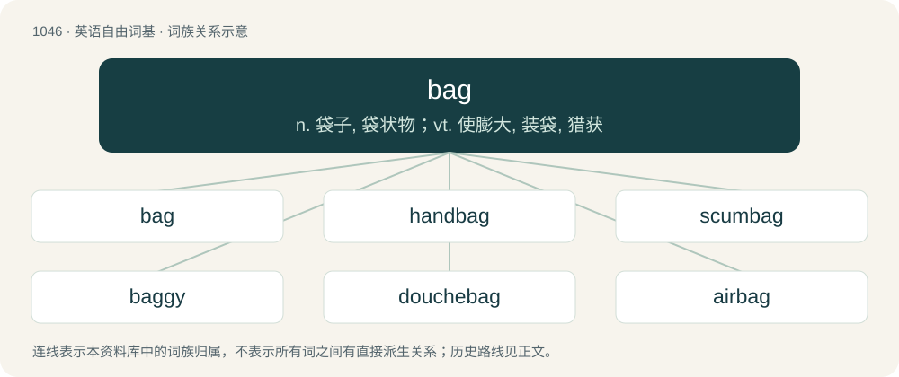

# 1128 · bag — n. 袋子, 袋状物；vt. 使膨大, 装袋, 猎获

[总目录](../00_总目录_按常用程度.md)

**类型**：英语自由词基　｜　**来源语言**：见词源记录

## 核心含义与来源

- 核心含义：n. 袋子, 袋状物；vt. 使膨大, 装袋, 猎获
- 英文含义：A soft container made out of cloth, paper, thin plastic, etc. and open at the top, used to hold food, commodities, and other goods.
- 词形：bag

**来源记录 1**（名词；A soft container made out of cloth, paper, thin plastic, etc. and open at the top, used to hold food, commodities, and other goods.）

Inherited from Middle English bagge, from Old Norse baggi (“bag, pack, satchel, bundle”) (whence also Old French bague (“bundle, package, sack”)); related to Old Norse bǫggr (“harm, shame; load, burden”), of uncertain origin.

## 词族图

## 单词速览（常用到不常用）

| 单词 | 音标 | 释义 |
|---|---|---|
| [bag](#w-1) | 英 /bæɡ/；/beɪ̯ɡ/ | n. 袋子, 袋状物；vt. 使膨大, 装袋, 猎获 |
| [handbag](#w-2) | 英 /ˈhændˌbæɡ/ | n. 手提包 |
| [scumbag](#w-3) | 美 /ˈskʌmˌbæɡ/ | n. &lt;俚&gt;避孕套, 卑鄙的家伙 |
| [baggy](#w-4) | /ˈbæɡi/ | a. 袋状的, 松垂的 |
| [douchebag](#w-5) | /ˈduːʃˌbæɡ/ | 人渣；变态 |
| [airbag](#w-6) | /ˈeəbæ^/ | \[机\] 空气囊 |
| [bagpipes](#w-7) | /ˈbæɡˌpaɪps/ | n. 风笛 |
| [dirtbag](#w-8) | /ˈdɜɹtbaɡ/ | n. 人渣 |
| [bagger](#w-9) | 英 /ˈbæɡə/；美 /ˈbæɡɚ/ | n. 装袋工, 装袋机；\[化\] 装水胎机; 装囊机; 装袋机 |
| [sandbag](#w-10) | 美 /ˈsændˌbæɡ/ | n. 沙袋；vt. 堆沙袋于, 用沙袋打 |
| [beanbag](#w-11) | /ˈbiːnbæɡ/ | n. 豆子袋(儿童投掷游戏用) |
| [baggie](#w-12) | /ˈbæɡi/ | 垃圾袋 |
| [shitbag](#w-13) |  | 【英文】A colostomy bag. |
| [teabag](#w-14) | /ˈtiː(ˌ)bæɡ/ | n. 袋装茶叶 |
| [bagman](#w-15) | /ˈbægmən/ | n. 推销员, 中间人 |
| [mailbag](#w-16) | 美 /ˈmeɪlˌbæɡ/ | n. 邮袋 |

## 逐词详解

### 1. bag

**词性**：名词　｜　**音标**：英 /bæɡ/；/beɪ̯ɡ/

**中文释义**：n. 袋子, 袋状物；vt. 使膨大, 装袋, 猎获

**英文义项**：A soft container made out of cloth, paper, thin plastic, etc. and open at the top, used to hold food, commodities, and other goods. / A container made of leather, plastic, or other material, usually with a handle or handles, in which you carry personal items, or clothes or other things that you need for travelling. Includes shopping bags, schoolbags, suitcases, briefcases, handbags, backpacks, etc.

**词源与演化**：

Inherited from Middle English bagge, from Old Norse baggi (“bag, pack, satchel, bundle”) (whence also Old French bague (“bundle, package, sack”)); related to Old Norse bǫggr (“harm, shame; load, burden”), of uncertain origin.

**例句**：

> Acid House is not my bag: I prefer the more traditional styles of music.

该用例对应义项：One's preference.

### 2. handbag

**词性**：名词　｜　**音标**：英 /ˈhændˌbæɡ/

**中文释义**：n. 手提包

**英文义项**：A small bag used chiefly by women for carrying various small personal items, sometimes considered as a fashion accessory.

**构词拆分**：hand + bag

**词源与演化**：

From hand + bag. The music genre is named from women dancing around a pile of their handbags in nightclubs. The verb is a reference to Margaret Thatcher's handbag.

**例句**：

> Mary claimed that the handbag had been a present from her husband.

### 3. scumbag

**词性**：名词　｜　**音标**：美 /ˈskʌmˌbæɡ/

**中文释义**：n. &lt;俚&gt;避孕套, 卑鄙的家伙

**英文义项**：A condom. / A sleazy, disreputable, despicable, or otherwise immoral person; a lowlife.

**构词拆分**：scum + bag

**词源与演化**：

From scum + bag; first recorded use 1953.

**例句**：

> Can you believe that scumbag Steve asked to sleep with her before even asking her name?

该用例对应义项：A sleazy, disreputable, despicable, or otherwise immoral person; a lowlife.

### 4. baggy

**词性**：形容词　｜　**音标**：/ˈbæɡi/

**中文释义**：a. 袋状的, 松垂的

**英文义项**：Of clothing, very loose-fitting, so as to hang away from the body. / Of or relating to a British music genre of the 1980s and 1990s, influenced by Madchester and psychedelia and associated with baggy clothing.

**构词拆分**：bag + -y

**词源与演化**：

From bag + -y (adjectival suffix).

**用法示例／搭配（非完整句）**：

> a baggy book

该用例对应义项：Of writing, etc.: overwrought; flabby; having too much padding.

### 5. douchebag

**词性**：名词　｜　**音标**：/ˈduːʃˌbæɡ/

**中文释义**：人渣；变态

**英文义项**：A sterile container for holding fluid used in a vaginal douche. / A jerk or asshole; a mean or rude person; someone seen as being arrogant, snobby or obnoxious.

**构词拆分**：douche + bag

**词源与演化**：

From douche + bag.

**例句**：

> It's fine to help your friends eat healthy, but don't be a douchebag and harass them about it.

该用例对应义项：A jerk or asshole; a mean or rude person; someone seen as being arrogant, snobby or obnoxious.

### 6. airbag

**词性**：名词　｜　**音标**：/ˈeəbæ^/

**中文释义**：\[机\] 空气囊

**英文义项**：A protective system in automobiles in which when a crash occurs, a bag containing nitrogen, formed by the explosive decomposition of sodium azide, quickly inflates in front of the driver or passenger, preventing injury to the head. Side air bags, including the back seat passengers, also prevent injury. / A similar inflated bag used in performing stunts, or for lifting objects in firefighting, etc.

**构词拆分**：air + bag

**词源与演化**：

From air + bag.

**例句**：

> He had to be hospitalized because of an airbag.

### 7. bagpipes

**词性**：名词　｜　**音标**：/ˈbæɡˌpaɪps/

**中文释义**：n. 风笛

**英文义项**：A musical wind instrument possessing a flexible bag inflated by bellows, a double-reed melody pipe and up to four drone pipes; any aerophone that produces sound using air from a reservoir to vibrate enclosed reeds.

**构词拆分**：bag + pipes

**词源与演化**：

From earlier bagpipe, from Middle English bagpipe; equivalent to bag + pipes.

**例句**：

> Bagpipes are traditionally played in most Celtic regions and many former parts of the British Empire.

该用例对应义项：A musical wind instrument possessing a flexible bag inflated by bellows, a double-reed melody pipe and up to four drone pipes; any aerophone that produces sound using air from a reservoir to vibrate enclosed reeds.

### 8. dirtbag

**词性**：名词　｜　**音标**：/ˈdɜɹtbaɡ/

**中文释义**：n. 人渣

**英文义项**：A dirty, grimy, sleazy, or disreputable person. / A poor climber, alpinist, skier or other outdoorsman who lives cheaply, without normal employment, and with few amenities in order to spend as much time on their sport as possible.

**构词拆分**：dirt + bag

**词源与演化**：

From dirt + bag.

### 9. bagger

**词性**：名词　｜　**音标**：英 /ˈbæɡə/；美 /ˈbæɡɚ/

**中文释义**：n. 装袋工, 装袋机；\[化\] 装水胎机; 装囊机; 装袋机

**英文义项**：One who bags. / A retail employee who bags customers' purchases and carries them to the customers' vehicles.

**构词拆分**：bag + -er (agent noun suffix)

**词源与演化**：

Inherited from Middle English bagger, baggere, baggare, equivalent to bag + -er (agent noun suffix).

### 10. sandbag

**词性**：动词　｜　**音标**：美 /ˈsændˌbæɡ/

**中文释义**：n. 沙袋；vt. 堆沙袋于, 用沙袋打

**英文义项**：To construct a barrier of sandbags (around). / To strike (someone) with a sandbag or other object to disable or render unconscious.

**构词拆分**：sand + bag

**词源与演化**：

From sand + bag.

### 11. beanbag

**词性**：名词　｜　**音标**：/ˈbiːnbæɡ/

**中文释义**：n. 豆子袋(儿童投掷游戏用)

**英文义项**：A small cloth bag filled with drybeans, used as a toy or for exercising the hands. / A type of juggling ball usually made from leather or cloth stuffed with dry beans.

**构词拆分**：bean + bag

**词源与演化**：

From bean + bag.

**例句**：

> Tom sat in his beanbag chair.

### 12. baggie

**词性**：名词　｜　**音标**：/ˈbæɡi/

**中文释义**：垃圾袋

**英文义项**：A small bag, especially a small, clear, plastic bag.

**构词拆分**：bag + -ie

**词源与演化**：

From bag + -ie (diminutive suffix).

**例句**：

> I need a baggie to put my phone in while I'm in the bath.

### 13. shitbag

**词性**：名词

**英文义项**：A colostomy bag. / A worthless or despicable person.

**构词拆分**：shit + bag

**词源与演化**：

From shit + bag. Sense 2 was dysphemistically modelled after scumbag.

### 14. teabag

**词性**：名词　｜　**音标**：/ˈtiː(ˌ)bæɡ/

**中文释义**：n. 袋装茶叶

**英文义项**：A cloth or paper sachet containing tea leaves or herbal tea, designed to act as an infuser when submerged in hot water.

**构词拆分**：tea + bag

**词源与演化**：

From tea + bag.

**例句**：

> He put the teabag on the saucer.

### 15. bagman

**词性**：名词　｜　**音标**：/ˈbægmən/

**中文释义**：n. 推销员, 中间人

**英文义项**：A person who collects, transports, or distributes illicit money, especially for the purpose of bribery, extortion, or the making of other improper payments. / A caddy.

**构词拆分**：bag + -man

**词源与演化**：

From bag + -man.

### 16. mailbag

**词性**：名词　｜　**音标**：美 /ˈmeɪlˌbæɡ/

**中文释义**：n. 邮袋

**英文义项**：A strong canvas bag used for the transportation of mail. / A smaller bag, slung from the shoulder, used by a mail carrier during the delivery of mail.

**构词拆分**：mail + bag

**词源与演化**：

From mail + bag.

**例句**：

> In our mailbag this month, we've got no less than 12 letters from those of you who think that Jones should not have been benched.

该用例对应义项：The correspondence received by a publishing entity such as a magazine or website.
