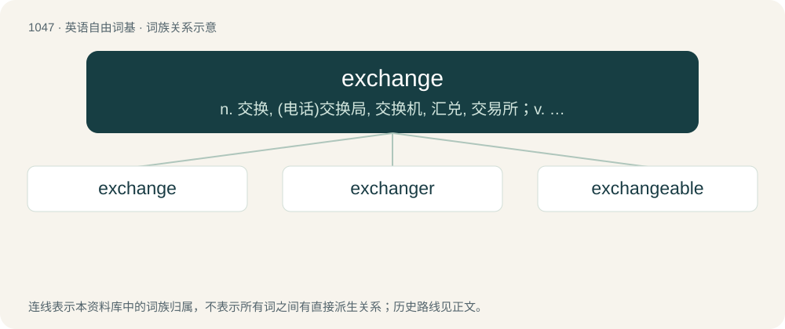

# 1129 · exchange — n. 交换, (电话)交换局, 交换机, 汇兑, 交易所；v. 交换, 交易, 兑换；\[计\] 交换; 电话局

[总目录](../00_总目录_按常用程度.md)

**类型**：英语自由词基　｜　**来源语言**：见词源记录

## 核心含义与来源

- 核心含义：n. 交换, (电话)交换局, 交换机, 汇兑, 交易所；v. 交换, 交易, 兑换；\[计\] 交换; 电话局
- 英文含义：An act of exchanging or trading.
- 词形：exchange

**多个词源／构词路径**：同一拼写可能有不同来源；以下按词性和含义分别列出。

**来源记录 1**（名词；An act of exchanging or trading.）

From Middle English eschaunge, borrowed from Anglo-Norman eschaunge, from Old French eschange (whence modern French échange), from the verb eschanger, from Vulgar Latin \*excambiāre (from Latin ex with Late Latin cambiō). Spelling later changed on the basis of ex-, with pronunciation following. By surface analysis, ex- + change.

**来源记录 2**（动词；To trade or barter.）

From Middle English eschaungen, from Anglo-Norman eschaungier, Old French eschanger, from the Old French verb eschangier, eschanger (whence modern French échanger), from Vulgar Latin \*excambiāre (from Latin ex with Late Latin cambiō). Gradually displaced native Old English wrixlan, wixlan (“to change, exchange, reciprocate”) and its descendants, wrixle being one of them.

## 词族图

## 单词速览（常用到不常用）

| 单词 | 音标 | 释义 |
|---|---|---|
| [exchange](#w-1) | /ɛksˈt͡ʃeɪnd͡ʒ/ | n. 交换, (电话)交换局, 交换机, 汇兑, 交易所；v. 交换, 交易, 兑换；\[计\] 交换; 电话局 |
| [exchanger](#w-2) | /iksˈtʃeindʒə/ | n. 交换器；\[计\] 交换程序, 交换器 |
| [exchangeable](#w-3) | /iksˈtʃeindʒəbl/ | a. 可交换的, 可兑换的, 可替换的 |

## 逐词详解

### 1. exchange

**词性**：名词　｜　**音标**：/ɛksˈt͡ʃeɪnd͡ʒ/

**中文释义**：n. 交换, (电话)交换局, 交换机, 汇兑, 交易所；v. 交换, 交易, 兑换；\[计\] 交换; 电话局

**英文义项**：An act of exchanging or trading. / A place for conducting trading.

**词源与演化**：

From Middle English eschaunge, borrowed from Anglo-Norman eschaunge, from Old French eschange (whence modern French échange), from the verb eschanger, from Vulgar Latin \*excambiāre (from Latin ex with Late Latin cambiō). Spelling later changed on the basis of ex-, with pronunciation following. By surface analysis, ex- + change.

**例句**：

> NPA-NXX-1234 is standard format, where NPA is the area code and NXX is the exchange.

该用例对应义项：The portion of a telephone number that represents (or formerly represented) a central office.

### 2. exchanger

**词性**：名词　｜　**音标**：/iksˈtʃeindʒə/

**中文释义**：n. 交换器；\[计\] 交换程序, 交换器

**英文义项**：A person or thing that exchanges one thing for another. / An antiporter.

**构词拆分**：From exchange + -er.

**词源与演化**：

From exchange + -er.

**例句**：

> You can download the instruction manual for the heat exchanger here.

### 3. exchangeable

**词性**：形容词　｜　**音标**：/iksˈtʃeindʒəbl/

**中文释义**：a. 可交换的, 可兑换的, 可替换的

**英文义项**：Able to be exchanged. / Having an associated right to be exchanged for another form of financial security.

**构词拆分**：exchange + -able

**词源与演化**：

From exchange + -able.

**例句**：

> This garment is exchangeable within three days.
