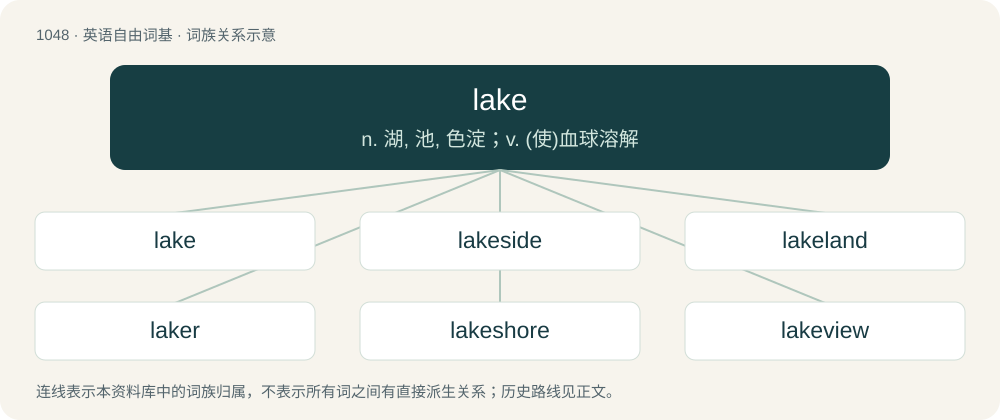

# 1130 · lake — n. 湖, 池, 色淀；v. (使)血球溶解

[总目录](../00_总目录_按常用程度.md)

**类型**：英语自由词基　｜　**来源语言**：见词源记录

## 核心含义与来源

- 核心含义：n. 湖, 池, 色淀；v. (使)血球溶解
- 英文含义：A large, landlocked stretch of water or similar liquid.
- 词形：lake

**多个词源／构词路径**：同一拼写可能有不同来源；以下按词性和含义分别列出。

**来源记录 1**（名词；A large, landlocked stretch of water or similar liquid.）

Arose from a conflation of \* Middle English lake (“small stream of running water, pool, lake”), from Old English lacu (“stream, pool, pond, lake”), from Proto-West Germanic \*laku, from Proto-Germanic \*lakō (“stream, pool, body of water", originally "a place where water runs off and collects”), ultimately from Proto-Indo-European \*leg- (“to leak, drain”); with \* Middle English lac (“lake”), from Old French lac (“lake, ditch, pit”), a borrowed term, likely from Latin lacus (“lake, tub, vat”) (see Old French lac for more). The first element is related to Dutch laak (“stream, drainage ditch, pond”), German Low German Lake, Laak (“drainage, marshland”), German Lache (“puddle, pool”), Norwegian løk (“a deep, slow-moving stream; a widening in a stream or river”), Faroese løkur (“small brook”) and lækja (“water hole, well, watershoot in a brook”), Icelandic lækur (“stream”). Despite their similarity in form and meaning, Old English lacu is not related to English lay (“lake”), Latin lacus (“hollow, lake, pond”), Scottish Gaelic loch (“lake”), Ancient Greek λάκκος (lákkos, “waterhole, tank, pond, pit”), all from Proto-Indo-European \*lókus, \*l̥kwés (“lake, pool”).

**来源记录 2**（名词；Play; sport; game; fun; glee.）

From Northern Middle English lake, lak, lac (also laik, layke; Southern loke), from Old English lāc (“play, sport, strife, battle, sacrifice, offering, gift, present, booty, message”), from Proto-West Germanic \*laik, from Proto-Germanic \*laikaz (“game, dance, hymn, sport”), from Proto-Indo-European \*leyg- (“to bounce, shake, tremble”). Cognate with Old High German leih (“song, melody, music”), Old Norse leikr (whence Danish leg (“game”), Swedish leka (“to play”)), and Gothic 𐌻𐌰𐌹𐌺𐍃 (laiks, “dance”). Doublet of lek. Verb form partly from Middle English laken, from Old English lacan, from Proto-Germanic \*laikaną, from Proto-Indo-European \*leyg-. More at lay, -lock.

**来源记录 3**（名词；In dyeing and painting, an often fugitive crimson or vermilion pigment derived from an organic colorant (cochineal or madder, for example) and an inorganic, generally metallic mordant.）

From French laque (“lacquer”), from Persian لاک (lâk), from Hindi लाख (lākh), from Sanskrit लाक्षा (lākṣā). Doublet of lac and lacquer.

## 词族图

## 单词速览（常用到不常用）

| 单词 | 音标 | 释义 |
|---|---|---|
| [lake](#w-1) | 英 /leɪk/ | n. 湖, 池, 色淀；v. (使)血球溶解 |
| [lakeside](#w-2) | 美 /ˈleɪkˌsaɪd/ | n. 湖边 |
| [lakeland](#w-3) |  | 【英文】Terrain with many lakes. |
| [laker](#w-4) | /ˈleɪkə(ɹ)/ | 【英文】One engaged in sport; a player; an actor. |
| [lakeshore](#w-5) | 英 /ˈleɪk.ʃɔː/；美 /ˈleɪk.ʃɔɹ/ | n. 湖岸 |
| [lakeview](#w-6) |  | \[地名\] \[美国\] 莱克维尤 |
| [lakefront](#w-7) | 美 /ˈleɪkˌfɹʌnt/ | n. 湖边平地, 湖边, 湖畔 |

## 逐词详解

### 1. lake

**词性**：名词　｜　**音标**：英 /leɪk/

**中文释义**：n. 湖, 池, 色淀；v. (使)血球溶解

**英文义项**：A large, landlocked stretch of water or similar liquid. / A large amount of liquid.

**词源与演化**：

Arose from a conflation of \* Middle English lake (“small stream of running water, pool, lake”), from Old English lacu (“stream, pool, pond, lake”), from Proto-West Germanic \*laku, from Proto-Germanic \*lakō (“stream, pool, body of water", originally "a place where water runs off and collects”), ultimately from Proto-Indo-European \*leg- (“to leak, drain”); with \* Middle English lac (“lake”), from Old French lac (“lake, ditch, pit”), a borrowed term, likely from Latin lacus (“lake, tub, vat”) (see Old French lac for more). The first element is related to Dutch laak (“stream, drainage ditch, pond”), German Low German Lake, Laak (“drainage, marshland”), German Lache (“puddle, pool”), Norwegian løk (“a deep, slow-moving stream; a widening in a stream or river”), Faroese løkur (“small brook”) and lækja (“water hole, well, watershoot in a brook”), Icelandic lækur (“stream”). Despite their similarity in form and meaning, Old English lacu is not related to English lay (“lake”), Latin lacus (“hollow, lake, pond”), Scottish Gaelic loch (“lake”), Ancient Greek λάκκος (lákkos, “waterhole, tank, pond, pit”), all from Proto-Indo-European \*lókus, \*l̥kwés (“lake, pool”).

**用法示例／搭配（非完整句）**：

> a lake of wine

该用例对应义项：A large amount of liquid.

### 2. lakeside

**词性**：名词　｜　**音标**：美 /ˈleɪkˌsaɪd/

**中文释义**：n. 湖边

**英文义项**：The ground near the edge of a lake; the land adjacent to a lake.

**构词拆分**：lake + -side

**词源与演化**：

From lake + -side.

**例句**：

> We put up at a lakeside hotel for the night.

### 3. lakeland

**词性**：名词

**英文义项**：Terrain with many lakes.

**构词拆分**：lake + land

**词源与演化**：

From lake + land.

### 4. laker

**词性**：名词　｜　**音标**：/ˈleɪkə(ɹ)/

**英文义项**：One engaged in sport; a player; an actor.

**构词拆分**：lake (“play, sport”) + -er

**词源与演化**：

From Middle English \*lakere, \*leikere, from Middle English laken, leiken (“to play, sport”), equivalent to lake (“play, sport”) + -er. More at lake.

### 5. lakeshore

**词性**：名词　｜　**音标**：英 /ˈleɪk.ʃɔː/；美 /ˈleɪk.ʃɔɹ/

**中文释义**：n. 湖岸

**英文义项**：The shore of a lake.

**构词拆分**：lake + shore

**词源与演化**：

From lake + shore.

### 6. lakeview

**词性**：形容词

**中文释义**：\[地名\] \[美国\] 莱克维尤

**英文义项**：Affording a view over a lake.

**构词拆分**：lake + view

**词源与演化**：

From lake + view.

### 7. lakefront

**词性**：形容词　｜　**音标**：美 /ˈleɪkˌfɹʌnt/

**中文释义**：n. 湖边平地, 湖边, 湖畔

**英文义项**：Adjacent to a lake. Usually used to describe real estate.

**构词拆分**：lake + front

**词源与演化**：

From lake + front.

**例句**：

> Lakefront property is very expensive because many people want access to the water for recreation.

该用例对应义项：Adjacent to a lake. Usually used to describe real estate.
