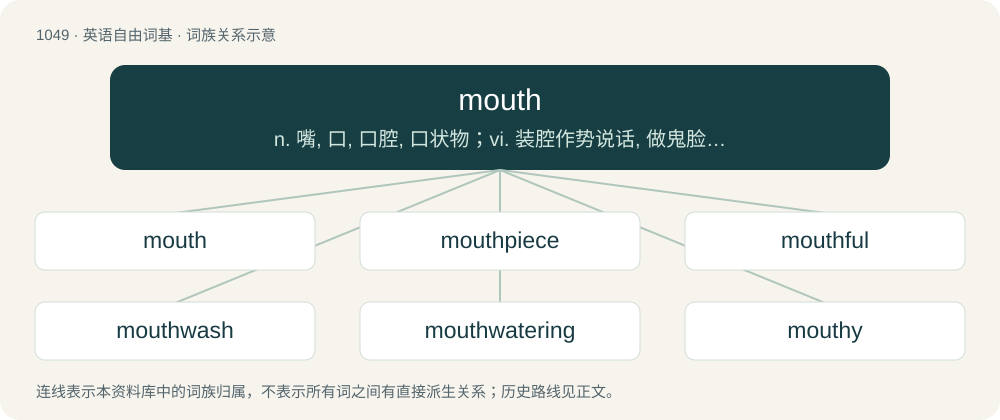

# 1131 · mouth — n. 嘴, 口, 口腔, 口状物；vi. 装腔作势说话, 做鬼脸；vt. 说出, 做作地说

[总目录](../00_总目录_按常用程度.md)

**类型**：英语自由词基　｜　**来源语言**：见词源记录

## 核心含义与来源

- 核心含义：n. 嘴, 口, 口腔, 口状物；vi. 装腔作势说话, 做鬼脸；vt. 说出, 做作地说
- 英文含义：The front opening of a creature through which food is ingested.
- 词形：mouth

**来源记录 1**（名词；The front opening of a creature through which food is ingested.）

From Middle English mouth, from Old English mūþ, from Proto-West Germanic \*munþ, from Proto-Germanic \*munþaz (“mouth”), from Proto-Indo-European \*ment- (“to chew; jaw, mouth”). Cognate with Scots mooth (“mouth”), North Frisian mös, müs, Mür (“mouth”), West Frisian mûn (“mouth”), Dutch mond (“mouth”), muide (“river mouth”) and mui (“riptide”), German Mund (“mouth”), Luxembourgish Mond (“mouth”), Danish mund (“mouth”), Faroese muður, munnur (“mouth”), Icelandic munnur (“mouth”), Swedish mun (“mouth”), Norwegian Bokmål and Norwegian Nynorsk munn (“mouth”), Gothic 𐌼𐌿𐌽𐌸𐍃 (munþs, “mouth”), Latin mentum (“chin”) and mandō (“to chew”), Ancient Greek μάσταξ (mástax, “jaws, mouth”) and μασάομαι (masáomai, “to chew”), Albanian mjekër (“chin, beard”), Welsh mant (“jawbone”), Hittite 𒈨𒂊𒉌𒄿 (me-e-ni-i /⁠mēni⁠/, “face, cheek”). The verb is from Middle English mouthen, from the noun.

## 词族图

## 单词速览（常用到不常用）

| 单词 | 音标 | 释义 |
|---|---|---|
| [mouth](#w-1) | /maʊθ/ | n. 嘴, 口, 口腔, 口状物；vi. 装腔作势说话, 做鬼脸；vt. 说出, 做作地说 |
| [mouthpiece](#w-2) | /ˈmaʊθˌpiːs/ | n. 发话筒, 代言人, (电话)送话口；\[机\] 钳口垫片 |
| [mouthful](#w-3) | /ˈmaʊθfʊl/ | n. 一口, 满口 |
| [mouthwash](#w-4) | /ˈmajθwɔʃ/ | n. 漱口剂, 洗口药 |
| [mouthwatering](#w-5) | /ˈmaʊðwɔːtərɪŋ/ | a. 令人垂涎的 |
| [mouthy](#w-6) | /ˈmauði/ | a. 说大话的, 大声叫嚣的, 多嘴的 |
| [loudmouth](#w-7) | /ˈlaʊdˌmaʊθ/ | n. 咭咭呱呱说个不停的人, 多嘴的人 |
| [largemouth](#w-8) | /ˈlɑːdʒmajθ/ | bass,large-mouthed\[-maJTd\](black)bass\[鱼\]黑鲈 |
| [mouthfeel](#w-9) | 美 /ˈmaʊθˌfil/ | n. （进食者对食品的）口觉, 口感 |
| [smallmouth](#w-10) | /ˈsmɔː lmajθ/ | n. \[鱼\]小口黑鲈 |
| [cottonmouth](#w-11) | /ˈkɔtən.mauθ/ | n. 棉口蛇；水腹蛇；噬鱼蝮蛇（等于water moccasin） |
| [mouthguard](#w-12) |  | = gumshield |

## 逐词详解

### 1. mouth

**词性**：名词　｜　**音标**：/maʊθ/

**中文释义**：n. 嘴, 口, 口腔, 口状物；vi. 装腔作势说话, 做鬼脸；vt. 说出, 做作地说

**英文义项**：The front opening of a creature through which food is ingested. / The end of a river out of which water flows into a sea or other large body of water; or the end of a tributary out of which water flows into a larger river.

**词源与演化**：

From Middle English mouth, from Old English mūþ, from Proto-West Germanic \*munþ, from Proto-Germanic \*munþaz (“mouth”), from Proto-Indo-European \*ment- (“to chew; jaw, mouth”). Cognate with Scots mooth (“mouth”), North Frisian mös, müs, Mür (“mouth”), West Frisian mûn (“mouth”), Dutch mond (“mouth”), muide (“river mouth”) and mui (“riptide”), German Mund (“mouth”), Luxembourgish Mond (“mouth”), Danish mund (“mouth”), Faroese muður, munnur (“mouth”), Icelandic munnur (“mouth”), Swedish mun (“mouth”), Norwegian Bokmål and Norwegian Nynorsk munn (“mouth”), Gothic 𐌼𐌿𐌽𐌸𐍃 (munþs, “mouth”), Latin mentum (“chin”) and mandō (“to chew”), Ancient Greek μάσταξ (mástax, “jaws, mouth”) and μασάομαι (masáomai, “to chew”), Albanian mjekër (“chin, beard”), Welsh mant (“jawbone”), Hittite 𒈨𒂊𒉌𒄿 (me-e-ni-i /⁠mēni⁠/, “face, cheek”). The verb is from Middle English mouthen, from the noun.

**例句**：

> The mouth of the river is a good place to go birdwatching in spring and autumn.

该用例对应义项：The end of a river out of which water flows into a sea or other large body of water; or the end of a tributary out of which water flows into a larger river.

### 2. mouthpiece

**词性**：名词　｜　**音标**：/ˈmaʊθˌpiːs/

**中文释义**：n. 发话筒, 代言人, (电话)送话口；\[机\] 钳口垫片

**英文义项**：The part of a telephone that is held close to the mouth. / The part of a wind instrument that is held in or against the mouth.

**构词拆分**：mouth + piece

**词源与演化**：

From mouth + piece.

**例句**：

> The novel's protagonist serves as a mouthpiece for the author's political views.

该用例对应义项：A spokesman; one who speaks on behalf of someone else.

### 3. mouthful

**词性**：名词　｜　**音标**：/ˈmaʊθfʊl/

**中文释义**：n. 一口, 满口

**英文义项**：The amount that will fit in a mouth. / Quite a bit.

**构词拆分**：mouth + -ful

**词源与演化**：

From Middle English mouthful, mouth-full, mouthe full, from Old English \*mūþfull, from Proto-West Germanic \*munþafull, equivalent to mouth + -ful. Compare Dutch mondvol (“mouthful”), German Mundvoll (“mouthful”), Danish mundfuld (“mouthful”), Swedish munfull (“mouthful”), Icelandic munnfylli (“mouthful”). Compare also West Frisian mûlfol (“mouthful”).

**例句**：

> He swallowed a mouthful of sea water when he fell in.

该用例对应义项：The amount that will fit in a mouth.

### 4. mouthwash

**词性**：名词　｜　**音标**：/ˈmajθwɔʃ/

**中文释义**：n. 漱口剂, 洗口药

**英文义项**：A liquid used to clean one's mouth.

**构词拆分**：mouth + wash

**词源与演化**：

From mouth + wash.

**例句**：

> Stop using my mouthwash to make mixed drinks. That's not what it's for.

### 5. mouthwatering

**词性**：形容词　｜　**音标**：/ˈmaʊðwɔːtərɪŋ/

**中文释义**：a. 令人垂涎的

**英文义项**：Causing one to salivate. / That is pleasing to the sense of taste; appetizing.

**构词拆分**：mouth + water

**词源与演化**：

From mouth + watering.

**例句**：

> Bivouac Canteen and Bar offers a variety of mouthwatering dishes, breakfast options, fast food, cocktails, and wine – all in a comfortable, inviting atmosphere.

### 6. mouthy

**词性**：形容词　｜　**音标**：/ˈmauði/

**中文释义**：a. 说大话的, 大声叫嚣的, 多嘴的

**英文义项**：Overly talkative, insolent, and loud. / Of a dog: inclined to bite or nip.

**构词拆分**：mouth + -y (adjectival suffix)

**词源与演化**：

From mouth + -y (adjectival suffix).

### 7. loudmouth

**词性**：名词　｜　**音标**：/ˈlaʊdˌmaʊθ/

**中文释义**：n. 咭咭呱呱说个不停的人, 多嘴的人

**英文义项**：One who talks too much or too loudly, especially in a boastful or self-important manner.

**构词拆分**：loud + mouth

**词源与演化**：

From loud + mouth.

**例句**：

> I hear every word spoken by the loudmouth in the next office.

该用例对应义项：One who talks too much or too loudly, especially in a boastful or self-important manner.

### 8. largemouth

**词性**：形容词　｜　**音标**：/ˈlɑːdʒmajθ/

**中文释义**：bass,large-mouthed\[-maJTd\](black)bass\[鱼\]黑鲈

**英文义项**：Applied to various kinds of fish characterized by a large mouth.

**构词拆分**：large + mouth

**词源与演化**：

From large + mouth.

### 9. mouthfeel

**词性**：名词　｜　**音标**：美 /ˈmaʊθˌfil/

**中文释义**：n. （进食者对食品的）口觉, 口感

**英文义项**：The texture of food, drink, etc. as perceived by the mouth. / The sensations of the tongue when it moves around in the mouth.

**构词拆分**：mouth + feel

**词源与演化**：

From mouth + feel.

**例句**：

> I have a much better mouthfeel since my broken tooth has been repaired.

该用例对应义项：The sensations of the tongue when it moves around in the mouth.

### 10. smallmouth

**词性**：名词　｜　**音标**：/ˈsmɔː lmajθ/

**中文释义**：n. \[鱼\]小口黑鲈

**英文义项**：A species of freshwater bass, Micropterus dolomieu, native to central North America but widely introduced throughout Canada and the United States as a game fish.

**构词拆分**：small + mouth

**词源与演化**：

From small + mouth.

### 11. cottonmouth

**词性**：名词　｜　**音标**：/ˈkɔtən.mauθ/

**中文释义**：n. 棉口蛇；水腹蛇；噬鱼蝮蛇（等于water moccasin）

**英文义项**：An oral dryness often associated with certain medicines and recreational drugs. / A snake, Agkistrodon piscivorus, the water moccasin.

**构词拆分**：cotton + mouth

**词源与演化**：

From cotton + mouth.

**例句**：

> Do you have any gum? I've got really bad cottonmouth.

### 12. mouthguard

**词性**：名词

**中文释义**：= gumshield

**英文义项**：A device that fits into the mouth over one or both arches of the teeth and usually made of plastic. Such devices may protect against injury during sport or fighting or may serve a medical purpose.

**构词拆分**：mouth + guard

**词源与演化**：

From mouth + guard.
