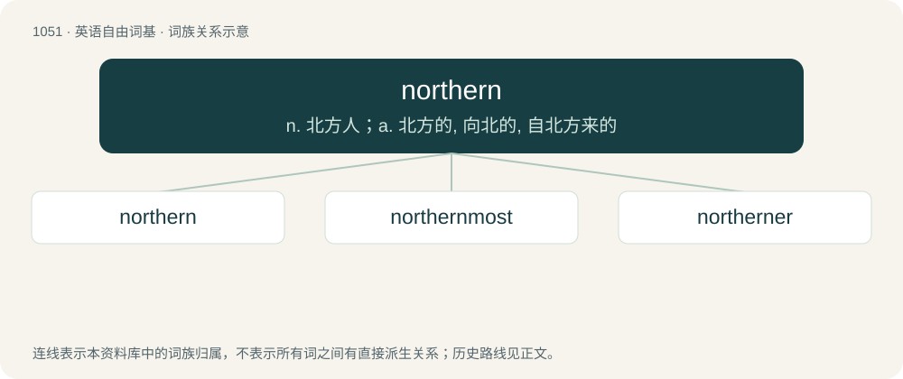

# 1132 · northern — n. 北方人；a. 北方的, 向北的, 自北方来的

[总目录](../00_总目录_按常用程度.md)

**类型**：英语自由词基　｜　**来源语言**：见词源记录

## 核心含义与来源

- 核心含义：n. 北方人；a. 北方的, 向北的, 自北方来的
- 英文含义：Of, facing, situated in, or related to the north; northerly.
- 词形：northern

**来源记录 1**（形容词；Of, facing, situated in, or related to the north; northerly.）

From Middle English northerne, from Old English norþerne, from Proto-West Germanic \*norþrōnī, from Proto-Germanic \*nurþrōnijaz. Cognate with Old High German nordrōni and Old Norse norrœnn. Morphologically north + -ern.

## 词族图

## 单词速览（常用到不常用）

| 单词 | 音标 | 释义 |
|---|---|---|
| [northern](#w-1) | 英 /ˈnɔː.ðən/；美 /ˈnɔɹ.ðɚn/ | n. 北方人；a. 北方的, 向北的, 自北方来的 |
| [northernmost](#w-2) | 英 /ˈnɔː.ðənˌməʊst/；美 /ˈnɔɹ.ðɚnˌmoʊst/ | a. 最北的 |
| [northerner](#w-3) | /ˈnɔːðənə/ | n. 北方人 |

## 逐词详解

### 1. northern

**词性**：形容词　｜　**音标**：英 /ˈnɔː.ðən/；美 /ˈnɔɹ.ðɚn/

**中文释义**：n. 北方人；a. 北方的, 向北的, 自北方来的

**英文义项**：Of, facing, situated in, or related to the north; northerly. / Blowing from the north; northerly.

**构词拆分**：north + -ern

**词源与演化**：

From Middle English northerne, from Old English norþerne, from Proto-West Germanic \*norþrōnī, from Proto-Germanic \*nurþrōnijaz. Cognate with Old High German nordrōni and Old Norse norrœnn. Morphologically north + -ern.

**例句**：

> Les Dawson was a famous northern comedian.

该用例对应义项：Characteristic of the North of England (usually capitalised)

### 2. northernmost

**词性**：形容词　｜　**音标**：英 /ˈnɔː.ðənˌməʊst/；美 /ˈnɔɹ.ðɚnˌmoʊst/

**中文释义**：a. 最北的

**英文义项**：Farthest north.

**构词拆分**：northern + -most

**词源与演化**：

From northern + -most.

**例句**：

> Alaska is the northernmost American state.

该用例对应义项：Farthest north.

### 3. northerner

**词性**：名词　｜　**音标**：/ˈnɔːðənə/

**中文释义**：n. 北方人

**英文义项**：A native or inhabitant of the north of a region (or of the world as a whole), such as one of the northern United States, the north of Norway, etc.

**构词拆分**：northern + -er

**词源与演化**：

From Middle English northerner, equivalent to northern + -er.

**例句**：

> Mary is a northerner. She comes from the Kiel region.
