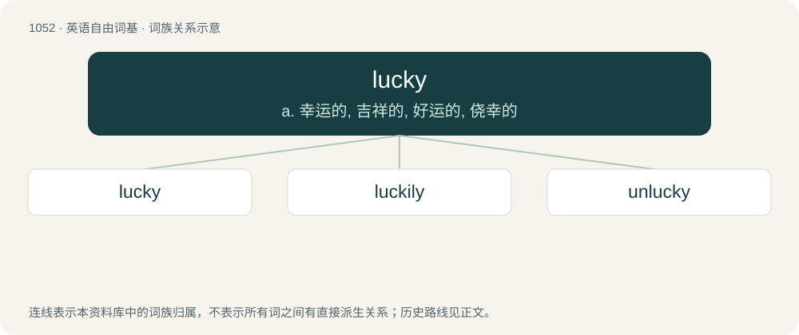

# 1133 · lucky — a. 幸运的, 吉祥的, 好运的, 侥幸的

[总目录](../00_总目录_按常用程度.md)

**类型**：英语自由词基　｜　**来源语言**：见词源记录

## 核心含义与来源

- 核心含义：a. 幸运的, 吉祥的, 好运的, 侥幸的
- 英文含义：Favoured by luck; fortunate; having good success or good fortune.
- 词形：lucky

**来源记录 1**（形容词；Favoured by luck; fortunate; having good success or good fortune.）

From Middle English lukky, equivalent to luck + -y. Cognate with Scots lucky (“lucky”), West Frisian lokkich (“lucky, fortunate”), Dutch gelukkig (“lucky, fortunate, happy”). Compare also Danish lykkelig (“happy”), Swedish lycklig (“happy, lucky”), German glücklich (“happy”), Saterland Frisian glukkelk (“happy”).

## 词族图

## 单词速览（常用到不常用）

| 单词 | 音标 | 释义 |
|---|---|---|
| [lucky](#w-1) | 英 /ˈlʌki/ | a. 幸运的, 吉祥的, 好运的, 侥幸的 |
| [luckily](#w-2) | 英 /ˈlʌk.ɪ.li/ | adv. 幸运地, 幸亏, 侥幸 |
| [unlucky](#w-3) | /ʌnˈlʌki/ | a. 不吉利的, 不祥的, 不幸的 |

## 逐词详解

### 1. lucky

**词性**：形容词　｜　**音标**：英 /ˈlʌki/

**中文释义**：a. 幸运的, 吉祥的, 好运的, 侥幸的

**英文义项**：Favoured by luck; fortunate; having good success or good fortune. / Producing, or resulting in, good fortune

**构词拆分**：luck + -y

**词源与演化**：

From Middle English lukky, equivalent to luck + -y. Cognate with Scots lucky (“lucky”), West Frisian lokkich (“lucky, fortunate”), Dutch gelukkig (“lucky, fortunate, happy”). Compare also Danish lykkelig (“happy”), Swedish lycklig (“happy, lucky”), German glücklich (“happy”), Saterland Frisian glukkelk (“happy”).

**例句**：

> The downed pilot is very lucky to be alive.

该用例对应义项：Favoured by luck; fortunate; having good success or good fortune.

### 2. luckily

**词性**：副词　｜　**音标**：英 /ˈlʌk.ɪ.li/

**中文释义**：adv. 幸运地, 幸亏, 侥幸

**英文义项**：In a lucky manner; by good fortune; fortunately.

**构词拆分**：lucky + -ly

**词源与演化**：

From lucky + -ly.

**例句**：

> They luckily escaped injury.

该用例对应义项：In a lucky manner; by good fortune; fortunately.

### 3. unlucky

**词性**：形容词　｜　**音标**：/ʌnˈlʌki/

**中文释义**：a. 不吉利的, 不祥的, 不幸的

**英文义项**：Unfortunate, marked by misfortune. / Inauspicious.

**构词拆分**：un- + lucky

**词源与演化**：

From un- + lucky.

**例句**：

> The unlucky prisoner was again put in irons.

该用例对应义项：marked by or promising bad fortune
