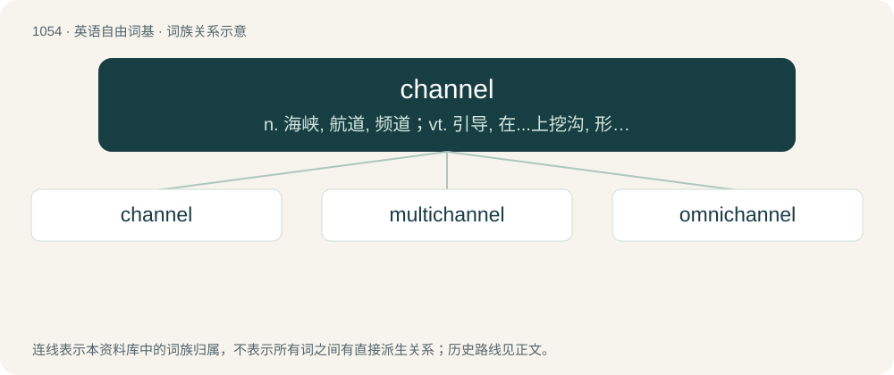

# 1134 · channel — n. 海峡, 航道, 频道；vt. 引导, 在...上挖沟, 形成河道；\[计\] 信道, 通道

[总目录](../00_总目录_按常用程度.md)

**类型**：英语自由词基　｜　**来源语言**：见词源记录

## 核心含义与来源

- 核心含义：n. 海峡, 航道, 频道；vt. 引导, 在...上挖沟, 形成河道；\[计\] 信道, 通道
- 英文含义：The hollow bed of running waters; (also) the bed of the sea or other body of water.
- 词形：channel

**多个词源／构词路径**：同一拼写可能有不同来源；以下按词性和含义分别列出。

**来源记录 1**（名词；The hollow bed of running waters; (also) the bed of the sea or other body of water.）

From Middle English chanel (also as canel, cannel, kanel), a borrowing from Old French chanel, canel, from Latin canālis (“groove; canal; channel”). Doublet of canal.

**来源记录 2**（动词；To make or cut a channel or groove in.）

From Middle English chanelen, from the noun (see above).

**来源记录 3**（名词；The wale of a sailing ship which projects beyond the gunwale and to which the shrouds attach via the chains. One of the flat ledges of heavy plank bolted edgewise to the outside of a vessel, to increase the spread of the shrouds and carry them clear of the bulwarks.）

From chainwale.

## 词族图

## 单词速览（常用到不常用）

| 单词 | 音标 | 释义 |
|---|---|---|
| [channel](#w-1) | 美 /ˈt͡ʃeə̯nəl/；/ˈt͡ʃænəl/ | n. 海峡, 航道, 频道；vt. 引导, 在...上挖沟, 形成河道；\[计\] 信道, 通道 |
| [multichannel](#w-2) | /.mʌltiˈtʃænl/ | a. 多通话线路的, 多波段的；\[电\] 多波道 |
| [omnichannel](#w-3) |  | 【英文】Integrating all physical (offline) and digital contact channels to provide a unified customer experience. |

## 逐词详解

### 1. channel

**词性**：名词　｜　**音标**：美 /ˈt͡ʃeə̯nəl/；/ˈt͡ʃænəl/

**中文释义**：n. 海峡, 航道, 频道；vt. 引导, 在...上挖沟, 形成河道；\[计\] 信道, 通道

**英文义项**：The hollow bed of running waters; (also) the bed of the sea or other body of water. / The natural or man-made deeper course through a reef, bar, bay, or any shallow body of water.

**词源与演化**：

From Middle English chanel (also as canel, cannel, kanel), a borrowing from Old French chanel, canel, from Latin canālis (“groove; canal; channel”). Doublet of canal.

**例句**：

> The water coming out of the waterwheel created a standing wave in the channel.

该用例对应义项：The hollow bed of running waters; (also) the bed of the sea or other body of water.

### 2. multichannel

**词性**：形容词　｜　**音标**：/.mʌltiˈtʃænl/

**中文释义**：a. 多通话线路的, 多波段的；\[电\] 多波道

**英文义项**：That uses multiple channels to process, receive, or transmit signals

**构词拆分**：multi- + channel

**词源与演化**：

From multi- + channel.

### 3. omnichannel

**词性**：形容词

**英文义项**：Integrating all physical (offline) and digital contact channels to provide a unified customer experience.

**构词拆分**：omni- + channel

**词源与演化**：

From omni- + channel.
