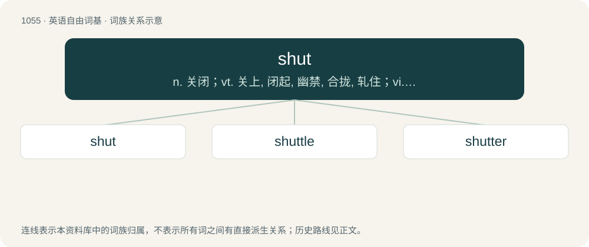

# 1135 · shut — n. 关闭；vt. 关上, 闭起, 幽禁, 合拢, 轧住；vi. 关上, 停止营业

[总目录](../00_总目录_按常用程度.md)

**类型**：英语自由词基　｜　**来源语言**：见词源记录

## 核心含义与来源

- 核心含义：n. 关闭；vt. 关上, 闭起, 幽禁, 合拢, 轧住；vi. 关上, 停止营业
- 英文含义：To remove or block an opening, gap or passage through.
- 词形：shut

**多个词源／构词路径**：同一拼写可能有不同来源；以下按词性和含义分别列出。

**来源记录 1**（动词；To remove or block an opening, gap or passage through.）

From Middle English schitten, schetten, from Old English sċyttan (“to cause rapid movement, shoot a bolt, shut, bolt”), from Proto-West Germanic \*skuttjan, from Proto-Germanic \*skutjaną, \*skuttijaną (“to bar, bolt”), from Proto-Germanic \*skuttą, \*skuttjō (“bar, bolt, shed”), from Proto-Indo-European \*(s)kewd- (“to drive, fall upon, rush”). The Modern English word was originally a dialect form; the Old English word would have normally merged with shit. Cognate with Dutch schutten (“to shut in, lock up”), Low German schütten (“to shut, lock in”), German schützen (“to shut out, dam, protect, guard”).

**来源记录 2**（名词；A narrow alley or passage acting as a short cut through the buildings between two streets.）

Variation of chute or shute (archaic, related to shoot) from Old English scēotan.

## 词族图

## 单词速览（常用到不常用）

| 单词 | 音标 | 释义 |
|---|---|---|
| [shut](#w-1) | /ʃʌt/ | n. 关闭；vt. 关上, 闭起, 幽禁, 合拢, 轧住；vi. 关上, 停止营业 |
| [shuttle](#w-2) | 美 /ˈʃʌtəl/ | n. 穿梭, 梭子, 往返移动之物；v. (使)穿梭移动, 往返运送 |
| [shutter](#w-3) | 英 /ˈʃʌtəː/；/ˈʃʌtɚ/ | n. 百叶窗, 关闭物, 照相机快门, 关闭者；vt. 为...装百叶窗, 以百叶窗遮闭 |

## 逐词详解

### 1. shut

**词性**：动词　｜　**音标**：/ʃʌt/

**中文释义**：n. 关闭；vt. 关上, 闭起, 幽禁, 合拢, 轧住；vi. 关上, 停止营业

**英文义项**：To remove or block an opening, gap or passage through. / To make or become unreceptive.

**词源与演化**：

From Middle English schitten, schetten, from Old English sċyttan (“to cause rapid movement, shoot a bolt, shut, bolt”), from Proto-West Germanic \*skuttjan, from Proto-Germanic \*skutjaną, \*skuttijaną (“to bar, bolt”), from Proto-Germanic \*skuttą, \*skuttjō (“bar, bolt, shed”), from Proto-Indo-European \*(s)kewd- (“to drive, fall upon, rush”). The Modern English word was originally a dialect form; the Old English word would have normally merged with shit. Cognate with Dutch schutten (“to shut in, lock up”), Low German schütten (“to shut, lock in”), German schützen (“to shut out, dam, protect, guard”).

**例句**：

> This app has a bug: when you try to sort a large spreadsheet, it shuts.

该用例对应义项：To terminate an application, window, file or database connection, etc.

### 2. shuttle

**词性**：名词　｜　**音标**：美 /ˈʃʌtəl/

**中文释义**：n. 穿梭, 梭子, 往返移动之物；v. (使)穿梭移动, 往返运送

**英文义项**：A tool used to carry the woof back and forth between the warp threads on a loom. / The sliding thread holder in a sewing machine, which carries the lower thread through a loop of the upper thread, to make a lock stitch.

**构词拆分**：shut + -le

**词源与演化**：

From a merger of two words: \* Middle English shutel, shotel, schetel, schettell, schyttyl, scutel (“bar; bolt”), from Old English sċyttel, sċutel (“bar; bolt”), equivalent to shut + -le \* Middle English shutel, schetil, shotil, shetel, schootyll, shutyll, schytle, scytyl (“missile; projectile; spear”), from Old English sċytel, sċutel (“dart, arrow”), from Proto-Germanic \*skutilaz. The name for a loom weaving instrument, recorded from 1338, is from a sense of being "shot" across the threads. The back-and-forth imagery inspired the extension to "passenger trains" in 1895, aircraft in 1942, and spacecraft in 1969, as well as older terms such as shuttlecock.

**例句**：

> The shuttle bus runs to the airport on a half-hourly basis from the central station.

该用例对应义项：A transport service (such as a bus or train) that goes back and forth between two or more places.

### 3. shutter

**词性**：动词　｜　**音标**：英 /ˈʃʌtəː/；/ˈʃʌtɚ/

**中文释义**：n. 百叶窗, 关闭物, 照相机快门, 关闭者；vt. 为...装百叶窗, 以百叶窗遮闭

**英文义项**：To close shutters covering. / To close up (a building) for a prolonged period of inoccupancy.

**构词拆分**：shut + -er

**词源与演化**：

From shut + -er. Compare shuttle.

**例句**：

> The US is seeking to get Iran to shutter its nuclear weapons program.

该用例对应义项：To cancel or terminate.
