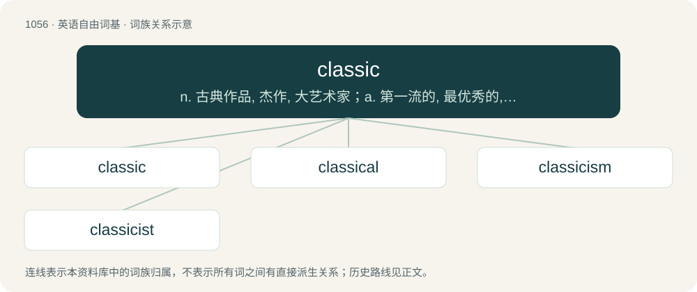

# 1136 · classic — n. 古典作品, 杰作, 大艺术家；a. 第一流的, 最优秀的, 古典的

[总目录](../00_总目录_按常用程度.md)

**类型**：英语自由词基　｜　**来源语言**：见词源记录

## 核心含义与来源

- 核心含义：n. 古典作品, 杰作, 大艺术家；a. 第一流的, 最优秀的, 古典的
- 英文含义：Of or relating to the first class or rank, especially in literature or art.
- 词形：classic

**来源记录 1**（形容词；Of or relating to the first class or rank, especially in literature or art.）

From French classique, from Latin classic(us) (“relating to the classes of Roman citizenry, especially the highest”), from classis. By surface analysis, class + -ic. Piecewise doublet of classy.

## 词族图

## 单词速览（常用到不常用）

| 单词 | 音标 | 释义 |
|---|---|---|
| [classic](#w-1) | 英 /ˈklæsɪk/ | n. 古典作品, 杰作, 大艺术家；a. 第一流的, 最优秀的, 古典的 |
| [classical](#w-2) | 英 /ˈklæs.ɪ.k(ə)l/ | a. 古典的, 正统派的, 经典的；\[医\] 古典的; 标准的, 典型的 |
| [classicism](#w-3) | /ˈklæsisizm/ | n. 古典主义, 古典风格, 古典崇拜, 古典知识, 古典成语 |
| [classicist](#w-4) | 美 /ˈklæsɪsɪst/ | n. 古典学者, 古典主义者 |

## 逐词详解

### 1. classic

**词性**：形容词　｜　**音标**：英 /ˈklæsɪk/

**中文释义**：n. 古典作品, 杰作, 大艺术家；a. 第一流的, 最优秀的, 古典的

**英文义项**：Of or relating to the first class or rank, especially in literature or art. / Exemplary of a particular style; defining a class or category; typical; archetypical; epitomic.

**构词拆分**：By surface analysis, class + -ic

**词源与演化**：

From French classique, from Latin classic(us) (“relating to the classes of Roman citizenry, especially the highest”), from classis. By surface analysis, class + -ic. Piecewise doublet of classy.

**例句**：

> It was classic—the way she slipped on a banana peel while she was telling us all to be careful!

该用例对应义项：Humorously ironic or apposite.

### 2. classical

**词性**：形容词　｜　**音标**：英 /ˈklæs.ɪ.k(ə)l/

**中文释义**：a. 古典的, 正统派的, 经典的；\[医\] 古典的; 标准的, 典型的

**英文义项**：Of or relating to the first class or rank, especially in literature or art. / Of or pertaining to established principles in a discipline.

**构词拆分**：classic + -al + class + -ical + class + -ic + -al；classic + -al；class + -ic + -al

**词源与演化**：

See classic § Etymology for history. By surface analysis, class + -ical or classic + -al or class + -ic + -al

**用法示例／搭配（非完整句）**：

> classical dance

该用例对应义项：Conforming to the best authority in literature and art; chaste; pure; refined

### 3. classicism

**词性**：名词　｜　**音标**：/ˈklæsisizm/

**中文释义**：n. 古典主义, 古典风格, 古典崇拜, 古典知识, 古典成语

**英文义项**：All the classical traditions of the art and architecture of ancient Greece and Rome, especially the aspects of simplicity, elegance and proportion. / Classical scholarship.

**构词拆分**：classic + -ism

**词源与演化**：

From classic + -ism.

**例句**：

> Classicism often derived its models from the ancient Greeks and Romans.

该用例对应义项：a movement in literature and art during the 17th and 18th centuries in Europe that favored rationality and restraint and strict forms

### 4. classicist

**词性**：名词　｜　**音标**：美 /ˈklæsɪsɪst/

**中文释义**：n. 古典学者, 古典主义者

**英文义项**：A classical scholar, especially one who studies ancient Greek and Latin language and culture. / A follower of classicism.

**构词拆分**：classic + -ist

**词源与演化**：

From classic + -ist.
