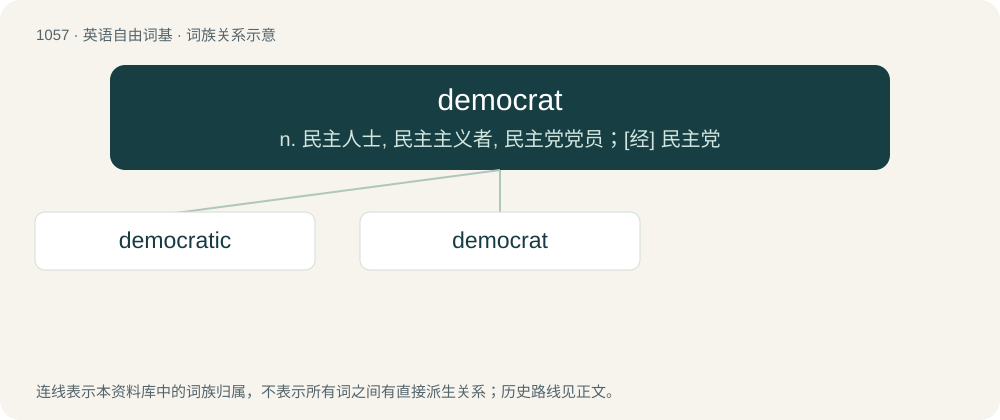

# 1137 · democrat — n. 民主人士, 民主主义者, 民主党党员；\[经\] 民主党

[总目录](../00_总目录_按常用程度.md)

**类型**：英语自由词基　｜　**来源语言**：见词源记录

## 核心含义与来源

- 核心含义：n. 民主人士, 民主主义者, 民主党党员；\[经\] 民主党
- 英文含义：A supporter of democracy; an advocate of democratic politics (originally (historical) as opposed to the aristocrats in Revolutionary France).
- 词形：democrat

**来源记录 1**（名词；A supporter of democracy; an advocate of democratic politics (originally (historical) as opposed to the aristocrats in Revolutionary France).）

From French démocrate, from démocratie (modelled on aristocrate (“aristocrat”)), equivalent to demo- + -crat.

## 词族图

## 单词速览（常用到不常用）

| 单词 | 音标 | 释义 |
|---|---|---|
| [democratic](#w-1) | 英 /ˌdɛməˈkɹætɪk/；美 /ˌdɛməˈkɹætɪk/ | a. 民主的；\[法\] 民主的, 民主政体的, 平民的 |
| [democrat](#w-2) | 英 /ˈdɛməkɹæt/；美 /ˈdɪməkɹæt/ | n. 民主人士, 民主主义者, 民主党党员；\[经\] 民主党 |

## 逐词详解

### 1. democratic

**词性**：形容词　｜　**音标**：英 /ˌdɛməˈkɹætɪk/；美 /ˌdɛməˈkɹætɪk/

**中文释义**：a. 民主的；\[法\] 民主的, 民主政体的, 平民的

**英文义项**：Pertaining to democracy; constructed upon or in line with the principle of government chosen by the people. / Exhibiting social equality; egalitarian.

**构词拆分**：democrat + -ic

**词源与演化**：

From Middle French democratique (“pertaining to democracy, democratic”) (modern French démocratique), and its etymon Late Latin democraticus (“pertaining to democracy, democratic; democrat”), from Ancient Greek δημοκρᾰτῐκός (dēmokrătĭkós, “of or for democracy; favouring or suited for democracy”), from δημοκρᾰτῐ́ᾱ (dēmokrătĭ́ā, “democracy”) + -ῐκός (-ĭkós, suffix with the sense ‘of or pertaining’ to forming adjectives). Δημοκρᾰτῐ́ᾱ (Dēmokrătĭ́ā) is derived from δῆμος (dêmos, “the common people; free citizens, sovereign people; popular assembly; popular government, democracy”) (ultimately from Proto-Indo-European \*deh₂- (“to divide; to share”)) + -κρᾰτῐ́ᾱ (-krătĭ́ā, suffix meaning ‘government; rule’) (from κρᾰ́τος (krắtos, “might, strength; dominion, power”) (ultimately from Proto-Indo-European \*kret- (“insight, intelligence; strength”)) + -ῐ́ᾱ (-ĭ́ā, suffix forming feminine abstract nouns)). By surface analysis, demo- + -cratic or democrat + -ic.

**例句**：

> The United States is a democratic country, as the citizens are allowed to choose leaders to represent their interests.

该用例对应义项：Pertaining to democracy; constructed upon or in line with the principle of government chosen by the people.

### 2. democrat

**词性**：名词　｜　**音标**：英 /ˈdɛməkɹæt/；美 /ˈdɪməkɹæt/

**中文释义**：n. 民主人士, 民主主义者, 民主党党员；\[经\] 民主党

**英文义项**：A supporter of democracy; an advocate of democratic politics (originally (historical) as opposed to the aristocrats in Revolutionary France). / Someone who rules a representative democracy.

**构词拆分**：demo- + -crat

**词源与演化**：

From French démocrate, from démocratie (modelled on aristocrate (“aristocrat”)), equivalent to demo- + -crat.

**例句**：

> I don't support the Democratic Party, but I am a small "d" democrat.
