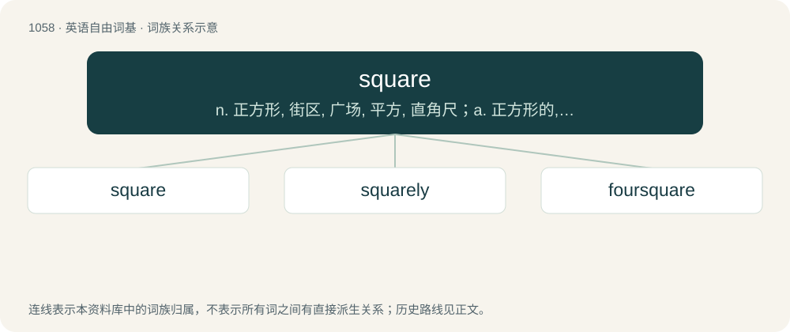

# 1138 · square — n. 正方形, 街区, 广场, 平方, 直角尺；a. 正方形的, 正直的, 公正的, 平方的, 方正的, 结清的；adv. 成直角地, 对准地

[总目录](../00_总目录_按常用程度.md)

**类型**：英语自由词基　｜　**来源语言**：见词源记录

## 核心含义与来源

- 核心含义：n. 正方形, 街区, 广场, 平方, 直角尺；a. 正方形的, 正直的, 公正的, 平方的, 方正的, 结清的；adv. 成直角地, 对准地
- 英文含义：A polygon with four straight sides of equal length and four right angles; an equilateral rectangle; a regular quadrilateral.
- 词形：square

**来源记录 1**（名词；A polygon with four straight sides of equal length and four right angles; an equilateral rectangle; a regular quadrilateral.）

From Middle English square, sqware, squyre; from Old French esquarre, esquerre, (modern French équerre), from Vulgar Latin \*exquadra, from Latin ex- + quadro, from quadrus (compare English quad and quadra). Doublet of squad and squadra. Displaced Old English fēowerecge (fēower nominative + ecg accusative, as in "four-edged").

## 词族图

## 单词速览（常用到不常用）

| 单词 | 音标 | 释义 |
|---|---|---|
| [square](#w-1) | 英 /skwɛə/；美 /skwɛɹ/ | n. 正方形, 街区, 广场, 平方, 直角尺；a. 正方形的, 正直的, 公正的, 平方的, 方正的, 结清的；adv. 成直角地, 对准地 |
| [squarely](#w-2) | 英 /ˈskwɛə(ɹ).li/；美 /ˈskwɛɹ.li/ | adv. 干脆地, 正好, 直角地 |
| [foursquare](#w-3) | 英 /ˈfɔːskwɛː/ | a. 正方形的, 直爽的, 坚定的；adv. 正方形地, 正直地；n. 正方形, 四角 |

## 逐词详解

### 1. square

**词性**：名词　｜　**音标**：英 /skwɛə/；美 /skwɛɹ/

**中文释义**：n. 正方形, 街区, 广场, 平方, 直角尺；a. 正方形的, 正直的, 公正的, 平方的, 方正的, 结清的；adv. 成直角地, 对准地

**英文义项**：A polygon with four straight sides of equal length and four right angles; an equilateral rectangle; a regular quadrilateral. / A cell in a grid.

**词源与演化**：

From Middle English square, sqware, squyre; from Old French esquarre, esquerre, (modern French équerre), from Vulgar Latin \*exquadra, from Latin ex- + quadro, from quadrus (compare English quad and quadra). Doublet of squad and squadra. Displaced Old English fēowerecge (fēower nominative + ecg accusative, as in "four-edged").

**例句**：

> You may not move a piece to a square already occupied by one of your own pieces.

该用例对应义项：A cell in a grid.

### 2. squarely

**词性**：副词　｜　**音标**：英 /ˈskwɛə(ɹ).li/；美 /ˈskwɛɹ.li/

**中文释义**：adv. 干脆地, 正好, 直角地

**英文义项**：In the shape of a square; at right angles. / Firmly and solidly.

**构词拆分**：square + -ly

**词源与演化**：

From square + -ly. First use appears c. 1557 in the writings of Robert Recorde.

**例句**：

> Hit the ball squarely.

该用例对应义项：firmly and solidly

### 3. foursquare

**词性**：形容词　｜　**音标**：英 /ˈfɔːskwɛː/

**中文释义**：a. 正方形的, 直爽的, 坚定的；adv. 正方形地, 正直地；n. 正方形, 四角

**英文义项**：Having four equal sides; square. / Solid, robust.

**构词拆分**：four + square

**词源与演化**：

From Middle English foure square; equivalent to four + square.
