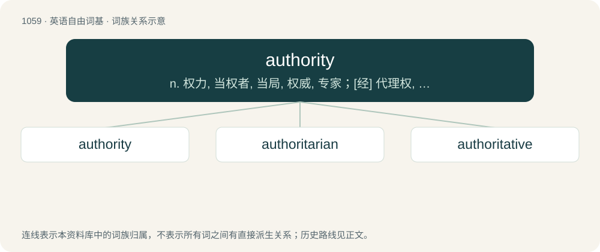

# 1139 · authority — n. 权力, 当权者, 当局, 权威, 专家；\[经\] 代理权, 授权, 权威

[总目录](../00_总目录_按常用程度.md)

**类型**：英语自由词基　｜　**来源语言**：见词源记录

## 核心含义与来源

- 核心含义：n. 权力, 当权者, 当局, 权威, 专家；\[经\] 代理权, 授权, 权威
- 英文含义：Power or right to make or enforce rules, give orders, or impose obligation; or a position having such power or right.
- 词形：authority

**来源记录 1**（名词；Power or right to make or enforce rules, give orders, or impose obligation; or a position having such power or right.）

From Middle English auctorite, autorite (“authority, book or quotation that settles an argument”), from Old French auctorité, from Latin stem of auctōritās (“invention, advice, opinion, influence, command”), from auctor (“master, leader, author”). For the presence of the h, compare the etymology of author.

## 词族图

## 单词速览（常用到不常用）

| 单词 | 音标 | 释义 |
|---|---|---|
| [authority](#w-1) | 英 /ɔːˈθɒɹəti/；美 /əˈθɔɹədi/ | n. 权力, 当权者, 当局, 权威, 专家；\[经\] 代理权, 授权, 权威 |
| [authoritarian](#w-2) | 英 /ɔːˌθɒɹ.ɪˈtɛə̯.ɹɪən/；美 /əˌθɔɹ.əˈtɛɹ.i.ən/ | a. 独裁的, 独裁主义的 |
| [authoritative](#w-3) | 英 /ɔːˈθɒɹɪtətɪv/；美 /əˈθɔɹɪˌteɪtɪv/ | a. 权威性的, 官方的, 命令式的；\[法\] 官方的, 当局的, 权威的 |

## 逐词详解

### 1. authority

**词性**：名词　｜　**音标**：英 /ɔːˈθɒɹəti/；美 /əˈθɔɹədi/

**中文释义**：n. 权力, 当权者, 当局, 权威, 专家；\[经\] 代理权, 授权, 权威

**英文义项**：Power or right to make or enforce rules, give orders, or impose obligation; or a position having such power or right. / Persons, regarded collectively, who occupy official positions of power; police or law enforcement.

**词源与演化**：

From Middle English auctorite, autorite (“authority, book or quotation that settles an argument”), from Old French auctorité, from Latin stem of auctōritās (“invention, advice, opinion, influence, command”), from auctor (“master, leader, author”). For the presence of the h, compare the etymology of author.

**例句**：

> I have the authority to penalise the staff in my department, but not the authority to sack them.

该用例对应义项：Power or right to make or enforce rules, give orders, or impose obligation; or a position having such power or right.

### 2. authoritarian

**词性**：形容词　｜　**音标**：英 /ɔːˌθɒɹ.ɪˈtɛə̯.ɹɪən/；美 /əˌθɔɹ.əˈtɛɹ.i.ən/

**中文释义**：a. 独裁的, 独裁主义的

**英文义项**：Of, or relating to, or exhibiting strict obedience to an authority; favoring authoritarianism over civic and individual liberties. / Demanding obedience to authority; marked by authoritarianism; dictatorial, tyrannical.

**构词拆分**：authority + -arian

**词源与演化**：

From authority + -arian, circa 1880.

**例句**：

> The authoritarian government was demanding stricter laws for low-wage peasants.

该用例对应义项：Demanding obedience to authority; marked by authoritarianism; dictatorial, tyrannical.

### 3. authoritative

**词性**：形容词　｜　**音标**：英 /ɔːˈθɒɹɪtətɪv/；美 /əˈθɔɹɪˌteɪtɪv/

**中文释义**：a. 权威性的, 官方的, 命令式的；\[法\] 官方的, 当局的, 权威的

**英文义项**：Arising or originating from a figure of authority. / Highly accurate or definitive; treated or worthy of treatment as a scholarly authority.

**构词拆分**：authority + -ative

**词源与演化**：

From authorit(y) + -ative.

**例句**：

> The authoritative rules in this school come not from the headmaster but from the aged matron.

该用例对应义项：Arising or originating from a figure of authority.
