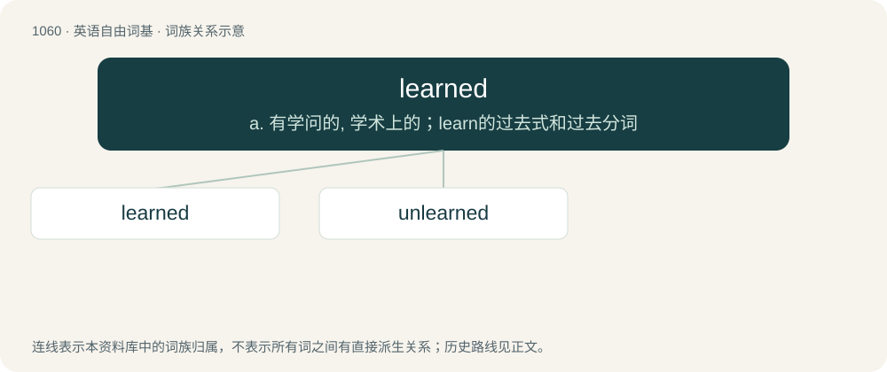

# 1140 · learned — a. 有学问的, 学术上的；learn的过去式和过去分词

[总目录](../00_总目录_按常用程度.md)

**类型**：英语自由词基　｜　**来源语言**：见词源记录

## 核心含义与来源

- 核心含义：a. 有学问的, 学术上的；learn的过去式和过去分词
- 英文含义：Having much learning, knowledgeable, erudite; highly educated.
- 词形：learned

**多个词源／构词路径**：同一拼写可能有不同来源；以下按词性和含义分别列出。

**来源记录 1**（形容词；Having much learning, knowledgeable, erudite; highly educated.）

From Middle English lerned, lernd, lernyd, equivalent to learn + -ed, which replaced the earlier lered (“taught”), from Old English (ġe)lǣred, past participle of lǣran (“to teach”). Learn formerly had the meaning “to teach”, which is now found only in nonstandard speech, as well as its standard meaning of “to learn”.

**来源记录 2**（形容词；Derived from experience; acquired by learning.）

Past participle of learn.

## 词族图

## 单词速览（常用到不常用）

| 单词 | 音标 | 释义 |
|---|---|---|
| [learned](#w-1) | 英 /ˈlɜːnɪd/；美 /ˈlɝnɪd/ | a. 有学问的, 学术上的；learn的过去式和过去分词 |
| [unlearned](#w-2) | 英 /ʌnˈlɜːnɪd/；美 /ʌnˈlɝnɪd/ | a. 无学问的, 未受教育的, 不熟练的；unlearn的过去式和过去分词 |

## 逐词详解

### 1. learned

**词性**：形容词　｜　**音标**：英 /ˈlɜːnɪd/；美 /ˈlɝnɪd/

**中文释义**：a. 有学问的, 学术上的；learn的过去式和过去分词

**英文义项**：Having much learning, knowledgeable, erudite; highly educated. / A courteous description used in various ways to refer to lawyers or judges.

**构词拆分**：learn + -ed

**词源与演化**：

From Middle English lerned, lernd, lernyd, equivalent to learn + -ed, which replaced the earlier lered (“taught”), from Old English (ġe)lǣred, past participle of lǣran (“to teach”). Learn formerly had the meaning “to teach”, which is now found only in nonstandard speech, as well as its standard meaning of “to learn”.

**例句**：

> All I need to know about life, I learned from a snowman.

### 2. unlearned

**词性**：形容词　｜　**音标**：英 /ʌnˈlɜːnɪd/；美 /ʌnˈlɝnɪd/

**中文释义**：a. 无学问的, 未受教育的, 不熟练的；unlearn的过去式和过去分词

**英文义项**：ignorant, uneducated, untaught, untrained.

**构词拆分**：By surface analysis, un- (“not”) + learned (“educated”)

**词源与演化**：

From Middle English unlerned (“not taught, uneducated”). By surface analysis, un- (“not”) + learned (“educated”).

**例句**：

> An unlearned group incapable of understanding complex issues.

该用例对应义项：uneducated in general; lacking knowledge or sophistication
