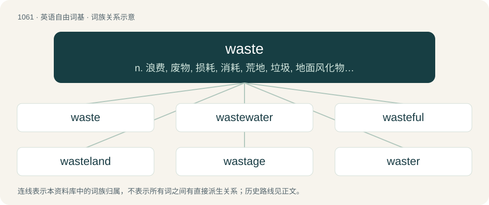

# 1141 · waste — n. 浪费, 废物, 损耗, 消耗, 荒地, 垃圾, 地面风化物；a. 废弃的, 荒芜的, 多余的；vt. 浪费, 消耗, 使荒芜

[总目录](../00_总目录_按常用程度.md)

**类型**：英语自由词基　｜　**来源语言**：见词源记录

## 核心含义与来源

- 核心含义：n. 浪费, 废物, 损耗, 消耗, 荒地, 垃圾, 地面风化物；a. 废弃的, 荒芜的, 多余的；vt. 浪费, 消耗, 使荒芜
- 英文含义：Excess of material, useless by-products, or damaged, unsaleable products; garbage; rubbish.
- 词形：waste

**多个词源／构词路径**：同一拼写可能有不同来源；以下按词性和含义分别列出。

**来源记录 1**（名词；Excess of material, useless by-products, or damaged, unsaleable products; garbage; rubbish.）

From Middle English wast, waste (“a waste”, noun), from Anglo-Norman, Old Northern French wast, waste (“a waste”), from Frankish \*wōstī (“a waste”), from Proto-Germanic \*wōstaz, \*wōstuz, from Proto-Indo-European \*h₁weh₂- (“empty, wasted”). Displaced native Middle English wernen (“to refuse”) likely due to the similar sounding Middle English warnen

**来源记录 2**（形容词；Barren; desert; empty.）

From Middle English wast, waste (“waste”, adjective), from Anglo-Norman, Old Northern French wast (“waste”), from Frankish \*wōstī (“waste, empty”), from Proto-Indo-European \*h₁weh₂- (“empty, wasted”). Cognate with Old High German wuosti, wuasti (“waste, empty”), German wüst, Old Saxon wōsti (“desolate”), Old English wēste (“waste, barren, desolate, empty”).

**来源记录 3**（动词；To devastate; to destroy.）

From Middle English wasten (“to waste, lay waste”), from Anglo-Norman, Old Northern French waster (“to waste, devastate”) (compare also the variant gaster and French gâter from a related Old French word); the Anglo-Norman form waster was either from Frankish \*wōstijan (“to waste”), from Proto-Indo-European \*wāsto- (“empty, wasted”), or alternatively from Latin vastāre and influenced by the Frankish; the English word was assisted by similarity to native Middle English westen ("to waste"; &gt; English weest). Cognate with Old High German wuostan, wuastan, wuostjan (“to waste”) (Modern German wüsten), Old English wēstan (“to lay waste, ravage”). Displaced native Old English essian and strȳndan. Largely overtook Old English forspillan and wēstan.

## 词族图

## 单词速览（常用到不常用）

| 单词 | 音标 | 释义 |
|---|---|---|
| [waste](#w-1) | /ˈweɪ̯st/ | n. 浪费, 废物, 损耗, 消耗, 荒地, 垃圾, 地面风化物；a. 废弃的, 荒芜的, 多余的；vt. 浪费, 消耗, 使荒芜 |
| [wastewater](#w-2) | /ˈweistwɔːtə/ | n. 废水 |
| [wasteful](#w-3) | /ˈweɪstfəl/ | a. 浪费的, 不经济的 |
| [wasteland](#w-4) | 英 /ˈweɪs(t)ˌland/；美 /ˈweɪs(t)ˌlænd/ | n. 荒地, 未开垦地 |
| [wastage](#w-5) | /ˈweɪstɪdʒ/ | n. 浪费, 浪费量, 废物；\[化\] 废物 |
| [waster](#w-6) | 英 /ˈweɪstə/ | n. 造成浪费的人, 造成损坏的人, 挥霍者, 浪子, 无用的人, 废品, 次品；\[化\] 废物 |
| [wastebasket](#w-7) | /ˈweist.bæskit/ | n. 废纸篓；\[计\] 废纸篓 |

## 逐词详解

### 1. waste

**词性**：名词　｜　**音标**：/ˈweɪ̯st/

**中文释义**：n. 浪费, 废物, 损耗, 消耗, 荒地, 垃圾, 地面风化物；a. 废弃的, 荒芜的, 多余的；vt. 浪费, 消耗, 使荒芜

**英文义项**：Excess of material, useless by-products, or damaged, unsaleable products; garbage; rubbish. / Excrement or urine.

**词源与演化**：

From Middle English wast, waste (“a waste”, noun), from Anglo-Norman, Old Northern French wast, waste (“a waste”), from Frankish \*wōstī (“a waste”), from Proto-Germanic \*wōstaz, \*wōstuz, from Proto-Indo-European \*h₁weh₂- (“empty, wasted”). Displaced native Middle English wernen (“to refuse”) likely due to the similar sounding Middle English warnen

**例句**：

> The cage was littered with animal waste.

该用例对应义项：Excrement or urine.

### 2. wastewater

**词性**：名词　｜　**音标**：/ˈweistwɔːtə/

**中文释义**：n. 废水

**英文义项**：Any water that has been used in some human domestic or industrial activity and, as a result, now contains waste products.

**构词拆分**：waste + water

**词源与演化**：

From waste + water.

**例句**：

> Benedito's work has implications for the future of wastewater treatment.

### 3. wasteful

**词性**：形容词　｜　**音标**：/ˈweɪstfəl/

**中文释义**：a. 浪费的, 不经济的

**英文义项**：Inclined to waste or squander money or resources.

**构词拆分**：waste + -ful

**词源与演化**：

From Middle English wastful; equivalent to waste + -ful.

**例句**：

> When wasteful war shall statues overturn.

该用例对应义项：laying waste

### 4. wasteland

**词性**：名词　｜　**音标**：英 /ˈweɪs(t)ˌland/；美 /ˈweɪs(t)ˌlænd/

**中文释义**：n. 荒地, 未开垦地

**英文义项**：A place with no remaining resources; a desert. / Any barren or uninteresting place.

**构词拆分**：waste + land

**词源与演化**：

Inherited from Middle English wast lond, modification of earlier weste lond, from Old English weste land (“wasteland”); equivalent to waste + land.

**例句**：

> After his experiences, he no longer found western Kansas such a wasteland.

该用例对应义项：Any barren or uninteresting place.

### 5. wastage

**词性**：名词　｜　**音标**：/ˈweɪstɪdʒ/

**中文释义**：n. 浪费, 浪费量, 废物；\[化\] 废物

**英文义项**：The amount or proportion of something that is wasted or lost by deterioration or other natural process. / The periodical turnover of personnel in an organisation by death, retirement or resignation, as perceived by those aspiring to promotion or appointment in the organisation.

**构词拆分**：waste + -age

**词源与演化**：

From waste + -age.

**例句**：

> The average wastage is 1.5% in the grocery department.

该用例对应义项：The amount or proportion of something that is wasted or lost by deterioration or other natural process.

### 6. waster

**词性**：名词　｜　**音标**：英 /ˈweɪstə/

**中文释义**：n. 造成浪费的人, 造成损坏的人, 挥霍者, 浪子, 无用的人, 废品, 次品；\[化\] 废物

**英文义项**：Someone or something that wastes; someone who squanders or spends extravagantly. / An imperfection in the wick of a candle, causing it to waste.

**构词拆分**：waste + -er

**词源与演化**：

From Middle English wastere, waister, wastar, wastour, equivalent to waste + -er. Compare Anglo-Norman wastur, Old French gastëor.

**例句**：

> It's easy to give out money when it's not yours. That's why the state is the biggest money waster.

### 7. wastebasket

**词性**：名词　｜　**音标**：/ˈweist.bæskit/

**中文释义**：n. 废纸篓；\[计\] 废纸篓

**英文义项**：A usually small indoor receptacle for items that are to be discarded; a rubbish bin. / Any region or grouping that is worthless or meaningless.

**构词拆分**：waste + basket

**词源与演化**：

From waste + basket.

**例句**：

> Give me the wrapper, so that I can throw it in the wastebasket already.
