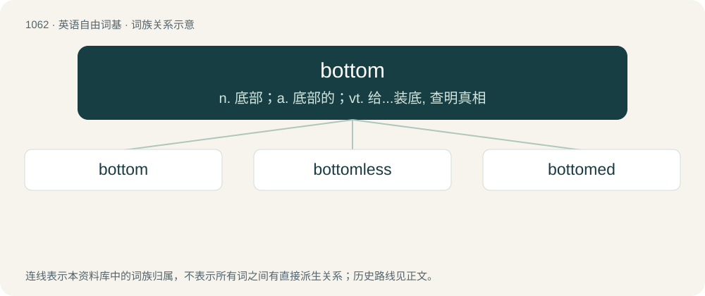

# 1142 · bottom — n. 底部；a. 底部的；vt. 给...装底, 查明真相

[总目录](../00_总目录_按常用程度.md)

**类型**：英语自由词基　｜　**来源语言**：见词源记录

## 核心含义与来源

- 核心含义：n. 底部；a. 底部的；vt. 给...装底, 查明真相
- 英文含义：The lowest part of anything.
- 词形：bottom

**来源记录 1**（名词；The lowest part of anything.）

From Middle English botme, botom, from Old English botm, bodan (“bottom, foundation; ground, abyss”), from Proto-West Germanic \*butm, from Proto-Germanic \*butmaz, \*budmaz (“bottom; ground”), from Proto-Indo-European \*bʰudʰmḗn (“bottom”). Cognates Cognate with Yola bothom, bottom (“bottom”), Saterland Frisian Boudem (“floor; ground”), West Frisian boaiem (“floor; ground”), Dutch bodem, boom, boôm (“bottom; ground, soil”), German Boden (“floor; ground; soil”), Limburgish baom (“bottom; ground, soil”), Luxembourgish Buedem (“bottom; earth, soil”), Vilamovian bödum (“bottom; ground”), Danish bund (“bottom”), Elfdalian buottn (“bottom”), Faroese botnur (“bottom”), Icelandic and Norwegian Nynorsk botn (“bottom”), Norwegian Bokmål botn, bunn (“bottom”), Swedish botten (“bottom”); also Irish and Scottish Gaelic bonn (“base, bottom; sole (of foot)”), Latin fundus (“bottom”) (whence fund, via French), Ancient Greek πυθμήν (puthmḗn, “bottom of a cup or jar; the bottom of the sea; butt of a tree”), Albanian buzë (“rocky chasm”), Armenian անդունդ (andund), անդունդք (andundkʻ, “abyss, chasm”), Northern Kurdish bin (“bottom”), Persian بن (bon, “bottom”), Sanskrit बुध्न (budhna, “bottom”). The noun sense “posterior of a person” is first attested in 1794; the verb sense “to reach the bottom of” is first attested in 1808. The term bottom dollar (“the last dollar one has”) is first attested in 1882.

## 词族图

## 单词速览（常用到不常用）

| 单词 | 音标 | 释义 |
|---|---|---|
| [bottom](#w-1) | 英 /ˈbɒt.əm/；美 /ˈbɑ.təm/ | n. 底部；a. 底部的；vt. 给...装底, 查明真相 |
| [bottomless](#w-2) | 英 /ˈbɒtəm.ləs/；美 /ˈbatəmlɪs/ | a. 无底的, 无限的, 深不可测的, 没有根据的 |
| [bottomed](#w-3) | /ˈbɔtəmd/ | ...底的, 底是...的 |

## 逐词详解

### 1. bottom

**词性**：名词　｜　**音标**：英 /ˈbɒt.əm/；美 /ˈbɑ.təm/

**中文释义**：n. 底部；a. 底部的；vt. 给...装底, 查明真相

**英文义项**：The lowest part of anything. / The lowest or last position in a rank.

**词源与演化**：

From Middle English botme, botom, from Old English botm, bodan (“bottom, foundation; ground, abyss”), from Proto-West Germanic \*butm, from Proto-Germanic \*butmaz, \*budmaz (“bottom; ground”), from Proto-Indo-European \*bʰudʰmḗn (“bottom”). Cognates Cognate with Yola bothom, bottom (“bottom”), Saterland Frisian Boudem (“floor; ground”), West Frisian boaiem (“floor; ground”), Dutch bodem, boom, boôm (“bottom; ground, soil”), German Boden (“floor; ground; soil”), Limburgish baom (“bottom; ground, soil”), Luxembourgish Buedem (“bottom; earth, soil”), Vilamovian bödum (“bottom; ground”), Danish bund (“bottom”), Elfdalian buottn (“bottom”), Faroese botnur (“bottom”), Icelandic and Norwegian Nynorsk botn (“bottom”), Norwegian Bokmål botn, bunn (“bottom”), Swedish botten (“bottom”); also Irish and Scottish Gaelic bonn (“base, bottom; sole (of foot)”), Latin fundus (“bottom”) (whence fund, via French), Ancient Greek πυθμήν (puthmḗn, “bottom of a cup or jar; the bottom of the sea; butt of a tree”), Albanian buzë (“rocky chasm”), Armenian անդունդ (andund), անդունդք (andundkʻ, “abyss, chasm”), Northern Kurdish bin (“bottom”), Persian بن (bon, “bottom”), Sanskrit बुध्न (budhna, “bottom”). The noun sense “posterior of a person” is first attested in 1794; the verb sense “to reach the bottom of” is first attested in 1808. The term bottom dollar (“the last dollar one has”) is first attested in 1882.

**例句**：

> James and Lukas would make a great couple if they weren't both bottoms.

该用例对应义项：A person who has a receptive role or has a preference for that role during intercourse.

### 2. bottomless

**词性**：形容词　｜　**音标**：英 /ˈbɒtəm.ləs/；美 /ˈbatəmlɪs/

**中文释义**：a. 无底的, 无限的, 深不可测的, 没有根据的

**英文义项**：Having no bottom. / Extremely deep.

**构词拆分**：bottom + -less

**词源与演化**：

From Middle English botemles, botmeles, equivalent to bottom + -less. Cognate with West Frisian boaiemleas (“bottomless”), Dutch bodemloos (“bottomless”), German Low German boddenloos (“bottomless”), German bodenlos (“bottomless”), Swedish bottenlös (“bottomless”), Icelandic botnlaus (“bottomless”).

**例句**：

> The restaurant offered bottomless drinks.

该用例对应义项：Having no bounds; limitless.

### 3. bottomed

**词性**：形容词　｜　**音标**：/ˈbɔtəmd/

**中文释义**：...底的, 底是...的

**英文义项**：Having some specified type of bottom.

**构词拆分**：bottom + -ed

**词源与演化**：

From bottom + -ed.

**例句**：

> The Dow plunged 35 points and then bottomed out.
