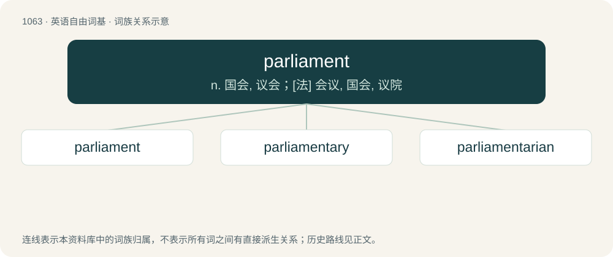

# 1143 · parliament — n. 国会, 议会；\[法\] 会议, 国会, 议院

[总目录](../00_总目录_按常用程度.md)

**类型**：英语自由词基　｜　**来源语言**：见词源记录

## 核心含义与来源

- 核心含义：n. 国会, 议会；\[法\] 会议, 国会, 议院
- 英文含义：In many countries, the legislative branch of government, a deliberative assembly or set of assemblies whose elected or appointed members meet to debate the major political issues of the day, make, amend, and repeal laws, authorize the executive branch of government to collect and spend money, and in some cases exercise judicial powers; a legislature.
- 词形：parliament

**来源记录 1**（名词；In many countries, the legislative branch of government, a deliberative assembly or set of assemblies whose elected or appointed members meet to debate the major political issues of the day, make, amend, and repeal laws, authorize the executive branch of government to collect and spend money, and in some cases exercise judicial powers; a legislature.）

From Middle English parlement, from Anglo-Norman parliament, parlement, parliment and Old French parlement (“discussion, meeting, negotiation; assembly, council”), from parler (“to speak”) + -ment (“-ment”, suffix forming nouns from verbs, usually indicating an action or state resulting from them) (from Latin -mentum). Compare Medieval Latin parlamentum, parliamentum (“discussion, meeting; council or court summoned by the monarch”), Italian parlamento and Sicilian parramentu.

## 词族图

## 单词速览（常用到不常用）

| 单词 | 音标 | 释义 |
|---|---|---|
| [parliament](#w-1) | 英 /ˈpɑːləmənt/；美 /ˈpɑɹləmənt/ | n. 国会, 议会；\[法\] 会议, 国会, 议院 |
| [parliamentary](#w-2) | 英 /ˌpɑːləˈmɛnt(ə)ɹi/；美 /ˌpɑɹləˈmɛnt(ə)ɹi/ | a. 国会的, 议会的, 议会制度的 |
| [parliamentarian](#w-3) | 英 /ˌpɑːləmənˈtɛəɹiən/；美 /ˌpɑɹləmənˈtɛɹiən/ | n. 议会法规专家, 国会议员, 熟悉议会法规而又有经验的议员 |

## 逐词详解

### 1. parliament

**词性**：名词　｜　**音标**：英 /ˈpɑːləmənt/；美 /ˈpɑɹləmənt/

**中文释义**：n. 国会, 议会；\[法\] 会议, 国会, 议院

**英文义项**：In many countries, the legislative branch of government, a deliberative assembly or set of assemblies whose elected or appointed members meet to debate the major political issues of the day, make, amend, and repeal laws, authorize the executive branch of government to collect and spend money, and in some cases exercise judicial powers; a legislature. / A particular assembly of the members of such a legislature, as convened for a specific purpose or period of time (commonly designated with an ordinal number – for example, first parliament or 12th parliament – or a descriptive adjective – for example, Long Parliament, Short Parliament and Rump Parliament).

**词源与演化**：

From Middle English parlement, from Anglo-Norman parliament, parlement, parliment and Old French parlement (“discussion, meeting, negotiation; assembly, council”), from parler (“to speak”) + -ment (“-ment”, suffix forming nouns from verbs, usually indicating an action or state resulting from them) (from Latin -mentum). Compare Medieval Latin parlamentum, parliamentum (“discussion, meeting; council or court summoned by the monarch”), Italian parlamento and Sicilian parramentu.

**例句**：

> This parliament has been more scandal-filled than any other in history.

该用例对应义项：a length of time for which a parliament is summoned, in modern times therefore the period between two consecutive elections.

### 2. parliamentary

**词性**：形容词　｜　**音标**：英 /ˌpɑːləˈmɛnt(ə)ɹi/；美 /ˌpɑɹləˈmɛnt(ə)ɹi/

**中文释义**：a. 国会的, 议会的, 议会制度的

**英文义项**：Of, relating to, or enacted by a parliament. / Having the supreme executive and legislative power resting with a cabinet of ministers chosen from, and responsible to a parliament.

**构词拆分**：parliament + -ary

**词源与演化**：

From parliament + -ary.

**例句**：

> Parliamentary procedures are sometimes slow.

该用例对应义项：Of, relating to, or enacted by a parliament.

### 3. parliamentarian

**词性**：形容词　｜　**音标**：英 /ˌpɑːləmənˈtɛəɹiən/；美 /ˌpɑɹləmənˈtɛɹiən/

**中文释义**：n. 议会法规专家, 国会议员, 熟悉议会法规而又有经验的议员

**英文义项**：Of or relating to a parliament; favouring the establishment of a parliament.

**构词拆分**：parliament + -arian

**词源与演化**：

From parliament + -arian.

**用法示例／搭配（非完整句）**：

> a parliamentarian democracy; the parliamentarian movement

该用例对应义项：Of or relating to a parliament; favouring the establishment of a parliament.
