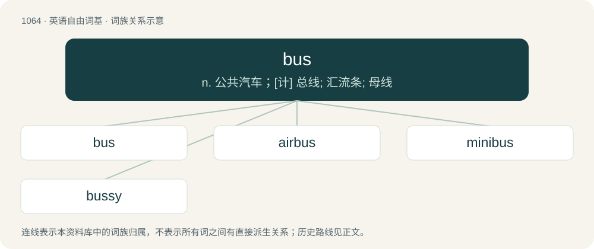

# 1144 · bus — n. 公共汽车；\[计\] 总线; 汇流条; 母线

[总目录](../00_总目录_按常用程度.md)

**类型**：英语自由词基　｜　**来源语言**：见词源记录

## 核心含义与来源

- 核心含义：n. 公共汽车；\[计\] 总线; 汇流条; 母线
- 英文含义：A motor vehicle for transporting large numbers of people along roads.
- 词形：bus

**多个词源／构词路径**：同一拼写可能有不同来源；以下按词性和含义分别列出。

**来源记录 1**（名词；A motor vehicle for transporting large numbers of people along roads.）

Clipping of omnibus. Superseded earlier 'bus, where the apostrophe indicated a clipping. The shift in spelling likely reflects the fact that modern speakers no longer perceive this term as a clipping. The electrical sense is derived from figurative application of the automotive sense.

**来源记录 2**（动词；To clear meal remains from.）

Back-formation from busboy.

## 词族图

## 单词速览（常用到不常用）

| 单词 | 音标 | 释义 |
|---|---|---|
| [bus](#w-1) | /bʌs/ | n. 公共汽车；\[计\] 总线; 汇流条; 母线 |
| [airbus](#w-2) | 美 /ˈeɹ.bʌs/ | 空中客车 |
| [minibus](#w-3) | 美 /ˈmɪ.ni.bəs/ | n. 中客车, 小型公共汽车 |
| [bussy](#w-4) | /ˈbʌsi/ | 【英文】A bus driver. |

## 逐词详解

### 1. bus

**词性**：名词　｜　**音标**：/bʌs/

**中文释义**：n. 公共汽车；\[计\] 总线; 汇流条; 母线

**英文义项**：A motor vehicle for transporting large numbers of people along roads. / A coach, a bus used for long travels.

**词源与演化**：

Clipping of omnibus. Superseded earlier 'bus, where the apostrophe indicated a clipping. The shift in spelling likely reflects the fact that modern speakers no longer perceive this term as a clipping. The electrical sense is derived from figurative application of the automotive sense.

**例句**：

> I can't read on the bus because I get sick.

该用例对应义项：A motor vehicle for transporting large numbers of people along roads.

### 2. airbus

**词性**：名词　｜　**音标**：美 /ˈeɹ.bʌs/

**中文释义**：空中客车

**英文义项**：A subsonic jet airliner, especially a wide-bodied one.

**构词拆分**：air + bus

**词源与演化**：

From air + bus.

### 3. minibus

**词性**：名词　｜　**音标**：美 /ˈmɪ.ni.bəs/

**中文释义**：n. 中客车, 小型公共汽车

**英文义项**：A small bus, especially one used as transport for small groups. / A sixteen-seater vehicle used as a taxi.

**构词拆分**：mini- + bus

**词源与演化**：

From mini- + bus. In the political sense, probably a back-formation from omnibus.

**例句**：

> Yanni was picked up by a minibus.

### 4. bussy

**词性**：名词　｜　**音标**：/ˈbʌsi/

**英文义项**：A bus driver.

**构词拆分**：bus + -y (diminutive suffix)

**词源与演化**：

From bus + -y (diminutive suffix).
