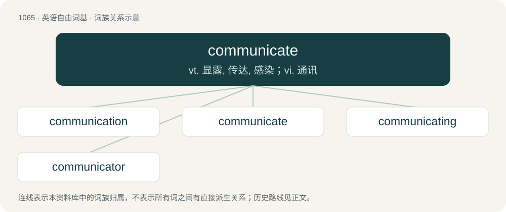

# 1145 · communicate — vt. 显露, 传达, 感染；vi. 通讯

[总目录](../00_总目录_按常用程度.md)

**类型**：英语自由词基　｜　**来源语言**：见词源记录

## 核心含义与来源

- 核心含义：vt. 显露, 传达, 感染；vi. 通讯
- 英文含义：To impart or transmit (information or knowledge) to someone; to make known, to tell.
- 词形：communicate

**来源记录 1**（动词；To impart or transmit (information or knowledge) to someone; to make known, to tell.）

Adapted borrowing of Latin commūnicāt- (past participial stem of commūnicō (“share, impart; make common”)) + -ate (verb-forming suffix), from commūnis (“common”) + -icō. Compare French communiquer and its older (and now obsolete) English cognate from Middle French, communique.

## 词族图

## 单词速览（常用到不常用）

| 单词 | 音标 | 释义 |
|---|---|---|
| [communication](#w-1) | 英 /kəˌmjuː.nɪˈkeɪ.ʃən/；美 /kəˌmju.nɪˈkeɪ.ʃən/ | n. 交流, 交通, 通讯；\[计\] 通信 |
| [communicate](#w-2) | /kəˈmjuːnɪkeɪt/ | vt. 显露, 传达, 感染；vi. 通讯 |
| [communicating](#w-3) | 英 /kəˈmjuː.nɪ.keɪ.tɪŋ/；美 /kəˈmju.nəˌkeɪ.tɪŋ/ | \[计\] 通信的 |
| [communicator](#w-4) | 英 /kəˈmjuːnɪkeɪtə/；美 /kəˈmjunɪkeɪtɚ/ | n. 传播者, 通信装置, 列车内通话装置 |

## 逐词详解

### 1. communication

**词性**：名词　｜　**音标**：英 /kəˌmjuː.nɪˈkeɪ.ʃən/；美 /kəˌmju.nɪˈkeɪ.ʃən/

**中文释义**：n. 交流, 交通, 通讯；\[计\] 通信

**英文义项**：The act or fact of communicating anything; transmission. / The concept or state of exchanging data or information between entities.

**构词拆分**：communicate + -ion

**词源与演化**：

Inherited from Middle English comunicacioun, communicacion (“discussion, association”), from Old French communicacion, from Latin commūnicātiōnem, accusative singular of commūnicātiō (“imparting, communicating”), from commūnicō (“to share, to impart”). Morphologically communicate + -ion.

**例句**：

> A round archway at the far end of the hallway provided communication to the main chamber.

该用例对应义项：A passageway or opening between two locations; connection.

### 2. communicate

**词性**：动词　｜　**音标**：/kəˈmjuːnɪkeɪt/

**中文释义**：vt. 显露, 传达, 感染；vi. 通讯

**英文义项**：To impart or transmit (information or knowledge) to someone; to make known, to tell. / To impart or transmit (an intangible quantity, substance); to give a share of.

**词源与演化**：

Adapted borrowing of Latin commūnicāt- (past participial stem of commūnicō (“share, impart; make common”)) + -ate (verb-forming suffix), from commūnis (“common”) + -icō. Compare French communiquer and its older (and now obsolete) English cognate from Middle French, communique.

**例句**：

> I feel I hardly know him; I just wish he'd communicate with me a little more.

该用例对应义项：To express or convey ideas, either through verbal or nonverbal means; to have intercourse, to exchange information.

### 3. communicating

**词性**：形容词　｜　**音标**：英 /kəˈmjuː.nɪ.keɪ.tɪŋ/；美 /kəˈmju.nəˌkeɪ.tɪŋ/

**中文释义**：\[计\] 通信的

**英文义项**：Allowing people to pass directly between two rooms.

**构词拆分**：From communicate + -ing.

**词源与演化**：

From communicate + -ing.

**例句**：

> Our rooms are connected by a secret communicating passage.

该用例对应义项：Allowing people to pass directly between two rooms.

### 4. communicator

**词性**：名词　｜　**音标**：英 /kəˈmjuːnɪkeɪtə/；美 /kəˈmjunɪkeɪtɚ/

**中文释义**：n. 传播者, 通信装置, 列车内通话装置

**英文义项**：Someone who, or something that communicates. / Any of several electronic devices that allow people with various disabilities to communicate via displays or artificial speech.

**构词拆分**：communicate + -or

**词源与演化**：

From communicate + -or, after Latin commūnicātor (“partner, sharer, participant”); compare Middle French communicateur (“sharer, participant”).

**例句**：

> We'll let Nick give the presentation next week: he's a good communicator.

该用例对应义项：Someone who, or something that communicates.
