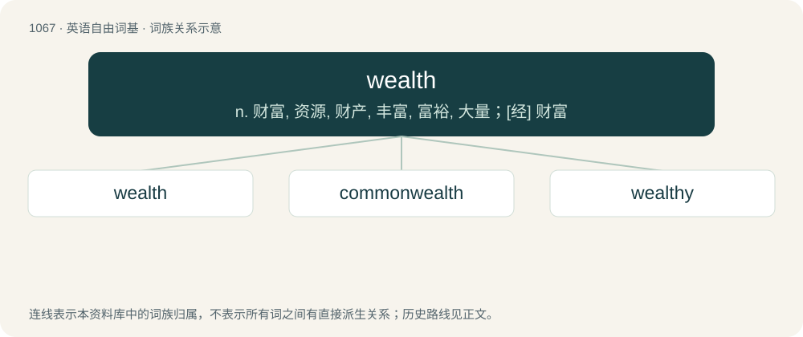

# 1146 · wealth — n. 财富, 资源, 财产, 丰富, 富裕, 大量；\[经\] 财富

[总目录](../00_总目录_按常用程度.md)

**类型**：英语自由词基　｜　**来源语言**：见词源记录

## 核心含义与来源

- 核心含义：n. 财富, 资源, 财产, 丰富, 富裕, 大量；\[经\] 财富
- 英文含义：Riches; a great amount of valuable assets or material possessions.
- 词形：wealth

**来源记录 1**（名词；Riches; a great amount of valuable assets or material possessions.）

Inherited from Middle English welth, welthe (“happiness, prosperity”), from Old English \*welþ, \*welþu, from Proto-West Germanic \*waliþu (“wealth”). Alternatively, possibly an alteration (due to similar words in -th: compare helth (“health”), derth (“dearth”)) of wele (“wealth, well-being, weal”), from Old English wela (“wealth, prosperity”), from Proto-Germanic \*walô (“well-being, prosperity”), from Proto-Indo-European \*wel- (“good, best”); equivalent to weal + -th (abstract nominal suffix). Cognate with West Frisian wielde (“wealth”), Dutch weelde (“wealth”), Low German Weelde (“wealth”), Old High German welida, welitha (“wealth”). Related also to German Wohl (“welfare, well-being, weal”), Danish vel (“weal, welfare”), Swedish väl (“well-being, weal”). More at weal, well.

## 词族图

## 单词速览（常用到不常用）

| 单词 | 音标 | 释义 |
|---|---|---|
| [wealth](#w-1) | /wɛlθ/ | n. 财富, 资源, 财产, 丰富, 富裕, 大量；\[经\] 财富 |
| [commonwealth](#w-2) | 英 /ˈkɒmənˌwɛlθ/；美 /ˈkɑmənˌwɛlθ/ | n. 共和国；联邦；国民整体 |
| [wealthy](#w-3) | 英 /ˈwɛl.θi/ | a. 富有的, 丰裕的, 充分的 |

## 逐词详解

### 1. wealth

**词性**：名词　｜　**音标**：/wɛlθ/

**中文释义**：n. 财富, 资源, 财产, 丰富, 富裕, 大量；\[经\] 财富

**英文义项**：Riches; a great amount of valuable assets or material possessions. / A great amount; an abundance or plenty.

**构词拆分**：weal + -th (abstract nominal suffix)

**词源与演化**：

Inherited from Middle English welth, welthe (“happiness, prosperity”), from Old English \*welþ, \*welþu, from Proto-West Germanic \*waliþu (“wealth”). Alternatively, possibly an alteration (due to similar words in -th: compare helth (“health”), derth (“dearth”)) of wele (“wealth, well-being, weal”), from Old English wela (“wealth, prosperity”), from Proto-Germanic \*walô (“well-being, prosperity”), from Proto-Indo-European \*wel- (“good, best”); equivalent to weal + -th (abstract nominal suffix). Cognate with West Frisian wielde (“wealth”), Dutch weelde (“wealth”), Low German Weelde (“wealth”), Old High German welida, welitha (“wealth”). Related also to German Wohl (“welfare, well-being, weal”), Danish vel (“weal, welfare”), Swedish väl (“well-being, weal”). More at weal, well.

**例句**：

> She brings a wealth of knowledge to the project.

该用例对应义项：A great amount; an abundance or plenty.

### 2. commonwealth

**词性**：名词　｜　**音标**：英 /ˈkɒmənˌwɛlθ/；美 /ˈkɑmənˌwɛlθ/

**中文释义**：n. 共和国；联邦；国民整体

**英文义项**：The entirety of a (secular) society, a polity, a state. / Republic. Often capitalized, as Commonwealth.

**构词拆分**：common (“public”) + wealth (“well-being”)

**词源与演化**：

From common (“public”) + wealth (“well-being”). From c. 1450 as common wele (commonweal). In the form common-wealth (common welthe) from c. 1520, used by Tyndale in the sense "secular society" in particular, for which other authors preferred publike weal. Also from the 1520s treated as a synonym or loan-translation of res publica (republic) (Rollison 2017:67f).

**例句**：

> The British Commonwealth of Nations is unable to let go of power.

### 3. wealthy

**词性**：名词　｜　**音标**：英 /ˈwɛl.θi/

**中文释义**：a. 富有的, 丰裕的, 充分的

**英文义项**：Synonym of rich: the wealthy people of a society or of the world collectively. / A rich person.

**构词拆分**：wealth + -y

**词源与演化**：

From Middle English welthy, welþi, equivalent to wealth + -y. Cognate with Middle Dutch weldech, weeldech (“magnificent, luscious, lavish”).

**例句**：

> F. Scott Fitzgerald never got over Ginevra King's dad reminding him he wasn't a wealthy and needed to aim lower.

该用例对应义项：A rich person.
