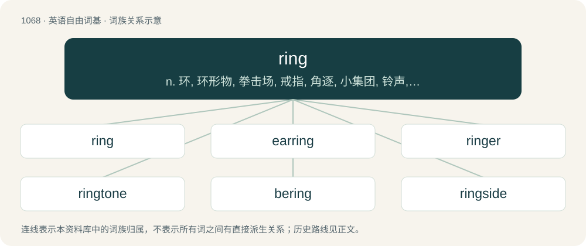

# 1147 · ring — n. 环, 环形物, 拳击场, 戒指, 角逐, 小集团, 铃声, 钟声, 声调；vt. 包围, 套住, 按铃, 敲钟；vi. 成环形, 响, 鸣, 按铃, 敲钟, 回响

[总目录](../00_总目录_按常用程度.md)

**类型**：英语自由词基　｜　**来源语言**：见词源记录

## 核心含义与来源

- 核心含义：n. 环, 环形物, 拳击场, 戒指, 角逐, 小集团, 铃声, 钟声, 声调；vt. 包围, 套住, 按铃, 敲钟；vi. 成环形, 响, 鸣, 按铃, 敲钟, 回响
- 英文含义：A circumscribing object, (roughly) circular and hollow, looking like an annual ring, earring, finger ring etc.
- 词形：ring

**多个词源／构词路径**：同一拼写可能有不同来源；以下按词性和含义分别列出。

**来源记录 1**（名词；A circumscribing object, (roughly) circular and hollow, looking like an annual ring, earring, finger ring etc.）

From Middle English ryng, from Old English hring (“ring, circle”), from Proto-West Germanic \*hring, from Proto-Germanic \*hringaz (“ring”), from Proto-Indo-European \*(s)krengʰ-, extended nasalized form of \*(s)ker- (“to turn, bend”). Doublet of rank and rink, as well as indirectly range. Cognates \* West Frisian ring \* Low German Ring \* Dutch ring \* German Ring \* Swedish ring \* Finnish rengas More distantly cognate with Proto-Slavic \*krǫgъ (whence Bulgarian кръг (krăg), Polish krąg, Russian круг (krug)).

**来源记录 2**（名词；The resonant sound of a bell, or a sound resembling it.）

From Middle English ryngen, from Old English hrinġan (“to ring”), from Proto-West Germanic \*hringijan, from Proto-Germanic \*hringijaną (“to ring”), of imitative origin. Cognate with Dutch ringen (“to ring”), Danish ringe (“to ring”), Swedish ringa (“to ring”), Faroese ringja (“to ring up, telephone”), Icelandic hringja (“to ring”), West Frisian ringelje (“to ring”), Dutch rinkelen (“to ring, jingle”), Faroese ringla (“to tinkle, jingle”).

**来源记录 3**（名词；An algebraic structure which consists of a set with two binary operations: an additive operation and a multiplicative operation, such that the set is an abelian group under the additive operation, a monoid under the multiplicative operation, and such that the multiplicative operation is distributive with respect to the additive operation.）

From a shortening of German Zahlring (“ring of numbers”), coined by German mathematician David Hilbert in 1892. Apparently first used in English in 1930, E. T. Bell, “Rings whose elements are ideals,” Bulletin of the American Mathematical Society.

## 词族图

## 单词速览（常用到不常用）

| 单词 | 音标 | 释义 |
|---|---|---|
| [ring](#w-1) | 英 /ɹɪŋ/ | n. 环, 环形物, 拳击场, 戒指, 角逐, 小集团, 铃声, 钟声, 声调；vt. 包围, 套住, 按铃, 敲钟；vi. 成环形, 响, 鸣, 按铃, 敲钟, 回响 |
| [earring](#w-2) | 英 /ˈɪəɹɪŋ/；美 /ˈɪɹɪŋ/ | n. 耳环, 耳饰 |
| [ringer](#w-3) | /ˈɹɪŋə(ɹ)/ | n. 套环, 投环, 按铃者, 敲钟者 |
| [ringtone](#w-4) | 英 /ˈɹɪŋˌtəʊn/；美 /ˈɹɪŋˌtoʊn/ | n. 铃声, 手机铃声 |
| [bering](#w-5) | 英 /bɪˈɹɪŋ/ | 【英文】To encircle (something) with a ring or some other circular object (such as a shackle). |
| [ringside](#w-6) |  | a. 紧靠比赛场的；n. \[the\]比赛场的外围, 比赛场的前缘 |
| [ringleader](#w-7) | /ˈɹɪŋˌliːdəɹ/ | n. 魁首, 头目；\[法\] 头目, 魁首, 叛国头子 |
| [ringworm](#w-8) | 美 /ˈɹɪŋˌwɝm/ | \[医\] 癣, 癣菌病 |
| [ringmaster](#w-9) | /ˈriŋmɑːstə/ | n. 马戏演出指挥, 导演 |
| [keyring](#w-10) | Australia /ˈkiːɹɪŋ/ | n. 钥匙圈 |
| [coring](#w-11) | /ˈkɔː.ɹɪŋ/ | \[机\] 结晶偏析 |

## 逐词详解

### 1. ring

**词性**：名词　｜　**音标**：英 /ɹɪŋ/

**中文释义**：n. 环, 环形物, 拳击场, 戒指, 角逐, 小集团, 铃声, 钟声, 声调；vt. 包围, 套住, 按铃, 敲钟；vi. 成环形, 响, 鸣, 按铃, 敲钟, 回响

**英文义项**：A circumscribing object, (roughly) circular and hollow, looking like an annual ring, earring, finger ring etc. / A round piece of (precious) metal worn around the finger or through the ear, nose, etc.

**词源与演化**：

From Middle English ryng, from Old English hring (“ring, circle”), from Proto-West Germanic \*hring, from Proto-Germanic \*hringaz (“ring”), from Proto-Indo-European \*(s)krengʰ-, extended nasalized form of \*(s)ker- (“to turn, bend”). Doublet of rank and rink, as well as indirectly range. Cognates \* West Frisian ring \* Low German Ring \* Dutch ring \* German Ring \* Swedish ring \* Finnish rengas More distantly cognate with Proto-Slavic \*krǫgъ (whence Bulgarian кръг (krăg), Polish krąg, Russian круг (krug)).

**例句**：

> His brother gifted him a ring for the engagement.

该用例对应义项：A round piece of (precious) metal worn around the finger or through the ear, nose, etc.

### 2. earring

**词性**：名词　｜　**音标**：英 /ˈɪəɹɪŋ/；美 /ˈɪɹɪŋ/

**中文释义**：n. 耳环, 耳饰

**英文义项**：A piece of jewelry worn on the ear.

**构词拆分**：ear + ring

**词源与演化**：

From Middle English erering, from Old English ēarhring (“ear-ring”), from Proto-West Germanic \*auʀahring, equivalent to ear + ring. Cognate with West Frisian earring (“earring”), Dutch oorring (“earring”), German Low German Ohrring (“earring”), German Ohrring (“earring”), Danish ørering (“earring”), Swedish örring (“earring”).

**例句**：

> I dropped a earring down the pipe. I must call the plumber.

### 3. ringer

**词性**：名词　｜　**音标**：/ˈɹɪŋə(ɹ)/

**中文释义**：n. 套环, 投环, 按铃者, 敲钟者

**英文义项**：Someone who rings, especially a bell ringer. / A crowbar.

**构词拆分**：ring (“to sound a bell”) + -er

**词源与演化**：

From Middle English ringere, rynger, ryngar, equivalent to ring (“to sound a bell”) + -er.

**例句**：

> Many companies and entrepreneurs have been put through the ringer this year.

### 4. ringtone

**词性**：名词　｜　**音标**：英 /ˈɹɪŋˌtəʊn/；美 /ˈɹɪŋˌtoʊn/

**中文释义**：n. 铃声, 手机铃声

**英文义项**：The sound made by a telephone when ringing. / A customizable tone used to indicate an incoming call on a telephone, especially a mobile phone.

**构词拆分**：ring + tone

**词源与演化**：

From ring + tone.

**例句**：

> I set my favorite song as my ringtone.

该用例对应义项：A customizable tone used to indicate an incoming call on a telephone, especially a mobile phone.

### 5. bering

**词性**：动词　｜　**音标**：英 /bɪˈɹɪŋ/

**英文义项**：To encircle (something) with a ring or some other circular object (such as a shackle).

**构词拆分**：be- (prefix forming verbs from adjectives or nouns, usually with the sense ‘to make, become, or cause to be \[like the adjective or noun\]’) + ring

**词源与演化**：

From be- (prefix forming verbs from adjectives or nouns, usually with the sense ‘to make, become, or cause to be \[like the adjective or noun\]’) + ring.

**例句**：

> The Bering Strait separates Asia from North America.

### 6. ringside

**词性**：形容词

**中文释义**：a. 紧靠比赛场的；n. \[the\]比赛场的外围, 比赛场的前缘

**英文义项**：Beside the ring, especially a boxing ring.

**构词拆分**：ring + -side

**词源与演化**：

From ring + -side.

**例句**：

> We got our hands on a pair of ringside tickets for the boxing match.

该用例对应义项：Beside the ring, especially a boxing ring.

### 7. ringleader

**词性**：名词　｜　**音标**：/ˈɹɪŋˌliːdəɹ/

**中文释义**：n. 魁首, 头目；\[法\] 头目, 魁首, 叛国头子

**英文义项**：A leader of a group of people, especially an unofficial group. / A person who starts and leads a disturbance (such as a riot), a conspiracy, or a criminal gang.

**构词拆分**：ring + leader

**词源与演化**：

From ring + leader.

**例句**：

> The police arrested the ringleaders of the smuggling operation.

该用例对应义项：A person who starts and leads a disturbance (such as a riot), a conspiracy, or a criminal gang.

### 8. ringworm

**词性**：名词　｜　**音标**：美 /ˈɹɪŋˌwɝm/

**中文释义**：\[医\] 癣, 癣菌病

**英文义项**：A contagious fungal infection of the skin, characterized by ring-shaped discolored patches, covered by vesicles or scales.

**构词拆分**：ring + worm

**词源与演化**：

From Middle English ringworm (“ringworm; intestinal worm”), from Old English rengwyrm (“maw-worm, intestinal worm”), equivalent to ring + worm.

**例句**：

> In superficial mycoses infection is localised to the skin, the hair, and the nails. An example is ringworm or tinea, an infection of the skin by a dermatophyte.

该用例对应义项：A contagious fungal infection of the skin, characterized by ring-shaped discolored patches, covered by vesicles or scales.

### 9. ringmaster

**词性**：名词　｜　**音标**：/ˈriŋmɑːstə/

**中文释义**：n. 马戏演出指挥, 导演

**英文义项**：The person who manages the performers in a circus ring. / The person who maintains a webring.

**构词拆分**：ring + master

**词源与演化**：

From ring + master.

### 10. keyring

**词性**：名词　｜　**音标**：Australia /ˈkiːɹɪŋ/

**中文释义**：n. 钥匙圈

**英文义项**：A ring, normally of metal or plastic, for holding keys together. / A set of data holding linked encryption keys.

**构词拆分**：key + ring

**词源与演化**：

From key + ring.

**例句**：

> I have a keyring with a snap hook with a dynamo lamp.

### 11. coring

**词性**：名词　｜　**音标**：/ˈkɔː.ɹɪŋ/

**中文释义**：\[机\] 结晶偏析

**英文义项**：The dual of a ring.

**构词拆分**：co- + ring

**词源与演化**：

From co- + ring.

**例句**：

> No peeling or coring is required.
