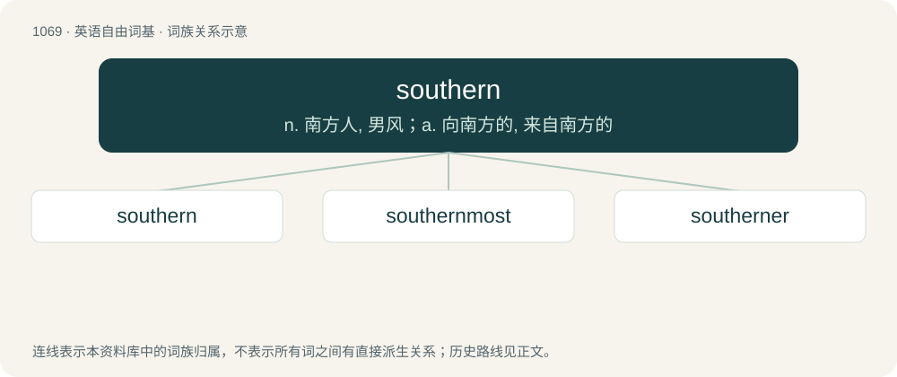

# 1148 · southern — n. 南方人, 男风；a. 向南方的, 来自南方的

[总目录](../00_总目录_按常用程度.md)

**类型**：英语自由词基　｜　**来源语言**：见词源记录

## 核心含义与来源

- 核心含义：n. 南方人, 男风；a. 向南方的, 来自南方的
- 英文含义：Of, facing, situated in, or related to the south.
- 词形：southern

**来源记录 1**（形容词；Of, facing, situated in, or related to the south.）

From Middle English southerne, sothern, sutherne, from Old English sūþerne (“southern, southerly, coming from the south; of southern make”), from Proto-Germanic \*sunþrōnijaz (“southern”), from Proto-Indo-European \*sh₂un-, \*sh₂wen-, r/n-stem alternation of \*sóh₂wl̥ (“sun”). Cognate with Scots southron, sudron (“southern”), Old Frisian sūthern, sūdern (“southern”), Middle Low German sūdern (“southern”), Middle High German sundern (“southern”), Icelandic suðrænn (“southern, tropical”). By surface analysis, south + -ern.

## 词族图

## 单词速览（常用到不常用）

| 单词 | 音标 | 释义 |
|---|---|---|
| [southern](#w-1) | 英 /ˈsʌðən/；美 /ˈsʌðɚn/ | n. 南方人, 男风；a. 向南方的, 来自南方的 |
| [southernmost](#w-2) | /ˈsʌð(ə)nməjst/ | a. 最南的 |
| [southerner](#w-3) | /ˈsʌðənə/ | n. 南方人 |

## 逐词详解

### 1. southern

**词性**：形容词　｜　**音标**：英 /ˈsʌðən/；美 /ˈsʌðɚn/

**中文释义**：n. 南方人, 男风；a. 向南方的, 来自南方的

**英文义项**：Of, facing, situated in, or related to the south. / Of or pertaining to a southern region, especially Southern Europe or the southern United States.

**词源与演化**：

From Middle English southerne, sothern, sutherne, from Old English sūþerne (“southern, southerly, coming from the south; of southern make”), from Proto-Germanic \*sunþrōnijaz (“southern”), from Proto-Indo-European \*sh₂un-, \*sh₂wen-, r/n-stem alternation of \*sóh₂wl̥ (“sun”). Cognate with Scots southron, sudron (“southern”), Old Frisian sūthern, sūdern (“southern”), Middle Low German sūdern (“southern”), Middle High German sundern (“southern”), Icelandic suðrænn (“southern, tropical”). By surface analysis, south + -ern.

**用法示例／搭配（非完整句）**：

> The southern climate.

该用例对应义项：Of or pertaining to a southern region, especially Southern Europe or the southern United States.

### 2. southernmost

**词性**：形容词　｜　**音标**：/ˈsʌð(ə)nməjst/

**中文释义**：a. 最南的

**英文义项**：Farthest south.

**构词拆分**：southern + -most

**词源与演化**：

From southern + -most.

**例句**：

> South Africa is the southernmost country in Africa.

该用例对应义项：Farthest south.

### 3. southerner

**词性**：名词　｜　**音标**：/ˈsʌðənə/

**中文释义**：n. 南方人

**英文义项**：A native or inhabitant of the south of a region (or of the world as a whole), such as the United Kingdom.

**构词拆分**：From southern + -er.

**词源与演化**：

From southern + -er.

**例句**：

> Beijingers speak Mandarin with a roll in the tongue that no Southerner could ever utter.
