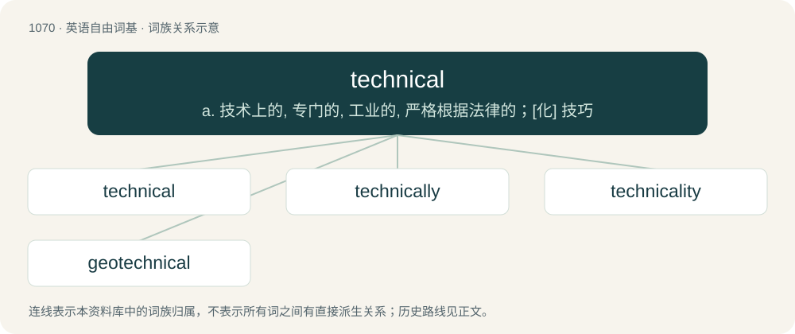

# 1150 · technical — a. 技术上的, 专门的, 工业的, 严格根据法律的；\[化\] 技巧

[总目录](../00_总目录_按常用程度.md)

**类型**：英语自由词基　｜　**来源语言**：见词源记录

## 核心含义与来源

- 核心含义：a. 技术上的, 专门的, 工业的, 严格根据法律的；\[化\] 技巧
- 英文含义：Specifically related to a particular discipline.
- 词形：technical

**来源记录 1**（形容词；Specifically related to a particular discipline.）

From Late Latin technicus + -al, from Ancient Greek τεχνικός (tekhnikós), from τέχνη (tékhnē, “skill”). For the late 20th-century origin of the noun sense (vehicle), see Wikipedia.

## 词族图

## 单词速览（常用到不常用）

| 单词 | 音标 | 释义 |
|---|---|---|
| [technical](#w-1) | 英 /ˈtɛk.nɪk.əl/ | a. 技术上的, 专门的, 工业的, 严格根据法律的；\[化\] 技巧 |
| [technically](#w-2) | /ˈtɛk.nɪˌkəl.i/ | adv. 技术上, 学术上, 专门地 |
| [technicality](#w-3) | /ˌtɛknɪˈkælɪti/ | n. 专门性, 学术性, 技术的使用；\[法\] 专门的事项, 细节, 用语 |
| [geotechnical](#w-4) | 英 /ˌdʒiːəʊˈtɛknɪkəl/；美 /ˌd͡ʒioʊˈtɛknɪkəl/ | a. 岩土工程技术的 |

## 逐词详解

### 1. technical

**词性**：形容词　｜　**音标**：英 /ˈtɛk.nɪk.əl/

**中文释义**：a. 技术上的, 专门的, 工业的, 严格根据法律的；\[化\] 技巧

**英文义项**：Specifically related to a particular discipline. / difficult to understand for those not specialized in this discipline.

**构词拆分**：Late Latin technicus + -al

**词源与演化**：

From Late Latin technicus + -al, from Ancient Greek τεχνικός (tekhnikós), from τέχνη (tékhnē, “skill”). For the late 20th-century origin of the noun sense (vehicle), see Wikipedia.

**例句**：

> Crossing the front lawn of that house to get to the mailbox was a technical trespass.

该用例对应义项：In the strictest sense, but not practically or meaningfully.

### 2. technically

**词性**：副词　｜　**音标**：/ˈtɛk.nɪˌkəl.i/

**中文释义**：adv. 技术上, 学术上, 专门地

**英文义项**：Based on precise facts, which, however, may be contrary to common belief or casual terminology. / Based on formal (de jure) arguments, which, however, may be misleading.

**构词拆分**：technical + -ly

**词源与演化**：

From technical + -ly.

**例句**：

> For now, it is technically impossible to have a manned flight to Mercury.

该用例对应义项：According to the current state of technology.

### 3. technicality

**词性**：名词　｜　**音标**：/ˌtɛknɪˈkælɪti/

**中文释义**：n. 专门性, 学术性, 技术的使用；\[法\] 专门的事项, 细节, 用语

**英文义项**：The quality or state of being technical. / That which is technical, or peculiar to any trade, profession, sect, or the like.

**构词拆分**：technical + -ity

**词源与演化**：

From technical + -ity.

**例句**：

> His death is a minor technicality, I'm sure you don't mind.

### 4. geotechnical

**词性**：形容词　｜　**音标**：英 /ˌdʒiːəʊˈtɛknɪkəl/；美 /ˌd͡ʒioʊˈtɛknɪkəl/

**中文释义**：a. 岩土工程技术的

**英文义项**：Of or relating to the soil and bedrock, especially aspects of foundations and earthworks.

**构词拆分**：geo- + technical

**词源与演化**：

From geo- + technical.
