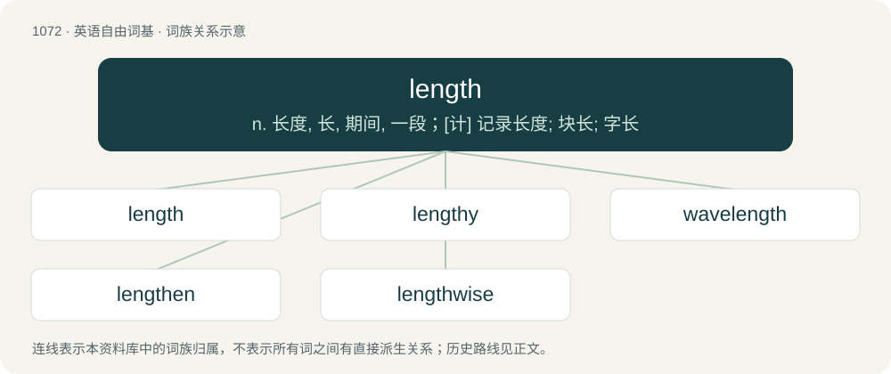

# 1152 · length — n. 长度, 长, 期间, 一段；\[计\] 记录长度; 块长; 字长

[总目录](../00_总目录_按常用程度.md)

**类型**：英语自由词基　｜　**来源语言**：见词源记录

## 核心含义与来源

- 核心含义：n. 长度, 长, 期间, 一段；\[计\] 记录长度; 块长; 字长
- 英文含义：The distance measured along the longest dimension of an object.
- 词形：length

**来源记录 1**（名词；The distance measured along the longest dimension of an object.）

From Middle English lengthe, from Old English lengþ, lengþu, from Proto-West Germanic \*langiþu, from Proto-Germanic \*langiþō, equivalent to long + -th (abstract nominal suffix). Cognate with Scots lenth, lainth (“length”), Saterland Frisian Loangte (“length”), West Frisian lingte, langte (“length”), Dutch lengte (“length”), German Low German Längde, Längd, Längte, Längt (“length”), Danish længde (“length”), Swedish längd (“length”), Icelandic lengd (“length”).

## 词族图

## 单词速览（常用到不常用）

| 单词 | 音标 | 释义 |
|---|---|---|
| [length](#w-1) | 英 /lɛŋ(k)θ/；美 /leɪŋ(k)θ/ | n. 长度, 长, 期间, 一段；\[计\] 记录长度; 块长; 字长 |
| [lengthy](#w-2) | /ˈleŋθi/ | a. 冗长的, 漫长的 |
| [wavelength](#w-3) | 英 /ˈweɪvlɛŋ(k)θ/；美 /ˈweɪvˌlɛŋ(k)θ/ | n. 波长；\[化\] 波长 |
| [lengthen](#w-4) | /ˈlɛŋθən/ | vt. 加长, 使延长；vi. 变长 |
| [lengthwise](#w-5) | /ˈleŋθwaiz/ | a. 纵长的；adv. 纵长地 |

## 逐词详解

### 1. length

**词性**：名词　｜　**音标**：英 /lɛŋ(k)θ/；美 /leɪŋ(k)θ/

**中文释义**：n. 长度, 长, 期间, 一段；\[计\] 记录长度; 块长; 字长

**英文义项**：The distance measured along the longest dimension of an object. / Duration.

**构词拆分**：long + -th (abstract nominal suffix)

**词源与演化**：

From Middle English lengthe, from Old English lengþ, lengþu, from Proto-West Germanic \*langiþu, from Proto-Germanic \*langiþō, equivalent to long + -th (abstract nominal suffix). Cognate with Scots lenth, lainth (“length”), Saterland Frisian Loangte (“length”), West Frisian lingte, langte (“length”), Dutch lengte (“length”), German Low German Längde, Längd, Längte, Längt (“length”), Danish længde (“length”), Swedish längd (“length”), Icelandic lengd (“length”).

**用法示例／搭配（非完整句）**：

> five lengths ahead of the field

该用例对应义项：The length of a horse, used to indicate the distance between horses at the end of a race.

### 2. lengthy

**词性**：形容词　｜　**音标**：/ˈleŋθi/

**中文释义**：a. 冗长的, 漫长的

**英文义项**：Having length; long and overextended, especially in time rather than dimension. / Speaking or writing at length; long-winded.

**构词拆分**：length + -y

**词源与演化**：

From length + -y.

**例句**：

> She died last night after a lengthy illness.

该用例对应义项：Having length; long and overextended, especially in time rather than dimension.

### 3. wavelength

**词性**：名词　｜　**音标**：英 /ˈweɪvlɛŋ(k)θ/；美 /ˈweɪvˌlɛŋ(k)θ/

**中文释义**：n. 波长；\[化\] 波长

**英文义项**：The length of a single cycle of a wave, as measured by the distance between one peak or trough of a wave and the next; it is often designated in physics as λ, and corresponds to the velocity of the wave divided by its frequency. / A person's attitude and way of thinking as compared to another person's.

**构词拆分**：wave + length

**词源与演化**：

From wave + length.

**例句**：

> I think you and I are on a different wavelength.

该用例对应义项：A person's attitude and way of thinking as compared to another person's.

### 4. lengthen

**词性**：动词　｜　**音标**：/ˈlɛŋθən/

**中文释义**：vt. 加长, 使延长；vi. 变长

**英文义项**：To make longer, to extend the length of. / To become longer.

**构词拆分**：From length + -en.

**词源与演化**：

From length + -en.

**例句**：

> You need to lengthen the story if you want to have it published.

该用例对应义项：To make longer, to extend the length of.

### 5. lengthwise

**词性**：形容词　｜　**音标**：/ˈleŋθwaiz/

**中文释义**：a. 纵长的；adv. 纵长地

**英文义项**：In the long direction of an oblong object.

**构词拆分**：length + -wise

**词源与演化**：

From length + -wise.

**例句**：

> A lengthwise cut is difficult to saw with hand tools.

该用例对应义项：In the long direction of an oblong object.
