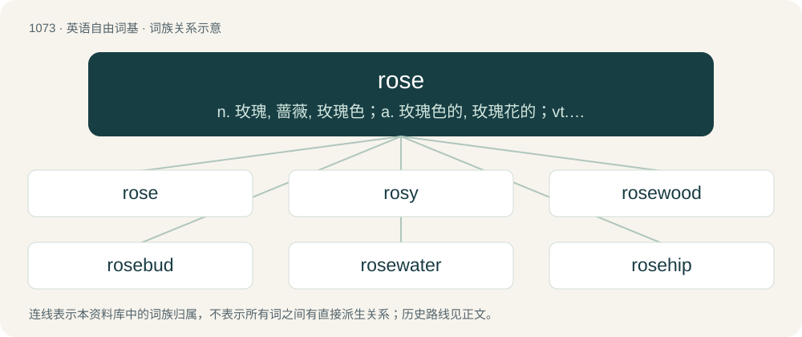

# 1154 · rose — n. 玫瑰, 蔷薇, 玫瑰色；a. 玫瑰色的, 玫瑰花的；vt. 使成玫瑰色

[总目录](../00_总目录_按常用程度.md)

**类型**：英语自由词基　｜　**来源语言**：见词源记录

## 核心含义与来源

- 核心含义：n. 玫瑰, 蔷薇, 玫瑰色；a. 玫瑰色的, 玫瑰花的；vt. 使成玫瑰色
- 英文含义：A shrub of the genus Rosa, with red, pink, white or yellow flowers.
- 词形：rose

**来源记录 1**（名词；A shrub of the genus Rosa, with red, pink, white or yellow flowers.）

From Middle English rose, roose, from Old English rōse, but with its vowel influenced by Old French rose, both from Latin rosa. cognates and more remote and uncertain etymology The Latin is of uncertain origin, but likely via Oscan from Ancient Greek ῥόδον (rhódon, “rose”) (Aeolic ϝρόδον (wródon)), from Old Persian \*vr̥dah (“flower”) (compare Avestan 𐬬𐬀𐬭𐬆𐬜𐬀- (var^əδa-), Sogdian \[script needed\] (ward), Parthian wâr, late Middle Persian \[Term?\] (gwl /⁠gul⁠/), Persian گل (gol, “rose, flower”), and Middle Iranian borrowings including Old Armenian վարդ (vard, “rose”), Aramaic וַרְדָּא (wardā) / ܘܪܕܐ (wardā), Arabic وَرْدَة (warda), Hebrew וֶרֶד (wéreḏ)), from Proto-Indo-European \*wr̥dʰos (“sweetbriar”) (compare Old English word (“thornbush”), Latin rubus (“bramble”), Albanian hurdhe (“ivy”)). Possibly ultimately a derivation from a verb for "to grow" only attested in Indo-Iranian (\*Hwardʰ-, compare Sanskrit वर्धति (vardhati), with relatives in Avestan).

## 词族图

## 单词速览（常用到不常用）

| 单词 | 音标 | 释义 |
|---|---|---|
| [rose](#w-1) | 英 /ɹəʊz/；美 /ɹoʊz/ | n. 玫瑰, 蔷薇, 玫瑰色；a. 玫瑰色的, 玫瑰花的；vt. 使成玫瑰色 |
| [rosy](#w-2) | 英 /ˈɹəʊzi/；美 /ˈɹoʊzi/ | a. 蔷薇色的, 玫瑰红色的 |
| [rosewood](#w-3) | 美 /ˈɹoʊzˌwʊd/ | n. 红木 |
| [rosebud](#w-4) | 英 /ˈɹəʊz.bʌd/；美 /ˈɹoʊz.bʌd/ | n. 蔷薇花蕾, 妙龄少女 |
| [rosewater](#w-5) | /ˈɹəʊzˌwɔːtə(ɹ)/ | a. 有玫瑰香水味的, 感伤的, 做作的 |
| [rosehip](#w-6) | 英 /ˈɹəʊzˌhɪp/；美 /ˈɹoʊzˌhɪp/ | n. 玫瑰果；蔷薇果 |

## 逐词详解

### 1. rose

**词性**：名词　｜　**音标**：英 /ɹəʊz/；美 /ɹoʊz/

**中文释义**：n. 玫瑰, 蔷薇, 玫瑰色；a. 玫瑰色的, 玫瑰花的；vt. 使成玫瑰色

**英文义项**：A shrub of the genus Rosa, with red, pink, white or yellow flowers. / A flower of the rose plant.

**词源与演化**：

From Middle English rose, roose, from Old English rōse, but with its vowel influenced by Old French rose, both from Latin rosa. cognates and more remote and uncertain etymology The Latin is of uncertain origin, but likely via Oscan from Ancient Greek ῥόδον (rhódon, “rose”) (Aeolic ϝρόδον (wródon)), from Old Persian \*vr̥dah (“flower”) (compare Avestan 𐬬𐬀𐬭𐬆𐬜𐬀- (var^əδa-), Sogdian \[script needed\] (ward), Parthian wâr, late Middle Persian \[Term?\] (gwl /⁠gul⁠/), Persian گل (gol, “rose, flower”), and Middle Iranian borrowings including Old Armenian վարդ (vard, “rose”), Aramaic וַרְדָּא (wardā) / ܘܪܕܐ (wardā), Arabic وَرْدَة (warda), Hebrew וֶרֶד (wéreḏ)), from Proto-Indo-European \*wr̥dʰos (“sweetbriar”) (compare Old English word (“thornbush”), Latin rubus (“bramble”), Albanian hurdhe (“ivy”)). Possibly ultimately a derivation from a verb for "to grow" only attested in Indo-Iranian (\*Hwardʰ-, compare Sanskrit वर्धति (vardhati), with relatives in Avestan).

**例句**：

> Me after ignoring all bad reviews on a rose from Shein and it literally starts electrocuting my clih.

该用例对应义项：A type of sex toy shaped like a rose.

### 2. rosy

**词性**：形容词　｜　**音标**：英 /ˈɹəʊzi/；美 /ˈɹoʊzi/

**中文释义**：a. 蔷薇色的, 玫瑰红色的

**英文义项**：Rose-coloured. / Of any reddish hue from bright pink to the color of ruddy cheeks in a light-skinned person.

**构词拆分**：rose + -y

**词源与演化**：

From Middle English rosy; equivalent to rose + -y.

**例句**：

> The dawn, with its rosy fingers, caresses the crowd with flowers.

### 3. rosewood

**词性**：名词　｜　**音标**：美 /ˈɹoʊzˌwʊd/

**中文释义**：n. 红木

**英文义项**：The fragrant wood of Dalbergia nigra, a Brazilian tree in the legume family, which has a sweet smell. / Any of several dozen woods, resembling that of Dalbergia nigra in some respect.

**构词拆分**：rose + wood

**词源与演化**：

A compound of rose + wood, originally so named because of the rose-scented aromatic oil derived from it; applied in later senses on account of these woods’ predominantly reddish-brown colour.

**例句**：

> The wood grain in Brazilian rosewood is beautiful.

### 4. rosebud

**词性**：名词　｜　**音标**：英 /ˈɹəʊz.bʌd/；美 /ˈɹoʊz.bʌd/

**中文释义**：n. 蔷薇花蕾, 妙龄少女

**英文义项**：The bud of a rose. / A pretty young woman.

**构词拆分**：rose + bud

**词源与演化**：

From rose + bud.

**例句**：

> He also pursed his lips to such an extent that they resembled a rosebud in a dirty bush.

### 5. rosewater

**词性**：名词　｜　**音标**：/ˈɹəʊzˌwɔːtə(ɹ)/

**中文释义**：a. 有玫瑰香水味的, 感伤的, 做作的

**英文义项**：A liquid produced by steeping rose petals in water, used as a coloring agent and a flavoring ingredient in certain foods.

**构词拆分**：rose + water

**词源与演化**：

From rose + water.

### 6. rosehip

**词性**：名词　｜　**音标**：英 /ˈɹəʊzˌhɪp/；美 /ˈɹoʊzˌhɪp/

**中文释义**：n. 玫瑰果；蔷薇果

**英文义项**：The fleshy false fruit of a wild rose plant (e.g. sweetbrier, dog rose, burnet rose, etc.), containing the achenes or true fruits.

**构词拆分**：rose + hip

**词源与演化**：

From rose + hip.
