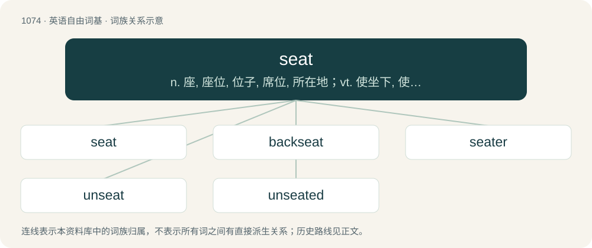

# 1155 · seat — n. 座, 座位, 位子, 席位, 所在地；vt. 使坐下, 使就座, 为...设座于, 使就职；vi. 安装在底座上

[总目录](../00_总目录_按常用程度.md)

**类型**：英语自由词基　｜　**来源语言**：见词源记录

## 核心含义与来源

- 核心含义：n. 座, 座位, 位子, 席位, 所在地；vt. 使坐下, 使就座, 为...设座于, 使就职；vi. 安装在底座上
- 英文含义：Something to be sat upon.
- 词形：seat

**来源记录 1**（名词；Something to be sat upon.）

From Middle English sete, from Old English sǣte, possibly from (or simply cognate with) Old Norse sæti (“seat”), both from Proto-Germanic \*sētiją (“seat”), from Proto-Indo-European \*sed- (“to sit”); compare Old English set (“seat”). Noun sense 2 (“location or site”) is probably derived from Old English sǣte (“house”), which is related to Old High German sāza (“sedan, seat, domicile”). Cognates \* Middle Dutch gesaete \* Old High German gisazi (modern German Gesäß)

## 词族图

## 单词速览（常用到不常用）

| 单词 | 音标 | 释义 |
|---|---|---|
| [seat](#w-1) | /siːt/ | n. 座, 座位, 位子, 席位, 所在地；vt. 使坐下, 使就座, 为...设座于, 使就职；vi. 安装在底座上 |
| [backseat](#w-2) | /ˈbæksiːt/ | n. 后座, 次要位置 |
| [seater](#w-3) | 美 /ˈsitɚ/ | n. 有...座位之交通工具 |
| [unseat](#w-4) | 英 /(ˌ)ʌnˈsiːt/；美 /ˌʌnˈsit/ | vt. 剥夺...的席位, 使失去资格, 使退位, 罢免, 使去职, 使退职 |
| [unseated](#w-5) | /ʌnˈsiːtid/ | v. （马）把（骑手）摔下来( unseat的过去式和过去分词 ); 夺去（议员等的）席位; 革除（职位）; 使失去资格 |

## 逐词详解

### 1. seat

**词性**：名词　｜　**音标**：/siːt/

**中文释义**：n. 座, 座位, 位子, 席位, 所在地；vt. 使坐下, 使就座, 为...设座于, 使就职；vi. 安装在底座上

**英文义项**：Something to be sat upon. / A place in which to sit.

**词源与演化**：

From Middle English sete, from Old English sǣte, possibly from (or simply cognate with) Old Norse sæti (“seat”), both from Proto-Germanic \*sētiją (“seat”), from Proto-Indo-European \*sed- (“to sit”); compare Old English set (“seat”). Noun sense 2 (“location or site”) is probably derived from Old English sǣte (“house”), which is related to Old High German sāza (“sedan, seat, domicile”). Cognates \* Middle Dutch gesaete \* Old High German gisazi (modern German Gesäß)

**例句**：

> He sat on the arm of the chair rather than the seat, which always annoyed his mother.

该用例对应义项：The horizontal portion of a chair or other furniture designed for sitting.

### 2. backseat

**词性**：动词　｜　**音标**：/ˈbæksiːt/

**中文释义**：n. 后座, 次要位置

**英文义项**：To act in the manner of a back-seat driver or a back-seat gamer.

**构词拆分**：From back + seat.

**词源与演化**：

From back + seat.

**例句**：

> Tom slept in the backseat of the car as Mary drove.

### 3. seater

**词性**：名词　｜　**音标**：美 /ˈsitɚ/

**中文释义**：n. 有...座位之交通工具

**英文义项**：A vehicle or item of furniture that has a specified seating capacity.

**构词拆分**：seat + -er (measurement suffix)

**词源与演化**：

From seat + -er (measurement suffix) or -er (agent noun suffix).

**例句**：

> Our new sofa is a three-seater.

该用例对应义项：A vehicle or item of furniture that has a specified seating capacity.

### 4. unseat

**词性**：动词　｜　**音标**：英 /(ˌ)ʌnˈsiːt/；美 /ˌʌnˈsit/

**中文释义**：vt. 剥夺...的席位, 使失去资格, 使退位, 罢免, 使去职, 使退职

**英文义项**：To dislodge or remove (someone) from a seat, especially on horseback. / To remove (someone) from an office or position, especially a political one; to dethrone.

**构词拆分**：un- (suffix meaning ‘not’) + seat (“to provide with a place to sit”)

**词源与演化**：

From un- (suffix meaning ‘not’) + seat (“to provide with a place to sit”).

**例句**：

> The Matrix (1999) utterly unseated audiences around the world with its mind-blowing plot twist.

该用例对应义项：To upset the composure of (someone); to astound, to shock, to unsettle.

### 5. unseated

**词性**：形容词　｜　**音标**：/ʌnˈsiːtid/

**中文释义**：v. （马）把（骑手）摔下来( unseat的过去式和过去分词 ); 夺去（议员等的）席位; 革除（职位）; 使失去资格

**英文义项**：Not seated.

**构词拆分**：un- + seat + -ed

**词源与演化**：

From un- + seat + -ed.

**例句**：

> The courts have already unseated a handful of governors who had been sworn in to the powerful positions.
