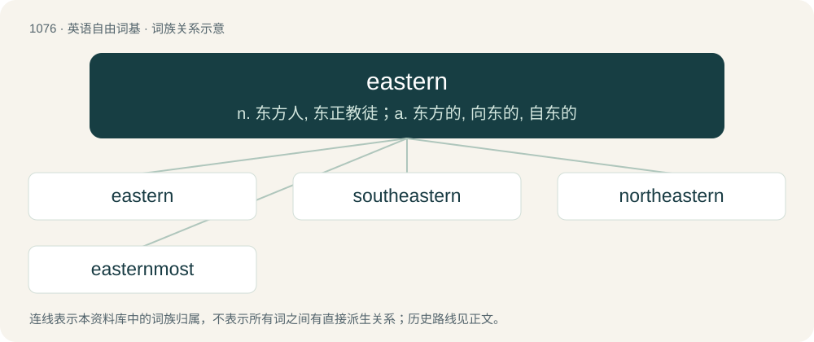

# 1156 · eastern — n. 东方人, 东正教徒；a. 东方的, 向东的, 自东的

[总目录](../00_总目录_按常用程度.md)

**类型**：英语自由词基　｜　**来源语言**：见词源记录

## 核心含义与来源

- 核心含义：n. 东方人, 东正教徒；a. 东方的, 向东的, 自东的
- 英文含义：Of, facing, situated in, or related to the east.
- 词形：eastern

**来源记录 1**（形容词；Of, facing, situated in, or related to the east.）

From Middle English esturne, esterne, from Old English ēasterne (“eastern”), from Proto-Germanic \*austrōnijaz (“eastern”), from Proto-Indo-European \*h₂ews-ro- (“eastern”), from Proto-Indo-European \*h₂ews- (“dawn, east”). Cognate with Old Saxon and Old High German ōstrōni (“eastern”), Old Norse austrœnn (“eastern”). Morphologically east + -ern.

## 词族图

## 单词速览（常用到不常用）

| 单词 | 音标 | 释义 |
|---|---|---|
| [eastern](#w-1) | 英 /ˈiː.stən/；美 /ˈi.stɚn/ | n. 东方人, 东正教徒；a. 东方的, 向东的, 自东的 |
| [southeastern](#w-2) | /sauθˈiːstən/ | a. 东南方的 |
| [northeastern](#w-3) | 英 /ˌnɔːˈθiː.stn̩/；美 /ˌnorˈθiː.stɚn/ | a. 东北方的, 在东北的, 来自东北的 |
| [easternmost](#w-4) | /ˈiːstənməust/ | a. 最东部的 |

## 逐词详解

### 1. eastern

**词性**：形容词　｜　**音标**：英 /ˈiː.stən/；美 /ˈi.stɚn/

**中文释义**：n. 东方人, 东正教徒；a. 东方的, 向东的, 自东的

**英文义项**：Of, facing, situated in, or related to the east. / Blowing from the east; easterly.

**构词拆分**：east + -ern

**词源与演化**：

From Middle English esturne, esterne, from Old English ēasterne (“eastern”), from Proto-Germanic \*austrōnijaz (“eastern”), from Proto-Indo-European \*h₂ews-ro- (“eastern”), from Proto-Indo-European \*h₂ews- (“dawn, east”). Cognate with Old Saxon and Old High German ōstrōni (“eastern”), Old Norse austrœnn (“eastern”). Morphologically east + -ern.

**例句**：

> The eastern end of the island.

该用例对应义项：lying toward or situated in the east

### 2. southeastern

**词性**：形容词　｜　**音标**：/sauθˈiːstən/

**中文释义**：a. 东南方的

**英文义项**：Of or pertaining to the southeast.

**构词拆分**：south + eastern

**词源与演化**：

From Middle English \*southesterne, from Old English sūþēasterne, equivalent to south + eastern.

**例句**：

> The southeastern part of the country is the most affluent.

该用例对应义项：Of or pertaining to the southeast.

### 3. northeastern

**词性**：形容词　｜　**音标**：英 /ˌnɔːˈθiː.stn̩/；美 /ˌnorˈθiː.stɚn/

**中文释义**：a. 东北方的, 在东北的, 来自东北的

**英文义项**：Of, related to, located in, or from the northeast.

**构词拆分**：north + eastern

**词源与演化**：

From Middle English norþesterne, from Old English norþēasterne, equivalent to north + eastern.

**例句**：

> Kabylie, a region in northeastern Algeria, is very similar to southern Italy.

### 4. easternmost

**词性**：形容词　｜　**音标**：/ˈiːstənməust/

**中文释义**：a. 最东部的

**英文义项**：Farthest east.

**构词拆分**：eastern + -most

**词源与演化**：

From eastern + -most.

**例句**：

> Cyprus is currently the easternmost country in the European Union.

该用例对应义项：Farthest east.
