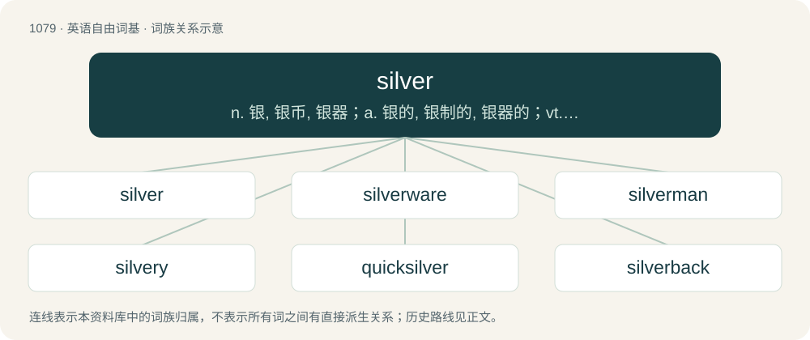

# 1158 · silver — n. 银, 银币, 银器；a. 银的, 银制的, 银器的；vt. 镀银

[总目录](../00_总目录_按常用程度.md)

**类型**：英语自由词基　｜　**来源语言**：见词源记录

## 核心含义与来源

- 核心含义：n. 银, 银币, 银器；a. 银的, 银制的, 银器的；vt. 镀银
- 英文含义：A lustrous, white, metallic element, atomic number 47, atomic weight 107.87, symbol Ag.
- 词形：silver

**来源记录 1**（名词；A lustrous, white, metallic element, atomic number 47, atomic weight 107.87, symbol Ag.）

Inherited from Middle English silver, selver, sulver, from Old English seolfor, from Proto-West Germanic \*silubr, from Proto-Germanic \*silubrą (“silver”), of uncertain origin. cognates and etymology discussion Cognate with Scots siller (“silver”), Saterland Frisian Säälwer (“silver”), West Frisian sulver (“silver”), Dutch zilver (“silver”), German Low German Silver, Sülver (“silver”), German Silber (“silver”), Swedish silver (“silver”), Icelandic silfur (“silver”). The Germanic word has parallels in Baltic and Slavic (Old Church Slavonic сьрєбро (sĭrebro), Lithuanian sidabras), Celtic (Celtiberian silaPur-), and outside Indo-European, in Basque zilar and Proto-Berber \*a-ẓrəf, but the ultimate origin of the word is unknown. Adjective sense 4 (“denoting a twenty-fifth anniversary”) generalized from silver wedding, itself a calque of German Silberhochzeit.

## 词族图

## 单词速览（常用到不常用）

| 单词 | 音标 | 释义 |
|---|---|---|
| [silver](#w-1) | 英 /ˈsɪl.və/；美 /ˈsɪl.vɚ/ | n. 银, 银币, 银器；a. 银的, 银制的, 银器的；vt. 镀银 |
| [silverware](#w-2) | /ˈsɪlvə(ɹ)ˌwɛə(ɹ)/ | n. 银器 |
| [silverman](#w-3) |  | 【英文】A butler responsible for the silverware. |
| [silvery](#w-4) | /ˈsɪlvəɹi/ | a. 像银的, 银色的, 银铃一般的 |
| [quicksilver](#w-5) | 美 /ˈkwɪkˌsɪlvɚ/ | n. 水银, 汞；vt. 涂水银于；a. 水银似的, 易变的 |
| [silverback](#w-6) | /ˈsilvəbæk/ | n. \[动\]银背大猩猩(指背部颈下方有银白色毛的雄性成年大猩猩) |
| [silversmith](#w-7) | /ˈsɪlvəsmɪθ/ | n. 银(器)匠 |
| [silverfish](#w-8) | /ˈsɪlvə(ɹ)fɪʃ/ | n. 银色的鱼, 蠹虫 |

## 逐词详解

### 1. silver

**词性**：形容词　｜　**音标**：英 /ˈsɪl.və/；美 /ˈsɪl.vɚ/

**中文释义**：n. 银, 银币, 银器；a. 银的, 银制的, 银器的；vt. 镀银

**英文义项**：Made from silver. / Made from another white metal.

**词源与演化**：

Inherited from Middle English silver, selver, sulver, from Old English seolfor, from Proto-West Germanic \*silubr, from Proto-Germanic \*silubrą (“silver”), of uncertain origin. cognates and etymology discussion Cognate with Scots siller (“silver”), Saterland Frisian Säälwer (“silver”), West Frisian sulver (“silver”), Dutch zilver (“silver”), German Low German Silver, Sülver (“silver”), German Silber (“silver”), Swedish silver (“silver”), Icelandic silfur (“silver”). The Germanic word has parallels in Baltic and Slavic (Old Church Slavonic сьрєбро (sĭrebro), Lithuanian sidabras), Celtic (Celtiberian silaPur-), and outside Indo-European, in Basque zilar and Proto-Berber \*a-ẓrəf, but the ultimate origin of the word is unknown. Adjective sense 4 (“denoting a twenty-fifth anniversary”) generalized from silver wedding, itself a calque of German Silberhochzeit.

**用法示例／搭配（非完整句）**：

> a silver-voiced young girl

该用例对应义项：Having the clear, musical tone of silver; soft and clear in sound.

### 2. silverware

**词性**：名词　｜　**音标**：/ˈsɪlvə(ɹ)ˌwɛə(ɹ)/

**中文释义**：n. 银器

**英文义项**：Anything manufactured from silver. / Anything with a silvery colour.

**构词拆分**：silver + -ware

**词源与演化**：

From silver + -ware.

**例句**：

> If you don't keep the silverware polished, it'll lose its luster.

### 3. silverman

**词性**：名词

**英文义项**：A butler responsible for the silverware.

**构词拆分**：silver + -man

**词源与演化**：

silver + -man

### 4. silvery

**词性**：形容词　｜　**音标**：/ˈsɪlvəɹi/

**中文释义**：a. 像银的, 银色的, 银铃一般的

**英文义项**：Resembling silver in color, shiny white. / Sprinkled or covered with silver.

**构词拆分**：silver + -y

**词源与演化**：

From Middle English silvery, sylvyry; equivalent to silver + -y.

**用法示例／搭配（非完整句）**：

> a silvery laugh

该用例对应义项：Having the clear, musical tone of silver; soft and clear in sound.

### 5. quicksilver

**词性**：名词　｜　**音标**：美 /ˈkwɪkˌsɪlvɚ/

**中文释义**：n. 水银, 汞；vt. 涂水银于；a. 水银似的, 易变的

**英文义项**：The metal mercury. / An amalgam of mercury and tin applied to the backs of mirrors; quicksilvering.

**构词拆分**：By surface analysis, quick (“living”) + silver

**词源与演化**：

From Middle English quyk silver, quyksilver, quikselver, from Old English cwicseolfor (“quicksilver”, literally “living silver”) (see Latin argentum vīvum) from its ability to move. See quick in the sense of "living". Cognate with Dutch kwikzilver, German Low German Quicksülver, German Quecksilber, Danish kviksølv, Norwegian Bokmål kvikksølv, Swedish kvicksilver. By surface analysis, quick (“living”) + silver.

**例句**：

> The alchemist tried unsuccessfully to convert quicksilver into gold.

### 6. silverback

**词性**：名词　｜　**音标**：/ˈsilvəbæk/

**中文释义**：n. \[动\]银背大猩猩(指背部颈下方有银白色毛的雄性成年大猩猩)

**英文义项**：A mature male gorilla leading a troop, so named from the silver streaking on its back. / A dominant or powerful older human male.

**构词拆分**：silver + back

**词源与演化**：

From silver + back.

**例句**：

> I obtained a permit to see the silverback gorillas.

### 7. silversmith

**词性**：名词　｜　**音标**：/ˈsɪlvəsmɪθ/

**中文释义**：n. 银(器)匠

**英文义项**：A person who makes articles out of silver usually larger than jewellery.

**构词拆分**：silver + smith

**词源与演化**：

Inherited from Middle English silver smyth, from Old English seolforsmiþ (“silversmith”), from Proto-Germanic \*silubrasmiþaz (“silversmith”), equivalent to silver + smith. Cognate with Saterland Frisian Säälwersmid (“silversmith”), West Frisian sulversmid (“silversmith”), Dutch zilversmid (“silversmith”), German Low German Sülversmitt (“silversmith”), German Silberschmied (“silversmith”), Danish sølvsmed (“silversmith”), Norwegian Bokmål sølvsmed (“silversmith”), Norwegian Nynorsk sølvsmed (“silversmith”), sylvsmed (“silversmith”), Swedish silversmed (“silversmith”), Icelandic silfursmiður (“silversmith”). Eclipsed non-native Middle English argentarie (“silversmith”) from Latin (faber) argentārius (“dealer in silver, silversmith”).

### 8. silverfish

**词性**：名词　｜　**音标**：/ˈsɪlvə(ɹ)fɪʃ/

**中文释义**：n. 银色的鱼, 蠹虫

**英文义项**：A small wingless insect of species Lepisma saccharinum, with silvery scales; a type of bristletail. / Ctenolepisma lineata (four-lined silverfish).

**构词拆分**：silver + fish

**词源与演化**：

From silver + fish: from its appearance, in the case of the insect.
