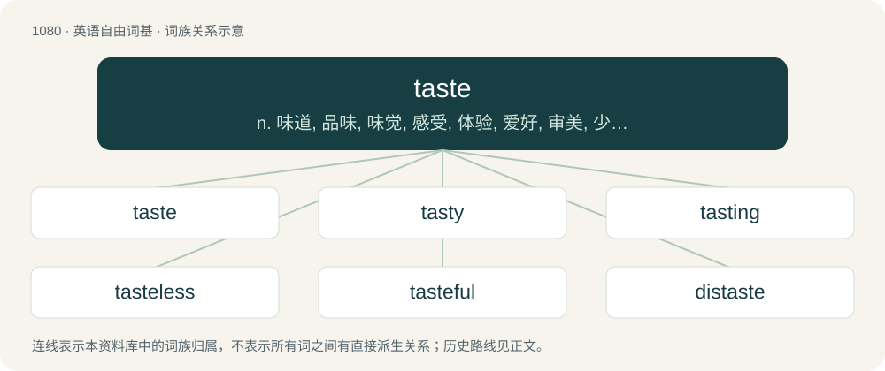

# 1159 · taste — n. 味道, 品味, 味觉, 感受, 体验, 爱好, 审美, 少量；vt. 尝, 察觉...的味道, 体会；vi. 品尝, 察觉味道, 有某种味道

[总目录](../00_总目录_按常用程度.md)

**类型**：英语自由词基　｜　**来源语言**：见词源记录

## 核心含义与来源

- 核心含义：n. 味道, 品味, 味觉, 感受, 体验, 爱好, 审美, 少量；vt. 尝, 察觉...的味道, 体会；vi. 品尝, 察觉味道, 有某种味道
- 英文含义：One of the sensations produced by the tongue in response to certain chemicals; the quality of giving this sensation.
- 词形：taste

**来源记录 1**（名词；One of the sensations produced by the tongue in response to certain chemicals; the quality of giving this sensation.）

The verb is from Middle English tasten, borrowed from Old French taster (“to taste, touch or hit”), from unattested Vulgar Latin \*tastāre (“to touch or feel”), from \*taxitāre, an innovated iterative form of Classical Latin taxāre (“to touch sharply”), from tangere (“to touch, to grasp”), ultimately from Proto-Indo-European \*teh₂g-, which is assumed to have had the same meaning as tangere. The noun came from the verb, and the two conflated after English lost its infinitive suffix -en, though tasten was most likely already used nominatively (as a gerund), similar to Modern English tasting. Almost fully displaced native smack, from Middle English smac, smak, smacke, from Old English smæc, smæċċ (“taste, smatch”). Displaced English smatch, from Middle English smacchen, smecchen, from Old English smæċċan (“to taste; to smack”); displaced also Middle English buriȝen, from Old English bierġan (“to taste”).

## 词族图

## 单词速览（常用到不常用）

| 单词 | 音标 | 释义 |
|---|---|---|
| [taste](#w-1) | /teɪst/ | n. 味道, 品味, 味觉, 感受, 体验, 爱好, 审美, 少量；vt. 尝, 察觉...的味道, 体会；vi. 品尝, 察觉味道, 有某种味道 |
| [tasty](#w-2) | /ˈteɪsti/ | a. 好吃的, 可口的 |
| [tasting](#w-3) | /ˈteɪstɪŋ/ | n. 品尝, 尝味 |
| [tasteless](#w-4) | /ˈteɪstləs/ | a. 没味道的, 无鉴赏力的 |
| [tasteful](#w-5) | /ˈteɪstfəl/ | a. 有鉴赏力的, 趣味高雅的, 雅观的 |
| [distaste](#w-6) | 美 /(ˌ)dɪsˈteɪst/ | n. 讨厌, 嫌恶 |
| [taster](#w-7) | /teɪstɚ/ | n. 尝味道者, 审阅人, 试味仪 |
| [aftertaste](#w-8) | 美 /ˈæftɚˌteɪst/ | n. 回味, 余韵 |
| [foretaste](#w-9) | /fɒːˈteist/ | vt. 预尝, 先试；n. 先尝, 预示 |

## 逐词详解

### 1. taste

**词性**：名词　｜　**音标**：/teɪst/

**中文释义**：n. 味道, 品味, 味觉, 感受, 体验, 爱好, 审美, 少量；vt. 尝, 察觉...的味道, 体会；vi. 品尝, 察觉味道, 有某种味道

**英文义项**：One of the sensations produced by the tongue in response to certain chemicals; the quality of giving this sensation. / The sense that consists in the perception and interpretation of this sensation.

**词源与演化**：

The verb is from Middle English tasten, borrowed from Old French taster (“to taste, touch or hit”), from unattested Vulgar Latin \*tastāre (“to touch or feel”), from \*taxitāre, an innovated iterative form of Classical Latin taxāre (“to touch sharply”), from tangere (“to touch, to grasp”), ultimately from Proto-Indo-European \*teh₂g-, which is assumed to have had the same meaning as tangere. The noun came from the verb, and the two conflated after English lost its infinitive suffix -en, though tasten was most likely already used nominatively (as a gerund), similar to Modern English tasting. Almost fully displaced native smack, from Middle English smac, smak, smacke, from Old English smæc, smæċċ (“taste, smatch”). Displaced English smatch, from Middle English smacchen, smecchen, from Old English smæċċan (“to taste; to smack”); displaced also Middle English buriȝen, from Old English bierġan (“to taste”).

**例句**：

> Such anecdotes give one a taste of life on a trauma ward.

该用例对应义项：A small amount of experience with something that gives a sense of its quality as a whole.

### 2. tasty

**词性**：形容词　｜　**音标**：/ˈteɪsti/

**中文释义**：a. 好吃的, 可口的

**英文义项**：Having a pleasant or satisfying flavor. / Appealing; when applied to persons, sexually appealing.

**构词拆分**：taste + -y

**词源与演化**：

From taste + -y. The Philippine sense is due to a genericized trademark from Taystee Bread Company, a defunct American company.

**例句**：

> You could make this tasty meal for breakfast.

该用例对应义项：Having a pleasant or satisfying flavor.

### 3. tasting

**词性**：名词　｜　**音标**：/ˈteɪstɪŋ/

**中文释义**：n. 品尝, 尝味

**英文义项**：A small amount of food or drink. / The taking of a small amount of food or drink into the mouth in order to taste it.

**构词拆分**：taste + -ing (gerundive ending)

**词源与演化**：

From Middle English tastynge, taastyng, equivalent to taste + -ing (gerundive ending).

**例句**：

> You forgot to shake up the milk bottle for a better tasting.

### 4. tasteless

**词性**：形容词　｜　**音标**：/ˈteɪstləs/

**中文释义**：a. 没味道的, 无鉴赏力的

**英文义项**：Having no flavour; bland; insipid. / Lacking delicacy, refinement, and good taste; unbecoming; crass.

**构词拆分**：taste + -less

**词源与演化**：

From taste + -less.

**例句**：

> That was a rather tasteless attack on the designer, especially given that many people like the design.

该用例对应义项：Lacking delicacy, refinement, and good taste; unbecoming; crass.

### 5. tasteful

**词性**：形容词　｜　**音标**：/ˈteɪstfəl/

**中文释义**：a. 有鉴赏力的, 趣味高雅的, 雅观的

**英文义项**：Having or exhibiting good taste; aesthetically pleasing or conforming to expectations or ideals of what is appropriate. / Having a high relish; savoury.

**构词拆分**：taste + -ful

**词源与演化**：

From taste + -ful.

**例句**：

> Her home was decorated with tasteful, classical furnishings.

该用例对应义项：Having or exhibiting good taste; aesthetically pleasing or conforming to expectations or ideals of what is appropriate.

### 6. distaste

**词性**：名词　｜　**音标**：美 /(ˌ)dɪsˈteɪst/

**中文释义**：n. 讨厌, 嫌恶

**英文义项**：A feeling of dislike, aversion or antipathy. / Alienation of affection; displeasure; anger.

**构词拆分**：dis- + taste

**词源与演化**：

From dis- + taste.

**例句**：

> He said both men agreed they share an "abhorrence and distaste" for war.

### 7. taster

**词性**：名词　｜　**音标**：/teɪstɚ/

**中文释义**：n. 尝味道者, 审阅人, 试味仪

**英文义项**：An object in which, or by which, food or drink is tasted, such as a small cup or spoon. / Someone who tastes something; especially, either (1) to check its quality (in food science, winemaking, etc.) or (2) as a security measure to prevent assassination of a protectee.

**构词拆分**：taste + -er

**词源与演化**：

From Middle English taster; equivalent to taste + -er.

**例句**：

> A flight of tasters was served to the people who would vote on the next soda flavor to be released.

该用例对应义项：An object in which, or by which, food or drink is tasted, such as a small cup or spoon.

### 8. aftertaste

**词性**：名词　｜　**音标**：美 /ˈæftɚˌteɪst/

**中文释义**：n. 回味, 余韵

**英文义项**：A taste of something that persists when it is no longer present. / The persistence of the taste of something no longer present.

**构词拆分**：after- + taste

**词源与演化**：

From after- + taste.

**例句**：

> Many people think certain artificial sweeteners have an unpleasant aftertaste.

该用例对应义项：The persistence of the taste of something no longer present.

### 9. foretaste

**词性**：名词　｜　**音标**：/fɒːˈteist/

**中文释义**：vt. 预尝, 先试；n. 先尝, 预示

**英文义项**：A taste beforehand. / A sample taken in anticipation; an experience undergone in advance.

**构词拆分**：fore- + taste (noun)

**词源与演化**：

From Middle English fortaste, equivalent to fore- + taste (noun).

**例句**：

> Every parting gives a foretaste of death, every reunion a hint of the resurrection.
