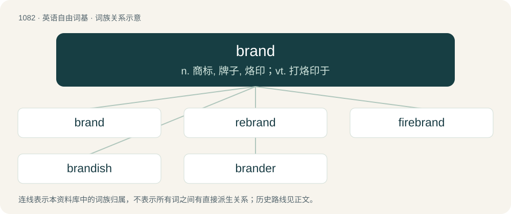

# 1160 · brand — n. 商标, 牌子, 烙印；vt. 打烙印于

[总目录](../00_总目录_按常用程度.md)

**类型**：英语自由词基　｜　**来源语言**：见词源记录

## 核心含义与来源

- 核心含义：n. 商标, 牌子, 烙印；vt. 打烙印于
- 英文含义：A mark or scar made by burning with a hot iron, especially to mark cattle or to classify the contents of a cask.
- 词形：brand

**来源记录 1**（名词；A mark or scar made by burning with a hot iron, especially to mark cattle or to classify the contents of a cask.）

From Middle English brand, from Old English brand (“fire; flame; burning; torch; sword”), from Proto-West Germanic \*brand, from Proto-Germanic \*brandaz (“flame; flaming; fire-brand; torch; sword”), derived from Proto-Germanic \*brinnaną (“to burn”), possibly from Proto-Indo-European \*bʰrewh₁- (“to boil; brew”). Cognate with Scots brand, West Frisian brân (“fire”), Dutch brand, German Brand, Danish brand, Swedish brand (“blaze, fire”), Icelandic brandur, French brand (&lt; Germanic). More distantly cognate with Proto-Slavic \*gorěti (“to burn”).

## 词族图

## 单词速览（常用到不常用）

| 单词 | 音标 | 释义 |
|---|---|---|
| [brand](#w-1) | 英 /ˈbɹænd/；美 /ˈbɹænd/ | n. 商标, 牌子, 烙印；vt. 打烙印于 |
| [rebrand](#w-2) | /ɹiːˈbɹænd/ | v. 给（产品或组织）重新命名（或包装）, 重塑…的形象 |
| [firebrand](#w-3) | 英 /ˈfaɪə.bɹænd/；美 /ˈfaɪɚ.bɹænd/ | n. 火把, 在燃烧的木柴, 煽动叛乱者 |
| [brandish](#w-4) | /ˈbɹændɪʃ/ | vt. 挥, 挥舞；n. 挥舞 |
| [brander](#w-5) | /ˈbrændə/ | n. 打烙印的人 |

## 逐词详解

### 1. brand

**词性**：名词　｜　**音标**：英 /ˈbɹænd/；美 /ˈbɹænd/

**中文释义**：n. 商标, 牌子, 烙印；vt. 打烙印于

**英文义项**：A mark or scar made by burning with a hot iron, especially to mark cattle or to classify the contents of a cask. / A branding iron.

**词源与演化**：

From Middle English brand, from Old English brand (“fire; flame; burning; torch; sword”), from Proto-West Germanic \*brand, from Proto-Germanic \*brandaz (“flame; flaming; fire-brand; torch; sword”), derived from Proto-Germanic \*brinnaną (“to burn”), possibly from Proto-Indo-European \*bʰrewh₁- (“to boil; brew”). Cognate with Scots brand, West Frisian brân (“fire”), Dutch brand, German Brand, Danish brand, Swedish brand (“blaze, fire”), Icelandic brandur, French brand (&lt; Germanic). More distantly cognate with Proto-Slavic \*gorěti (“to burn”).

**例句**：

> Some brands of breakfast cereal contain a lot of sugar.

该用例对应义项：A specific product, service, or provider so distinguished.

### 2. rebrand

**词性**：动词　｜　**音标**：/ɹiːˈbɹænd/

**中文释义**：v. 给（产品或组织）重新命名（或包装）, 重塑…的形象

**英文义项**：To change the brand name, logo, or image of a product or organization.

**构词拆分**：re- + brand

**词源与演化**：

From re- + brand.

**例句**：

> Acme Co. is trying to rebrand their line of toasters under the Bewidget name.

该用例对应义项：To change the brand name, logo, or image of a product or organization.

### 3. firebrand

**词性**：名词　｜　**音标**：英 /ˈfaɪə.bɹænd/；美 /ˈfaɪɚ.bɹænd/

**中文释义**：n. 火把, 在燃烧的木柴, 煽动叛乱者

**英文义项**：A torch or other burning stick with a flame at one end. / An argumentative troublemaker or revolutionary; one who agitates against the status quo.

**构词拆分**：fire + brand

**词源与演化**：

From Middle English fyr-brand, furbrond, equivalent to fire + brand. Cognate with German Feuerbrand (“firebrand”).

**例句**：

> The crowd cheered as a firebrand was tossed onto the huge pile of wood to start the traditional homecoming bonfire.

该用例对应义项：A torch or other burning stick with a flame at one end.

### 4. brandish

**词性**：动词　｜　**音标**：/ˈbɹændɪʃ/

**中文释义**：vt. 挥, 挥舞；n. 挥舞

**英文义项**：To move or swing a weapon back and forth, particularly if demonstrating anger, threat or skill. / To bear something with ostentatious show.

**构词拆分**：brand + -ish

**词源与演化**：

From Middle English braundischen, from Old French brandiss-, stem of brandir (“to flourish a sword”), from Frankish \*brandijan, from Frankish \*brand (“firebrand; sword”), from Proto-Germanic \*brandaz (“fire; flame; sword”), whence Old English brand (“firebrand; torch”); equivalent to brand + -ish. More at brand.

**例句**：

> He brandished his sword at the pirates.

该用例对应义项：To move or swing a weapon back and forth, particularly if demonstrating anger, threat or skill.

### 5. brander

**词性**：名词　｜　**音标**：/ˈbrændə/

**中文释义**：n. 打烙印的人

**英文义项**：A person who brands. / An implement used to brand something; a branding iron.

**构词拆分**：From brand + -er.

**词源与演化**：

From brand + -er.
