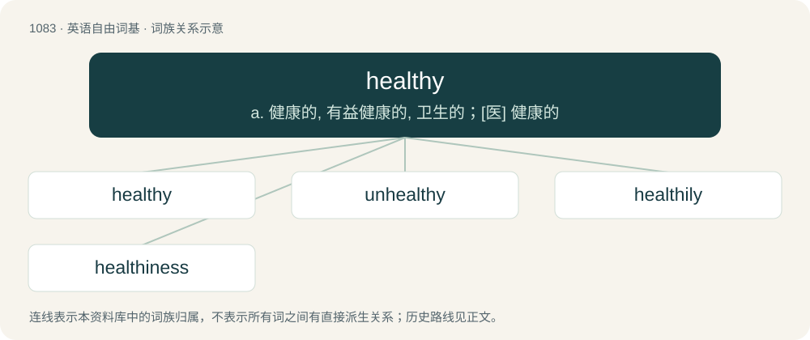

# 1161 · healthy — a. 健康的, 有益健康的, 卫生的；\[医\] 健康的

[总目录](../00_总目录_按常用程度.md)

**类型**：英语自由词基　｜　**来源语言**：见词源记录

## 核心含义与来源

- 核心含义：a. 健康的, 有益健康的, 卫生的；\[医\] 健康的
- 英文含义：Enjoying good health; free from disease or disorder.
- 词形：healthy

**来源记录 1**（形容词；Enjoying good health; free from disease or disorder.）

From health + -y.

## 词族图

## 单词速览（常用到不常用）

| 单词 | 音标 | 释义 |
|---|---|---|
| [healthy](#w-1) | 英 /ˈhɛl.θi/ | a. 健康的, 有益健康的, 卫生的；\[医\] 健康的 |
| [unhealthy](#w-2) | 英 /ʌnˈhɛl.θi/ | a. 不健康的 |
| [healthily](#w-3) | /ˈhelθili/ | adv. 健康地 |
| [healthiness](#w-4) | /ˈhelθinis/ | n. 健康, 健全 |

## 逐词详解

### 1. healthy

**词性**：形容词　｜　**音标**：英 /ˈhɛl.θi/

**中文释义**：a. 健康的, 有益健康的, 卫生的；\[医\] 健康的

**英文义项**：Enjoying good health; free from disease or disorder. / Conducive to health.

**构词拆分**：health + -y

**词源与演化**：

From health + -y.

**例句**：

> Sam unwrapped the sandwich and took a healthy bite out of the middle.

该用例对应义项：Significant, hefty; beneficial.

### 2. unhealthy

**词性**：形容词　｜　**音标**：英 /ʌnˈhɛl.θi/

**中文释义**：a. 不健康的

**英文义项**：Characterized by, or conducive to poor health. / Sick or ill.

**构词拆分**：un- + healthy

**词源与演化**：

From un- + healthy.

**例句**：

> The villagers lived in unhealthy surroundings.

该用例对应义项：Characterized by, or conducive to poor health.

### 3. healthily

**词性**：副词　｜　**音标**：/ˈhelθili/

**中文释义**：adv. 健康地

**英文义项**：In a healthy manner.

**构词拆分**：healthy + -ly

**词源与演化**：

From healthy + -ly.

**例句**：

> The answers were healthily individual.

该用例对应义项：in a levelheaded manner

### 4. healthiness

**词性**：名词　｜　**音标**：/ˈhelθinis/

**中文释义**：n. 健康, 健全

**英文义项**：The state or quality of being healthy. / The product or result of being healthy.

**构词拆分**：healthy + -ness

**词源与演化**：

From healthy + -ness.

**例句**：

> If you pour a lot of dressing on your salad, it cancels out some of the healthiness of the salad itself.
