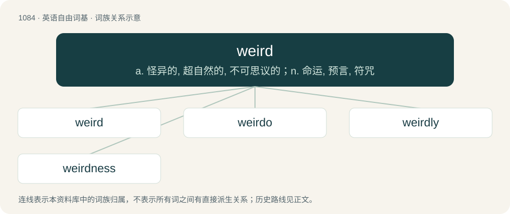

# 1162 · weird — a. 怪异的, 超自然的, 不可思议的；n. 命运, 预言, 符咒

[总目录](../00_总目录_按常用程度.md)

**类型**：英语自由词基　｜　**来源语言**：见词源记录

## 核心含义与来源

- 核心含义：a. 怪异的, 超自然的, 不可思议的；n. 命运, 预言, 符咒
- 英文含义：Having an unusually strange character or behaviour.
- 词形：weird

**来源记录 1**（形容词；Having an unusually strange character or behaviour.）

From Middle English werde, wierde, wirde, wyrede, wurde, from Old English wyrd (“fate”), from Proto-West Germanic \*wurdi, from Proto-Germanic \*wurdiz, from Proto-Indo-European \*wert- (“to turn, wind”). Cognate with Icelandic urður (“fate”). Related to Old English weorþan (“to become”); more at worth (verb). Doublet of wyrd, a reborrowing of the original sense and spelling. Obsolete by the 16th century in English, it was reintroduced by Shakespeare, who borrowed Middle Scots weird as weyward in the name of the Weyward Sisters (later respelt as Weird Sisters), meaning “Sisters of Fate”. The senses “abnormal”, “strange” etc., arising from a reinterpretatation of the Sisters' naming, are posterior to his borrowing.

## 词族图

## 单词速览（常用到不常用）

| 单词 | 音标 | 释义 |
|---|---|---|
| [weird](#w-1) | 英 /ˈwɪə(ɹ)d/；美 /ˈwiɚd/ | a. 怪异的, 超自然的, 不可思议的；n. 命运, 预言, 符咒 |
| [weirdo](#w-2) | 英 /ˈwɪə.dəʊ/；美 /ˈwiɹ.doʊ/ | n. 古怪的人, 奇怪的人 |
| [weirdly](#w-3) | /ˈwɪə(ɹ)dli/ | adv. 古怪地 |
| [weirdness](#w-4) | 美 /ˈwɪɚdnəs/ | n. 命运；不可思议；离奇 |

## 逐词详解

### 1. weird

**词性**：形容词　｜　**音标**：英 /ˈwɪə(ɹ)d/；美 /ˈwiɚd/

**中文释义**：a. 怪异的, 超自然的, 不可思议的；n. 命运, 预言, 符咒

**英文义项**：Having an unusually strange character or behaviour. / Deviating from the normal; bizarre.

**词源与演化**：

From Middle English werde, wierde, wirde, wyrede, wurde, from Old English wyrd (“fate”), from Proto-West Germanic \*wurdi, from Proto-Germanic \*wurdiz, from Proto-Indo-European \*wert- (“to turn, wind”). Cognate with Icelandic urður (“fate”). Related to Old English weorþan (“to become”); more at worth (verb). Doublet of wyrd, a reborrowing of the original sense and spelling. Obsolete by the 16th century in English, it was reintroduced by Shakespeare, who borrowed Middle Scots weird as weyward in the name of the Weyward Sisters (later respelt as Weird Sisters), meaning “Sisters of Fate”. The senses “abnormal”, “strange” etc., arising from a reinterpretatation of the Sisters' naming, are posterior to his borrowing.

**例句**：

> It was quite weird to bump into all my ex-girlfriends on the same day.

该用例对应义项：Deviating from the normal; bizarre.

### 2. weirdo

**词性**：名词　｜　**音标**：英 /ˈwɪə.dəʊ/；美 /ˈwiɹ.doʊ/

**中文释义**：n. 古怪的人, 奇怪的人

**英文义项**：A strange, odd, eccentric person. / An insane, possibly dangerous person.

**构词拆分**：weird + -o (“person with characteristic”)

**词源与演化**：

From weird + -o (“person with characteristic”). First attested in the early 1950s, in American English. The similar word weirdie (“odd, unconventional person”) is attested from earlier, in 1887; in Scottish English.

**例句**：

> Ziri found out he wasn't the only one with a weirdo brother.

### 3. weirdly

**词性**：副词　｜　**音标**：/ˈwɪə(ɹ)dli/

**中文释义**：adv. 古怪地

**英文义项**：In a weird manner. / Contrary to expectations.

**构词拆分**：weird + -ly

**词源与演化**：

From weird + -ly.

**例句**：

> Weirdly, Alice showed up 10 minutes early. She was usually late for everything.

该用例对应义项：Contrary to expectations.

### 4. weirdness

**词性**：名词　｜　**音标**：美 /ˈwɪɚdnəs/

**中文释义**：n. 命运；不可思议；离奇

**英文义项**：The state or quality of being weird. / The result or product of being weird.

**构词拆分**：weird + -ness

**词源与演化**：

From weird + -ness.

**例句**：

> Yanni's weirdness was part of his charm.
