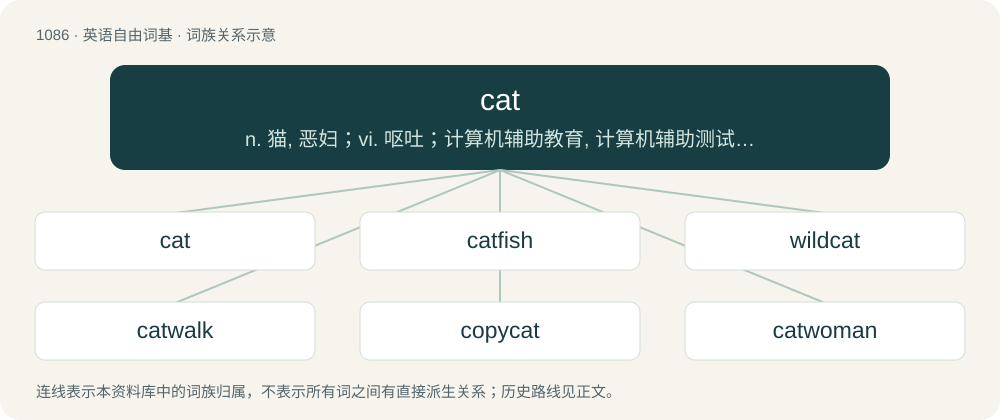

# 1164 · cat — n. 猫, 恶妇；vi. 呕吐；计算机辅助教育, 计算机辅助测试, 计算机辅助翻译, 计算机辅助排版

[总目录](../00_总目录_按常用程度.md)

**类型**：英语自由词基　｜　**来源语言**：见词源记录

## 核心含义与来源

- 核心含义：n. 猫, 恶妇；vi. 呕吐；计算机辅助教育, 计算机辅助测试, 计算机辅助翻译, 计算机辅助排版
- 英文含义：A mammal of the family Felidae.
- 词形：cat

**多个词源／构词路径**：同一拼写可能有不同来源；以下按词性和含义分别列出。

**来源记录 1**（名词；A mammal of the family Felidae.）

From Middle English cat, catte, from Old English catt (“male cat”), catte (“female cat”), from Proto-West Germanic \*kattu, from Proto-Germanic \*kattuz, generally thought to be from Late Latin cattus (“domestic cat”) (c. 350, Palladius), from Latin catta (c. 75 A.D., Martial), possibly from an Afroasiatic language. Doublet of gato. A loan from Afro-Asiatic into European languages would roughly match how the animal itself spread, as genetic studies suggest domestic cats first began to spread out of the Near East / Fertile Crescent during the Neolithic, especially after they became popular and domesticated in Egypt 4000 years ago; they were found in Greece and Italy later, 2500 years ago. However, every proposed source word has presented problems. Adolphe Pictet and many subsequent sources refer to Barabra (Nubian) \[script needed\] (kaddîska) and "Nouba" (Nobiin) ⲕⲁⲇⲓ̄ⲥ (kadīs, “kadīs”) as possible sources or cognates, but M. Lionel Bender says the Nubian word is a loan from Arabic قِطَّة (qiṭṭa), which has long been thought to be non-Arabic in origin. Jean-Paul Savignac suggests the Latin word is from an Egyptian precursor of Coptic ϣⲁⲩ (šau, “tomcat”) suffixed with feminine -t, but John Huehnergard says "the source … was clearly not Egyptian itself, where no analogous form is attested." It may be a wanderword. Kroonen says the word must have existed in Germanic from a very early date, as it shows morphological alternations, and suggests that it might have been borrowed from Uralic, compare Northern Sami gađfe (“female stoat”) and Hungarian hölgy (“stoat; lady, bride”) from Proto-Uralic \*käďwä (“female (of a fur animal)”). Cognates Related to Scots cat (“cat”), North Frisian kaat, kaot, Kat, kåt (“cat”), Saterland Frisian Kat (“cat”), West Frisian kat (“cat”), Alemannic German Chats, Chatz, chatza, chatzu, chatzò, chàzzà, Kàtz (“cat”), Bavarian ckozza, Katz, khoze, kòtze (“cat”), Cimbrian katze, khatz, khatza (“cat”), Dutch kat (“cat”), German Katze (“cat”), German Low German Katt (“cat”), Luxembourgish Kaz (“cat”), Mòcheno kòtz (“cat”), Yiddish קאַץ (kats, “cat”), Danish kat (“cat”), Faroese køttur (“cat”), Icelandic köttur (“cat”), Norwegian Bokmål, Norwegian Nynorsk and Swedish katt (“cat”), Latin cattus, catus (“cat”), Aromanian cãtush (“cat”), French chat (“cat”), Occitan, Norman cat (“cat”), Portuguese, Spanish gato (“cat”), Breton kaz, kazh (“cat”), Cornish cath, kath (“cat”), Irish cat, cut (“cat”), Scottish Gaelic cat (“cat”), Welsh cath (“cat”), as well as Ancient Greek κάτα (káta), κάττα (kátta, “cat”), Greek γάτα (gáta, “cat”), Turkish kedi (“cat”), and from the same ultimate source Belarusian, Russian кот (kot, “cat”), Ukrainian кіт (kit, “cat”), Polish kot (“cat”), Kashubian kòt (“cat”), Latvian kaķis (“cat”), Lithuanian katė (“cat”), and more distantly Armenian կատու (katu, “cat”), Basque katu (“cat”), Georgian კატა (ḳaṭa, “cat”), Classical Syriac ܩܛܐ, ܩܛܘ (“cat”), Arabic قِطَّة (qiṭṭa, “cat”) alongside dialectal Maghrebi Arabic قَطُّوس (qaṭṭūs, “cat”) (from Berber, probably from Latin).

**来源记录 2**（名词；A program and command in Unix that reads one or more files and directs their content to the standard output.）

From concatenate, derived from the program's function of concatenating files. Compare concat.

**来源记录 3**（名词；A street name of the drug methcathinone.）

Abbreviations.

## 词族图

## 单词速览（常用到不常用）

| 单词 | 音标 | 释义 |
|---|---|---|
| [cat](#w-1) | 英 /ˈkæt/；美 /ˈkæt/ | n. 猫, 恶妇；vi. 呕吐；计算机辅助教育, 计算机辅助测试, 计算机辅助翻译, 计算机辅助排版 |
| [catfish](#w-2) | /ˈkætfɪʃ/ | n. 鲶鱼 |
| [wildcat](#w-3) | 英 /ˈwaɪldˌkæt/；美 /ˈwaɪ.əldˌkæt/ | n. 野猫, 凶悍的人；a. 非法经营的, 不可靠的；vi. 盲目钻井, 从事非法商业活动 |
| [catwalk](#w-4) | /ˈkætwɒːk/ | n. 狭小通道 |
| [copycat](#w-5) | 美 /kɑpiˈkæt/ | n. 模仿者 |
| [catwoman](#w-6) |  | 猫女（虚拟人物） |
| [bobcat](#w-7) | 英 /ˈbɒb.kæt/；美 /ˈbɔb.kæt/ | n. 红猫, 短尾猫 |
| [catnip](#w-8) | /ˈkætnɪp/ | n. 假荆芥, 樟脑草；\[医\] 樟脑草(潞州荆芥) |
| [catty](#w-9) | /ˈkæti/ | a. 恶毒的, 如猫的；\[经\] 斤 |
| [hellcat](#w-10) | 美 /ˈhɛlˌkæt/ | n. 悍妇, 泼妇人, 巫婆 |
| [bearcat](#w-11) | 美 /ˈbɛɚˌkæt/ | n. 熊猫, 勇士 |
| [catsuit](#w-12) | 美 /ˈkætˌsut/ | n. 女式紧身连衣裤 |
| [catfight](#w-13) | /ˈkætfait/ | n. 激烈的争辩 |

## 逐词详解

### 1. cat

**词性**：名词　｜　**音标**：英 /ˈkæt/；美 /ˈkæt/

**中文释义**：n. 猫, 恶妇；vi. 呕吐；计算机辅助教育, 计算机辅助测试, 计算机辅助翻译, 计算机辅助排版

**英文义项**：A mammal of the family Felidae. / A carnivorous, four-legged, generally furry domesticated species (Felis catus) of feline animal, commonly kept as a house pet.

**词源与演化**：

From Middle English cat, catte, from Old English catt (“male cat”), catte (“female cat”), from Proto-West Germanic \*kattu, from Proto-Germanic \*kattuz, generally thought to be from Late Latin cattus (“domestic cat”) (c. 350, Palladius), from Latin catta (c. 75 A.D., Martial), possibly from an Afroasiatic language. Doublet of gato. A loan from Afro-Asiatic into European languages would roughly match how the animal itself spread, as genetic studies suggest domestic cats first began to spread out of the Near East / Fertile Crescent during the Neolithic, especially after they became popular and domesticated in Egypt 4000 years ago; they were found in Greece and Italy later, 2500 years ago. However, every proposed source word has presented problems. Adolphe Pictet and many subsequent sources refer to Barabra (Nubian) \[script needed\] (kaddîska) and "Nouba" (Nobiin) ⲕⲁⲇⲓ̄ⲥ (kadīs, “kadīs”) as possible sources or cognates, but M. Lionel Bender says the Nubian word is a loan from Arabic قِطَّة (qiṭṭa), which has long been thought to be non-Arabic in origin. Jean-Paul Savignac suggests the Latin word is from an Egyptian precursor of Coptic ϣⲁⲩ (šau, “tomcat”) suffixed with feminine -t, but John Huehnergard says "the source … was clearly not Egyptian itself, where no analogous form is attested." It may be a wanderword. Kroonen says the word must have existed in Germanic from a very early date, as it shows morphological alternations, and suggests that it might have been borrowed from Uralic, compare Northern Sami gađfe (“female stoat”) and Hungarian hölgy (“stoat; lady, bride”) from Proto-Uralic \*käďwä (“female (of a fur animal)”). Cognates Related to Scots cat (“cat”), North Frisian kaat, kaot, Kat, kåt (“cat”), Saterland Frisian Kat (“cat”), West Frisian kat (“cat”), Alemannic German Chats, Chatz, chatza, chatzu, chatzò, chàzzà, Kàtz (“cat”), Bavarian ckozza, Katz, khoze, kòtze (“cat”), Cimbrian katze, khatz, khatza (“cat”), Dutch kat (“cat”), German Katze (“cat”), German Low German Katt (“cat”), Luxembourgish Kaz (“cat”), Mòcheno kòtz (“cat”), Yiddish קאַץ (kats, “cat”), Danish kat (“cat”), Faroese køttur (“cat”), Icelandic köttur (“cat”), Norwegian Bokmål, Norwegian Nynorsk and Swedish katt (“cat”), Latin cattus, catus (“cat”), Aromanian cãtush (“cat”), French chat (“cat”), Occitan, Norman cat (“cat”), Portuguese, Spanish gato (“cat”), Breton kaz, kazh (“cat”), Cornish cath, kath (“cat”), Irish cat, cut (“cat”), Scottish Gaelic cat (“cat”), Welsh cath (“cat”), as well as Ancient Greek κάτα (káta), κάττα (kátta, “cat”), Greek γάτα (gáta, “cat”), Turkish kedi (“cat”), and from the same ultimate source Belarusian, Russian кот (kot, “cat”), Ukrainian кіт (kit, “cat”), Polish kot (“cat”), Kashubian kòt (“cat”), Latvian kaķis (“cat”), Lithuanian katė (“cat”), and more distantly Armenian կատու (katu, “cat”), Basque katu (“cat”), Georgian კატა (ḳaṭa, “cat”), Classical Syriac ܩܛܐ, ܩܛܘ (“cat”), Arabic قِطَّة (qiṭṭa, “cat”) alongside dialectal Maghrebi Arabic قَطُّوس (qaṭṭūs, “cat”) (from Berber, probably from Latin).

**用法示例／搭配（非完整句）**：

> civet cat polecat

该用例对应义项：Chiefly with a descriptive word: an animal not of the family Felidae which (somewhat) resembles a domestic feline (etymology 1, noun sense 1.1.1).

### 2. catfish

**词性**：动词　｜　**音标**：/ˈkætfɪʃ/

**中文释义**：n. 鲶鱼

**英文义项**：To fish for catfish.

**构词拆分**：cat + fish

**词源与演化**：

From cat + fish. Likely so named for its prominent barbels like a cat's whiskers. Compare West Frisian katfisk (“catfish”), Dutch katvis (“catfish”). Compare also German Seekatze (“catfish”, literally “sea-cat”).

**例句**：

> I only use this rod for catfishing.

该用例对应义项：To fish for catfish.

### 3. wildcat

**词性**：动词　｜　**音标**：英 /ˈwaɪldˌkæt/；美 /ˈwaɪ.əldˌkæt/

**中文释义**：n. 野猫, 凶悍的人；a. 非法经营的, 不可靠的；vi. 盲目钻井, 从事非法商业活动

**英文义项**：To drill for oil in an area where no oil has been found before.

**构词拆分**：wild + cat

**词源与演化**：

From Middle English wyld cat, wylde cat (in the plural as wild cattes, wylde catis, wyle cattes), equivalent to wild + cat. Cognate with Middle Low German wiltkatte, German Wildkatze, Swedish vildkatt. Its adjectival senses were originally American and derived from the "wildcat banks" of Michigan, following its elevation to statehood in 1837. Two laws—one easing the requirements for establishing a new bank and another occasioned by the Panic of 1837 that removed the need for payment in specie—led to the creation and collapse of around 50 banks within two years. The term is apocryphally derived from a wildcat supposedly featured on the currency printed by one of these banks, but more probably derived from the remote locations "where the wildcats roamed" chosen by these banks to avoid oversight and minimize redemption of notes.

**例句**：

> These days, the wildcat is a protected species in Algeria.

### 4. catwalk

**词性**：名词　｜　**音标**：/ˈkætwɒːk/

**中文释义**：n. 狭小通道

**英文义项**：An elevated enclosed passage providing access fore and aft from the bridge of a merchant vessel. / Any similar elevated walkway.

**构词拆分**：cat + walk

**词源与演化**：

From cat + walk.

**例句**：

> Models displayed clothes on a catwalk at the fashion show.

该用例对应义项：narrow platform extending out into an auditorium

### 5. copycat

**词性**：名词　｜　**音标**：美 /kɑpiˈkæt/

**中文释义**：n. 模仿者

**英文义项**：One who imitates or plagiarizes the work of others. / A criminal who imitates the crimes of another; specifically, a criminal who commits the same crime, especially a highly-publicized one, that has recently been committed by someone else.

**构词拆分**：copy + cat (“a former derogatory term for a person”)

**词源与演化**：

Originally American English, from copy + cat (“a former derogatory term for a person”).

**用法示例／搭配（非完整句）**：

> a copycat strangler

该用例对应义项：A criminal who imitates the crimes of another; specifically, a criminal who commits the same crime, especially a highly-publicized one, that has recently been committed by someone else.

### 6. catwoman

**词性**：名词

**中文释义**：猫女（虚拟人物）

**英文义项**：A woman in a cat costume.

**构词拆分**：cat + woman

**词源与演化**：

From cat + woman.

### 7. bobcat

**词性**：名词　｜　**音标**：英 /ˈbɒb.kæt/；美 /ˈbɔb.kæt/

**中文释义**：n. 红猫, 短尾猫

**英文义项**：A North American wildcat (Lynx rufus), having tufted ears and a short tail.

**构词拆分**：bob (short hair; with reference to its tail) + cat

**词源与演化**：

From bob (short hair; with reference to its tail) + cat.

**例句**：

> Pounce is an amber and gold bobcat with light brown eyes facial markings and a pink nose.

### 8. catnip

**词性**：名词　｜　**音标**：/ˈkætnɪp/

**中文释义**：n. 假荆芥, 樟脑草；\[医\] 樟脑草(潞州荆芥)

**英文义项**：Any of the about 250 species of flowering plant of the genus Nepeta, family Lamiaceae, certain of which are said to have medicinal qualities. / Nepeta cataria and Nepeta grandiflora (and perhaps other species), which are well-known for causing an apparently harmless pheromone-based intoxication among certain cats.

**构词拆分**：cat + nep

**词源与演化**：

Compound of cat + nep, nip (“catnip”), from Middle English nep, from Old English nepte, from Proto-West Germanic \*nepetā, from Latin nepeta (“catnip”). Compare earlier catmint (“catnip”), from Middle English catt mynte, which very likely existed in Old English (as \*cattes minte) as well.

**例句**：

> Their outrage was catnip to the trolls who had deepfaked the video.

该用例对应义项：Something that causes excitement or interest.

### 9. catty

**词性**：形容词　｜　**音标**：/ˈkæti/

**中文释义**：a. 恶毒的, 如猫的；\[经\] 斤

**英文义项**：Resembling or characteristic of a cat. / With subtle hostility in an effort to hurt, annoy, or upset (particularly in interactions between women).

**构词拆分**：cat + -y

**词源与演化**：

From cat + -y. Compare Dutch kattig, which also means “subtly hostile” and is formed the same way (kat + -ig); see also catfight.

**例句**：

> I heard a catty shriek.

该用例对应义项：Resembling or characteristic of a cat.

### 10. hellcat

**词性**：名词　｜　**音标**：美 /ˈhɛlˌkæt/

**中文释义**：n. 悍妇, 泼妇人, 巫婆

**英文义项**：A witch. / A spiteful and violent person, especially a woman.

**构词拆分**：hell + cat

**词源与演化**：

From hell + cat.

### 11. bearcat

**词性**：名词　｜　**音标**：美 /ˈbɛɚˌkæt/

**中文释义**：n. 熊猫, 勇士

**英文义项**：A binturong (Arctictis binturong, in the family Viverridae).

**构词拆分**：bear + cat

**词源与演化**：

From bear + cat.

### 12. catsuit

**词性**：名词　｜　**音标**：美 /ˈkætˌsut/

**中文释义**：n. 女式紧身连衣裤

**英文义项**：A tight-fitting one-piece women's garment, covering the legs, arms and torso.

**构词拆分**：cat + suit

**词源与演化**：

From cat + suit.

### 13. catfight

**词性**：名词　｜　**音标**：/ˈkætfait/

**中文释义**：n. 激烈的争辩

**英文义项**：A fight between cats. / A fight or bickering, especially between women.

**构词拆分**：cat + fight

**词源与演化**：

From cat + fight. So named because, like cats, scratching is a common defensive tactic among women, as opposed to a fistfight between men.

**例句**：

> Nancy and Sheila got into a catfight when Nancy's boyfriend cheated on her with Sheila.

该用例对应义项：A fight or bickering, especially between women.
