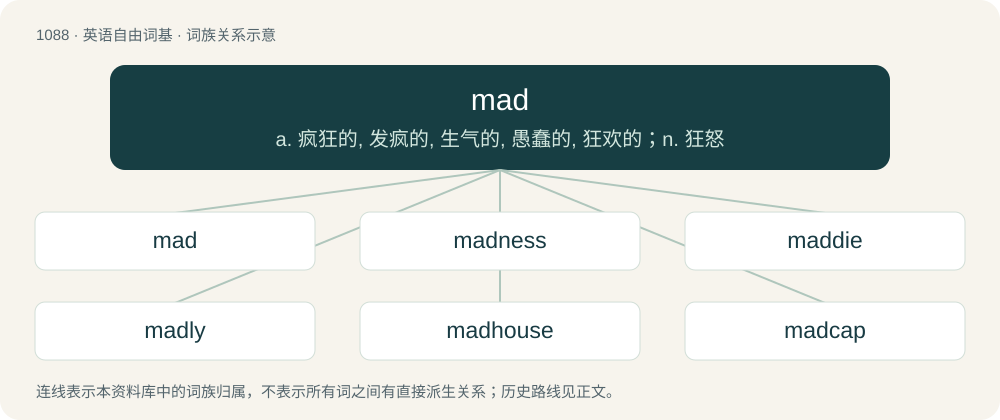

# 1165 · mad — a. 疯狂的, 发疯的, 生气的, 愚蠢的, 狂欢的；n. 狂怒

[总目录](../00_总目录_按常用程度.md)

**类型**：英语自由词基　｜　**来源语言**：见词源记录

## 核心含义与来源

- 核心含义：a. 疯狂的, 发疯的, 生气的, 愚蠢的, 狂欢的；n. 狂怒
- 英文含义：Insane; crazy; mentally deranged.
- 词形：mad

**多个词源／构词路径**：同一拼写可能有不同来源；以下按词性和含义分别列出。

**来源记录 1**（形容词；Insane; crazy; mentally deranged.）

From Middle English mad, madde, madd, medd, from Old English ġemǣd, ġemǣded (“enraged”), past participle of ġemǣdan, \*mǣdan (“to make insane or foolish”), from Proto-Germanic \*maidijaną (“to change; damage; cripple; injure; make mad”), from Proto-Germanic \*maidaz ("weak; crippled"; compare Old English gemād (“silly, mad”), Old High German gimeit (“foolish, crazy”), literary German gemeit (“mad, insane”), Gothic 𐌲𐌰𐌼𐌰𐌹𐌸𐍃 (gamaiþs, “crippled”)), from Proto-Indo-European \*mey- ("to change"; compare Old Irish máel (“bald, dull”), Old Lithuanian ap-maitinti (“to wound”), Sanskrit मेथति (méthati, “he hurts, comes to blows”)).

**来源记录 2**（动词；To madden, to anger, to frustrate.）

Inherited from Middle English madden. Compare Old English ġemǣdan.

## 词族图

## 单词速览（常用到不常用）

| 单词 | 音标 | 释义 |
|---|---|---|
| [mad](#w-1) | /ˈmæd/ | a. 疯狂的, 发疯的, 生气的, 愚蠢的, 狂欢的；n. 狂怒 |
| [madness](#w-2) | 英 /ˈmad.nəs/；美 /ˈmæd.nəs/ | n. 疯狂, 愚蠢的行为；\[医\] 狂, 疯狂 |
| [maddie](#w-3) |  | 【英文】A mad person. |
| [madly](#w-4) | /ˈmædli/ | adv. 发狂地, 精神失常地, 愚蠢地 |
| [madhouse](#w-5) | 美 /ˈmædˌhaʊs/ | n. 精神病院, 极为吵闹的场所 |
| [madcap](#w-6) | 英 /ˈmædkæp/；美 /ˈmædˌkæp/ | a. 鲁莽的, 冲动的；n. 鲁莽的人 |
| [madwoman](#w-7) | /ˈmædwumən/ | n. 狂女, 疯女 |

## 逐词详解

### 1. mad

**词性**：形容词　｜　**音标**：/ˈmæd/

**中文释义**：a. 疯狂的, 发疯的, 生气的, 愚蠢的, 狂欢的；n. 狂怒

**英文义项**：Insane; crazy; mentally deranged. / Angry; annoyed.

**词源与演化**：

From Middle English mad, madde, madd, medd, from Old English ġemǣd, ġemǣded (“enraged”), past participle of ġemǣdan, \*mǣdan (“to make insane or foolish”), from Proto-Germanic \*maidijaną (“to change; damage; cripple; injure; make mad”), from Proto-Germanic \*maidaz ("weak; crippled"; compare Old English gemād (“silly, mad”), Old High German gimeit (“foolish, crazy”), literary German gemeit (“mad, insane”), Gothic 𐌲𐌰𐌼𐌰𐌹𐌸𐍃 (gamaiþs, “crippled”)), from Proto-Indo-European \*mey- ("to change"; compare Old Irish máel (“bald, dull”), Old Lithuanian ap-maitinti (“to wound”), Sanskrit मेथति (méthati, “he hurts, comes to blows”)).

**例句**：

> You want to spend a thousand pounds on a pair of shoes? Are you mad?

该用例对应义项：Insane; crazy; mentally deranged.

### 2. madness

**词性**：名词　｜　**音标**：英 /ˈmad.nəs/；美 /ˈmæd.nəs/

**中文释义**：n. 疯狂, 愚蠢的行为；\[医\] 狂, 疯狂

**英文义项**：The state of being mad; insanity; mental disease. / The state of being angry.

**构词拆分**：mad + -ness

**词源与演化**：

From Middle English madnes, madnesse; equivalent to mad + -ness.

**例句**：

> He who lives without madness is not as wise as he thinks.

### 3. maddie

**词性**：名词

**英文义项**：A mad person.

**构词拆分**：mad + -ie

**词源与演化**：

From mad + -ie.

### 4. madly

**词性**：副词　｜　**音标**：/ˈmædli/

**中文释义**：adv. 发狂地, 精神失常地, 愚蠢地

**英文义项**：without reason or understanding; wildly. / angrily

**构词拆分**：mad + -ly

**词源与演化**：

From Middle English madly, madli, medliche, equivalent to mad + -ly.

**例句**：

> Diane screamed madly down the phone to the prank caller.

该用例对应义项：angrily

### 5. madhouse

**词性**：名词　｜　**音标**：美 /ˈmædˌhaʊs/

**中文释义**：n. 精神病院, 极为吵闹的场所

**英文义项**：A chaotic, uproarious, noisy place.

**构词拆分**：mad + house

**词源与演化**：

From mad + house.

**例句**：

> It's not a madhouse. It's a clinic for the mentally unstable.

### 6. madcap

**词性**：形容词　｜　**音标**：英 /ˈmædkæp/；美 /ˈmædˌkæp/

**中文释义**：a. 鲁莽的, 冲动的；n. 鲁莽的人

**英文义项**：Capricious, impulsive, or reckless; also, bizarre, crazy, zany; or foolish, idiotic.

**构词拆分**：mad + cap (“(informal) head”)

**词源与演化**：

The noun is derived from mad + cap (“(informal) head”). The adjective is from an attributive use of the noun.

**例句**：

> The film featured a madcap car chase that went right through a crowded café.

该用例对应义项：Capricious, impulsive, or reckless; also, bizarre, crazy, zany; or foolish, idiotic.

### 7. madwoman

**词性**：名词　｜　**音标**：/ˈmædwumən/

**中文释义**：n. 狂女, 疯女

**英文义项**：A woman who is insane or mentally disturbed.

**构词拆分**：mad + -woman

**词源与演化**：

From mad + -woman.
